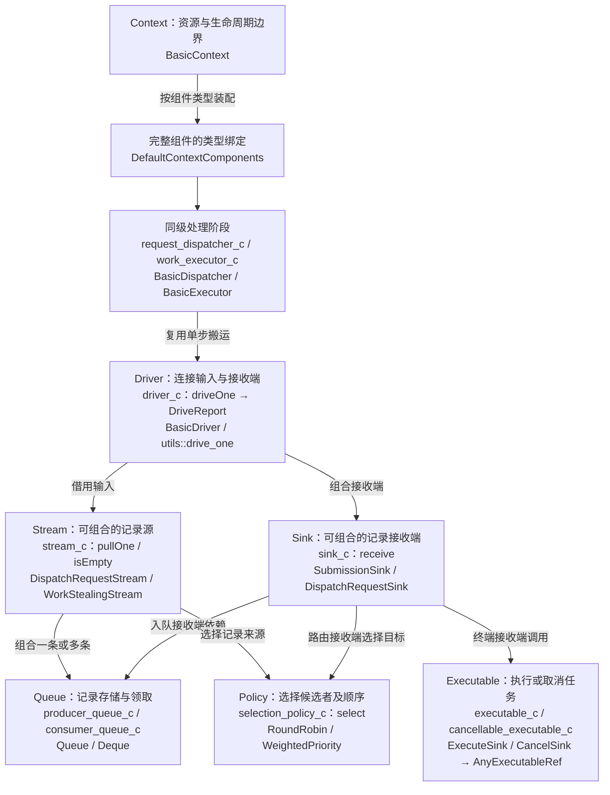
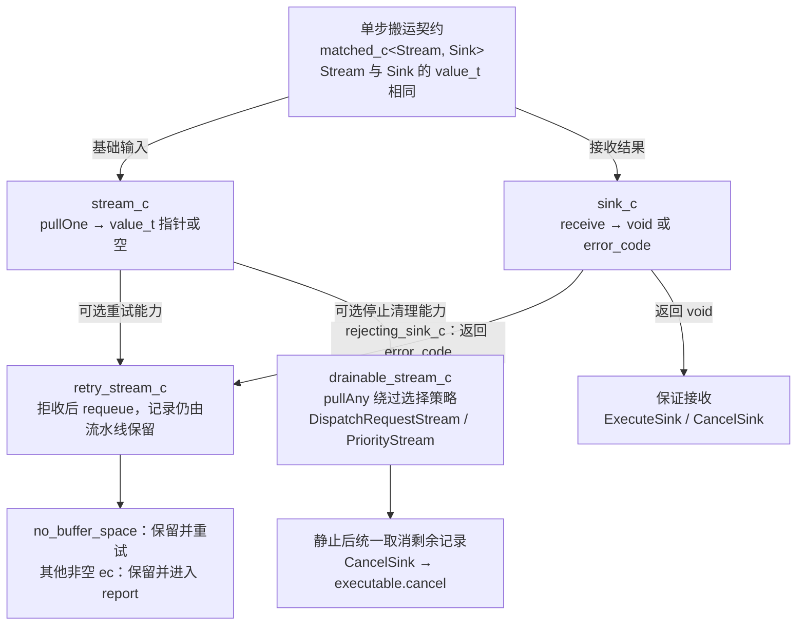
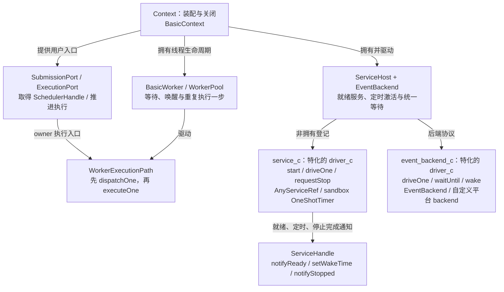
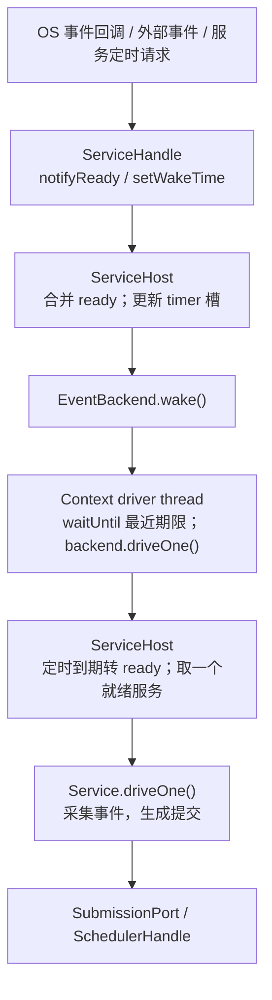
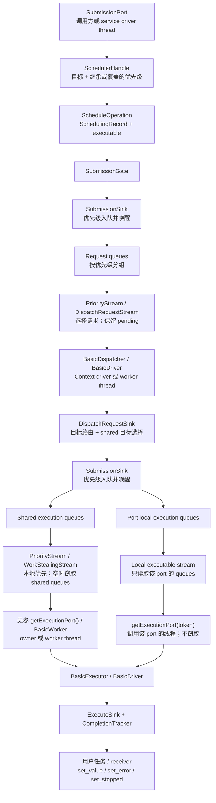
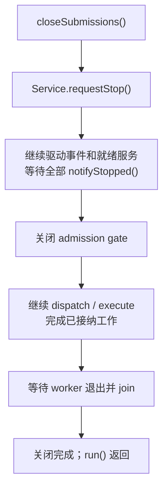
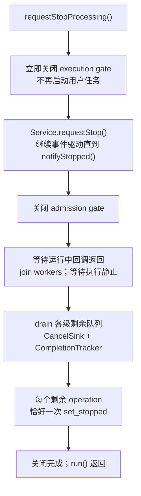

# Async Core

## 核心概念与组合

图中的 concept 表示结构化接口约束，类名给出当前实现。箭头标明组合或依赖关系，不表示继承或运行时调用顺序。

Stream 可以组合 Queue 或其他 Stream，封装选择策略及 pending 等行为；Sink 封装接收、路由或终端处理，也可以继续包装其他 Sink。Driver 只负责一次 `pullOne → receive`，不靠 Sink 的静态标签判断是否执行任务。Dispatcher 与 Executor 复用 BasicDriver，分别给出 `DispatchReport` 和 `ExecutionReport`。

Stream/Sink 与 execution 的 sender/receiver 共享组合思路，但属于不同协议：Stream 是同步、非阻塞的记录源，Sink 是同步接收边界；它们不因此满足 `sender_c` / `receiver_c`。`SchedulerHandle` 通过 `ScheduleSender` / `ScheduleOperation` 接入 execution，最终完成仍通过 receiver 的 `set_value / set_error / set_stopped` 交付。

能力按使用场景细化，不要求所有组件承担重试、清理或等待：

`std::error_code` 是接收结果，不等同于错误；空值表示已接收，非空值表示未接收。`retry_stream_c` 只在接收端可能拒收时由 Driver 要求；`drainable_stream_c` 用于停止清理，不属于基础 Stream 的必需能力。

运行宿主负责决定何时、在哪个线程推进这些组件；服务和事件后端复用单步驱动协议，不要求其内部由 Stream/Sink 实现：

`getExecutionPort(token)` 只执行该 port 的 local 队列，不经过 `WorkerExecutionPath`。`ServiceHost` 借用服务；Context 拥有默认后端与固定登记存储，平台事件能力由具体 backend 提供。

## 运行流程

服务激活与事件转换：生命周期和 `driveOne()` 由 Context driver thread 串行调用；`ServiceHandle` 可跨线程使用。

`enableServiceHandling()` 调用 `Service.start(handle)`；`run()` 自动启用。Service 由调用方持有。默认 EventBackend 只提供定时等待和跨线程唤醒；平台 OS 事件注册及回调由自定义 backend 提供。休眠服务不逐个轮询。

提交与执行流水线：实线表示记录流向，记录及 executable 均借用 operation 的存储。

Owner 与 worker 的 `WorkerExecutionPath` 先选择并驱动 dispatcher，再尝试执行 shared 工作。Token local ExecutionPort 只执行自身队列。`executeOne()` 返回 ExecutionReport，`waitAndExecuteOne()` 等待唤醒再尝试执行。完成会更新 outstanding 并通知等待者。

Sink 拒收时，driver 先将记录 `requeue`：`no_buffer_space` 留待重试，其他错误进入 report；直接 submit 的拒收错误交回调用方。各队列、stream、sink、policy 通过组件组合替换，Context 在 `create()` 时用显式 memory resource 预留固定存储。

优雅关闭由 Context driver thread 推进：

快速停止由 Context driver thread 推进：

当前已有 sender/receiver completion 路径，尚未接入 coroutine promise 或 `co_await`。未来 coroutine 可在 sender/receiver 边界适配：挂起时提交 operation，恢复时沿 scheduler 选定的 execution 路径完成；不改变队列、service 和关闭协议。
