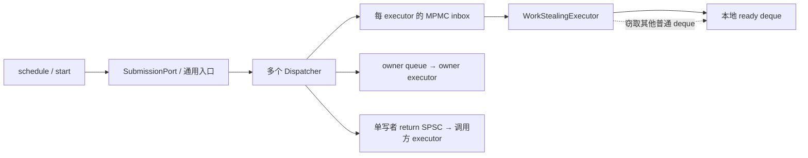
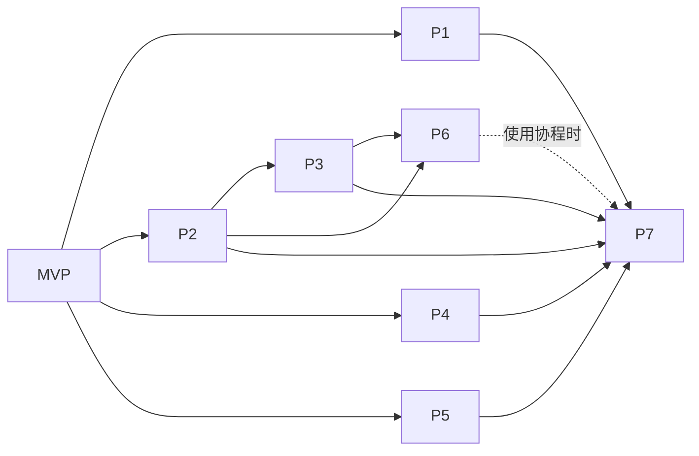

# Async Core 设计

本文规定 async 的目标架构、协议边界和运行时契约。当前 `include/async/core.h` 已接入多 Dispatcher、独立 Queue、工作窃取 Executor、SubmissionPort 和接受推进函数的 BasicWorker/WorkerPool；execution 提供 provider 选择、协议及组合算法重导出，`exec::ext` 尚未实现。当前代码按 C++23 构建；文中另行标明后续目标接口，当前运行示例位于 `tests/sandbox/sandbox.cpp`。

设计按使用者看到的组合关系自顶向下展开；后续能力顺序见本文第 12 节。修改协议或行为时，应同步更新类型关系、资源与完成契约及验收条件。

## 1. 目标、范围与命名

### 1.1 目标消费场景

首个消费目标是 LCFEngine 仓库 <https://github.com/mmmmmcree/LCFEngine.git> 的 `examples/shader_toy`，用于替换其 Asio 调度。本文提及该项目时均使用仓库 URL 与仓库内相对路径。

运行时组合逻辑执行域、多个 Dispatcher、Executor 和 Worker；专用提交/返回入口可使用 SPSC，普通 ready work 支持窃取。零后台 Worker 时宿主推进全部工作。专有系统通过 SchedulerHandle 选择提交目标和返回域，不读取物理 Worker 下标。

Core 应可嵌入、可由调用方驱动，独立支持 record、timer 和 coroutine。标准 sender/receiver 负责任务组合，公开 SchedulerHandle 直接满足标准 scheduler 协议，内部适配实现将运行时能力接入该模型。普通 sender 业务使用 CPU workers 不以协程实现为前提。

### 1.2 架构不变量

- Core 可以依赖标准 execution 协议及其操作/查询接口，provider 由公共 `config.h` 选择，统一别名为 `lcf::async::stde`。SchedulerHandle 直接实现标准 scheduler，适配细节留在 Core；仅需导出宏的基础声明、Queue 和容器按需包含 `config/macros.h`，调度概念统一通过 `protocol.h` 获取标准 execution 词汇。Core 不包含 execution.h、不调用 then/when_all 等组合算法，不使用 stdexec 私有类型；protocols 和 execution 的基础接口不反向依赖 Core。
- 公共 Core 类型通过模板、concept、CPO、ADL 和组合扩展，不建立公共继承体系。`std::pmr::memory_resource` 是预留的标准虚函数资源边界。
- queue/timer 默认借用调用方嵌入的节点；需要拥有闭包或状态时，必须明确分配来源、存活范围和回收路径。
- 已启动操作恰好完成一次。取消、拒收或关闭不能以静默丢弃节点代替完成；请求停止与销毁对象是不同动作。
- 完成可能同步发生，完成函数可能销毁 operation。发布 record 或交付完成后，不得继续假定其所属状态仍存活。
- 跨执行域恢复必须经过目标提交协议。不能因当前线程相同而隐式 inline，也不能把其他域的 continuation 直接作为对称转移结果。
- Core 不提供硬实时保证。预算不能抢占已开始的 C++ 函数、协程段、析构或用户 callback；队列的进展性质也不等于完整提交路径的延迟保证。

### 1.3 命名规则

非 execution 层遵循 LCFEngine 的 `agent-workspace/conventions/cpp-style.md`：普通类型、类型模板参数和别名使用 PascalCase；非类型模板参数、静态成员函数、自由函数、参数及局部变量使用 snake_case；非静态成员函数使用 camelCase，concept 使用 `snake_case_c`。数据成员使用 `m_`，普通常量使用 `k_`，枚举值使用 `ePascalCase`；配置对象保留 `_info`，指针和句柄变量使用约定的语义后缀。

CPO 对象使用操作名的 snake_case，不加 k_ 或 _cpo；实现类型使用 PascalCase，标准 execution 的协议定制名保留标准形式。Core 当前直接使用满足 concept 的成员接口，不增加只有转发作用的 CPO。普通类文件与类名一致，集合文件使用 snake_case。模块内以 declarations/ 集中组织基础声明，按 concepts.h、enums.h、structs.h、aliases.h 分别存放概念、枚举、值结构体和模块级类型别名，内容较多时可按语义分组为 poll_structs.h 等；这些头包含使用所需的完整定义。declarations/ 只表示文件组织，不增加命名空间。类自身的类型别名保留在类内；独立的 AlgorithmTag 等类型仍可使用同名文件。不为分类创建空文件，也不用泛化的 types.h 混装不同职责。

core/declarations/concepts.h 仅保留跨模块的 executable 和 record 约束。投递统一返回 std::error_code，各层原样传递，成功为空错误，失败保留原因。Queue 约束归 queue/declarations/concepts.h；submitter、Executor、目标路由约束与标准 execution 概念转发统一归 scheduling/declarations/concepts.h。Worker 的状态、推进函数和等待协议归 worker/declarations/；线程入口别名、join/launch 协议及实现归 worker/thread/；投递目标选择归 scheduling/dispatcher/selectors/；executor 选择和窃取目标选择归 scheduling/executor/selectors/。Context 连接规则归 context/details/ContextTopology.h。同级头可用相对文件名，跨目录引用统一使用 <async/...>。

`core/` 是目录和依赖边界，不是 C++ 命名空间。Context、Executor、Worker、SchedulerToken、SchedulerHandle 与 Core concepts 位于 lcf::async。队列设施位于 core/queue，与 scheduling 并列；公开命名空间按 queue::intrusive/non_intrusive、mpmc/spmc/mpsc/spsc 分层，拓扑下的类名使用 Queue 或 Deque，算法目录仅组织具体特化。标准角色词汇位于 protocols，标准操作、查询和算法位于 exec；实现细节使用各组件的 details。

execution 沿用标准/provider 命名，包括 `protocols::sender`、`exec::schedule`、`exec::get_env` 和 `exec::ext::then_expected`。`core/scheduling/declarations/concepts.h` 直接在 `lcf::async` 中用 `sender_c`、`receiver_c`、`scheduler_c`、`operation_state_c`、`receiver_of_c` 转发原概念；这些别名服务于 Core 的标准调度适配，execution 直接使用标准概念，不反向包含它们。SchedulerHandle 和内部适配的普通类型仍用项目命名，但 `connect/start/get_env`、`sender_concept`、`completion_signatures` 等协议定制名保留原样；语言要求的 `promise_type/await_suspend`、标准基础词汇和第三方引用亦不改名。适配实现位于 Core 的 details，用户直接取得 SchedulerHandle 并使用标准 CPO。

模板取值条件使用 requires。运行时断言集中在存储操作、公共身份/返回目标边界以及线程、生命周期契约上；内部路由和索引依赖构造流程与底层容器，不逐层重复检查。低层 queue/dispatcher 借用记录，Context 统一检查销毁前排空。源码注释只保留代码难以表达的并发、存活或协议原因。

## 2. 分层、类型与所有权

### 2.1 依赖与职责

Queue 和基础 executable/record 约束不依赖 execution provider。BasicExecutor、工作窃取队列和 Worker 也可独立包含；SchedulerHandle 及其内部适配使用公共 protocol/operations/queries，不依赖组合算法或 provider 私有类型。

| 组件 | 职责 | 借用或拥有 |
| --- | --- | --- |
| Queue / Deque | 接纳、存储和领取；兑现具体 producer/consumer 协议 | 队列拥有槽位或链接管理权，借用工作对象 |
| SubmissionPort | 显式提交入口，为指定目标创建 scheduler | 借用入口 queue 和通知对象，不拥有线程；SPSC port 由单一 producer 使用 |
| SchedulerHandle | 标识逻辑执行域，实现标准 scheduler | 借用提交服务，不隐含调用线程或返回线程 |
| BasicDispatcher | 有预算地收取、路由和重试请求，不执行用户任务 | 保存输入和路由策略；借用请求，保留阻塞请求链 |
| BasicExecutor | 从借用 queue 领取并执行 | 不拥有 queue，不提供入队或关闭入口 |
| WorkStealingExecutor | 本地领取、空时有限补充收件队列、空闲窃取 | 借用 inbox、本地 deque 和允许窃取的工作源 |
| ExecutorView | 无分配的异构 executor 借用视图 | 不延长 executor 寿命，不增加并发安全保证 |
| BasicWorker | 提供线程、推进循环、等待、停止和 join | 保存推进 callable、等待对象引用和线程句柄 |
| WorkerPool | 启动、停止和 join 一组 Worker | 拥有 Worker 存储和控制状态，不拥有业务 queue |
| Context / ContextTopology | 分配运行时对象，配置连接、执行域和生命周期 | Context 拥有全部默认拓扑；独立组件不反向依赖 Context |

Worker 接收一次推进 callable；它可以驱动 dispatcher、executor，或两者的有限组合。不存在 WorkerDriver 公共类。Context 的默认组合为调度和计算分别安排后台 Worker；启动时绑定推进对象，循环中不再按下标识别角色。独立使用时可换成混合推进。

### 2.2 默认运行拓扑



逻辑 scheduler、dispatcher、executor 和物理线程数量分离。普通 scheduler 首版共享 CPU 执行域，不获得独立 FIFO、串行或亲和性保证。owner 和 return 域不进入窃取集合。

每个登记 port 有一条提交 SPSC 和一条返回 SPSC，创建时按连续下标分区分配 home dispatcher。每个 dispatcher 只借用自己的 ingress 和 port span，不扫描其他分区。只有 home dispatcher 写返回 queue；其他 dispatcher 先将请求转发至 home 入口。普通 CPU 工作可由任意 dispatcher 写入 MPMC inbox，避免创建 dispatcher × worker 的 SPSC 矩阵。各 dispatcher 的输入游标、目标选择游标和待转发链均为局部状态。

所有 schedule 请求统一经过 dispatcher 路由，不再为内部 CPU 提交维护 TLS 捷径。空闲 executor 在全部普通 CPU 工作源中有限轮转窃取；每个工作源先领取 ready deque，再领取 MPMC inbox，使阻塞 Worker 新收到的工作也可由空闲 Worker 执行。

### 2.3 文件组织

```text
core/
├─ declarations/concepts.h
├─ queue/
│  ├─ declarations/concepts.h
│  ├─ intrusive/
│  │  ├─ ExecutionNode.h
│  │  ├─ mpmc/…
│  │  └─ spmc/…
│  └─ non_intrusive/
│     ├─ spsc/Queue.h
│     └─ spmc/Deque.h
├─ scheduling/
│  ├─ declarations/{concepts,dispatch_structs}.h
│  ├─ SchedulerHandle.h
│  ├─ SubmissionPort.h
│  ├─ dispatcher/
│  │  ├─ BasicDispatcher.h
│  │  ├─ declarations/concepts.h
│  │  └─ selectors/RoundRobinTargetSelector.h
│  ├─ executor/
│  │  ├─ BasicExecutor.h
│  │  ├─ WorkStealingExecutor.h
│  │  ├─ ExecutorView.h
│  │  └─ selectors/RoundRobinVictimSelector.h
│  └─ details/{dispatch_targets,exec_schedule_adapters}.h
├─ worker/
│  ├─ BasicWorker.h
│  ├─ WorkerPool.h
│  ├─ declarations/…
│  ├─ thread/…
│  └─ details/{WorkSignal,WorkerControl}.h
├─ context/
│  ├─ BasicContext.h
│  ├─ ContextInfo.h
│  ├─ declarations/poll_structs.h
│  └─ details/ContextTopology.h
└─ details/containers/FixedCapacityVector.h
```

新增 SPSC ring 和 mutex deque 各有一种实现；通用入口复用现有 intrusive MPMC queue，通过节点模板参数支持 DispatchRequest。selector 分别选择投递目标和窃取目标；异构 ExecutorView 可由宿主自己的推进函数遍历，不另设 selector 协议。

## 3. Core 提交协议与一次操作

### 3.1 可执行对象、Record 和提交者

最小提交单位是具有明确存活范围的 record，不是裸 coroutine handle。Core 按消费方所需能力定义三种约束：`executable_c` 描述可执行对象，`work_record_c` 描述提供可执行对象的工作记录，二者定义在 `core/declarations/concepts.h`；`record_submitter_c<Submitter, Record>` 描述对实际 Record 的接纳能力，定义在 `core/scheduling/declarations/concepts.h`。投递使用标准 std::error_code，不再另设结果枚举。

```cpp
namespace lcf::async {

template <typename Executable>
concept executable_c = requires(Executable & executable) {
    { executable.execute() } noexcept -> std::same_as<void>;
};

template <typename Record>
concept work_record_c = requires(Record & record) {
    { record.getExecutable() } noexcept;
    requires std::is_lvalue_reference_v<decltype(record.getExecutable())>;
    requires executable_c<std::remove_reference_t<decltype(record.getExecutable())>>;
};

template <typename Submitter, typename Record>
concept record_submitter_c = work_record_c<Record> and
    requires(Submitter & submitter, Record & record) {
        { submitter.tryEnqueue(record) } noexcept -> std::same_as<std::error_code>;
    };

} // namespace lcf::async
```

`Executable` 不要求是节点、继承某个类型或存储队列链接；只要求 `execute() noexcept -> void`。Record 通过 `getExecutable()` 返回可执行对象的稳定左值引用。引用所指对象可以内嵌于 operation 或独立存储，由 owner 保活到最后访问。具体 Queue 是否接纳这个对象，由提交端的实际接口检查；`ExecutionNode` 只是默认侵入式队列采用的实现类型。

concept 检查成员表达式、返回类型和 noexcept；运行时直接调用 `record.getExecutable()` 与 `submitter.tryEnqueue(record)`。Core 不为这些成员增加同义 CPO 转发层。只有出现需要支持的独立定制协议时，才在实际边界引入定制点。标准 execution 的 CPO 继续复用 provider。

`record_submitter_c<Submitter, Record>` 按 Submitter 的实际 cv 限定检查；const handle 可经借用指针访问提交服务，不需要将 queue 整体标为 mutable。提交能力不捆绑工作驱动、timer、allocator 或 scope 计数。成功返回 `{}`；有界 queue 暂满返回 `std::errc::no_buffer_space`，关闭返回 `std::errc::operation_canceled`。调用方可直接判断错误，只有执行恢复策略的边界才区分原因。

接口检查不能证明线程安全、地址稳定或恰好一次。实现还需声明 producer 数量、线程限制、顺序、容量和进展性质；这些语义由实现与验证兑现。

### 3.2 接纳与完成契约

| 事件 | record/operation 的责任 |
| --- | --- |
| 构造操作 | owner 持有输入与稳定状态，尚未发布；不隐式执行工作 |
| 空错误 | 运行时取得排队访问权；owner 仍负责存储存活，运行时必须执行或按取消/关闭契约交付完成 |
| 非空错误 | 不接管 record；operation/adapter 按声明处理拒收或保留为尚未提交的业务工作 |
| 执行、取消、到期竞争 | 只允许一个完成胜者；队列摘除不等于所有并发访问已经结束 |
| 完成交付 | 完成函数可能销毁 operation；交付后不得继续访问其成员 |
| 最后访问结束 | owner 才能释放或复用状态；节点脱链、取消 registration 和回收记录也需结束 |

提交不在调用线程 inline 执行 record，但其他 owner 可在发布后、提交返回前消费它。提交实现和 start 路径必须处理这种竞争，不能在发布后再次读取已可能销毁的 operation。

ready queue 和 timer index 不执行 receiver，也不在内部锁下调用用户代码。关闭必须兑现已接纳操作；continuation 入队失败时要有预留容量、有效完成通道或其他明确契约，不能丢失完成，也不能在错误线程直接恢复以伪装成功。

### 3.3 协议复用与边界

基础 record 仍通过 getExecutable() 提供稳定左值引用。默认 Context 的路由还要求 getDispatchRequest() noexcept -> DispatchRequest &，请求携带 executable 指针和逻辑目标，并提供独立的 dispatcher 待投递链接；该链接与 ExecutionNode 的 queue 链接分离。标准 ScheduleOperation 内嵌二者，首版不额外分配。

value_queue_c 描述任意 Value 的接纳和领取；work_queue_c 在此基础上要求 Value 可执行。收件 queue、ready deque、路由请求 queue 不必共享相同 Value 类型。stealable_work_source_c 只要求可执行 Value 和 trySteal，供窃取源和选择器复用；stealable_work_queue_c 同时要求 work_queue_c。multiple_consumers 本身不能替代 owner/stealer 操作协议。

work_executor_c 只要求 executeOne/isEmpty；可选等待仍单独检查。关闭 queue 属于其 owner。worker_progress_c 描述 noexcept bool callable，worker_waiter_c 描述观察版本、等待和停止/关闭；两者不要求调度类型。

SchedulerHandle 在实际 Record 上检查普通或索引提交能力，保存明确的提交入口和逻辑目标。Context 创建的句柄始终走通用并发入口；SubmissionPort 创建的句柄始终走该 port 的 queue。入口由 scheduler 对象确定，不依赖 TLS、创建线程或作用域绑定。独立 submitter 仍可实现相同协议，句柄不指向某个物理 Worker。

公共组件通过模板、concept 和借用视图组合，不建立公共继承体系。默认 Context 是一套固定组合，不要求所有外部 executor 采用它的 inbox 或队列容量。
## 4. 资源、取消与存活

### 4.1 存储来源

ContextInfo 显式绑定两项 PMR 资源：ContextAllocators::m_runtime 用于 queue、port、dispatcher 和 executor 的固定数组，m_workers 用于后台 Worker 数组；默认均为 null_memory_resource，不偷偷使用全局默认资源。内嵌 owner queue、等待和绑定状态随 Context 存活。

context_info.storageRequirements<ThreadHandle, queue_capacity>() 报告 m_runtime/m_workers 的字节数和对齐。它按实际数组分配顺序计入每段对齐；从正确对齐的首地址提供精确字节数并使用 null upstream，可以验证默认运行时元数据没有堆 fallback。与 BasicContext 的线程句柄、queue_capacity 参数必须一致。

Context 按 CPU、port、dispatcher 三类状态分配固定数组。每个 CPU 状态组合独立的 inbox、deque 和借用它们的 executor；每个 dispatcher 状态组合 ingress 与 dispatcher。SPSC/deque 槽位内嵌；通用入口借用 DispatchRequest，inbox/owner queue 借用 ExecutionNode，均复用 intrusive MPMC 实现，不为每次投递分配节点。请求从入口领取后复用自己的链接进入 dispatcher 待转发链。通道容量不等于全局未完成操作上限。

FixedCapacityVector 负责 typed allocation 和元素生命周期：申请容量后逐项构造，地址不迁移，移动容器只转移缓冲区和释放资源。Context::create 先分配数组，再构造组件并建立借用关系；分配或组件构造抛异常时销毁已构造元素、释放数组并返回错误码，不发布部分拓扑。

PMR 只解决字节来源，不保证线程安全、对象存活或业务 drain。allocator/resource 必须活过 Context 析构及存储释放；operation 必须活到执行的最后访问。SubmissionPort 和 scheduler 均不延长 Context 寿命。

这些预算只覆盖本库运行时元数据。业务输入/结果、用户 callback、provider 内部状态以及系统线程的分配分别由各自 owner 管理。后续 owning post、coroutine frame 和 timer backing storage 继续遵守独立、显式的资源契约。
### 4.2 分配和回收策略

| 策略 | 适用范围 | 必须说明的限制 |
| --- | --- | --- |
| 直接 resource / 显式 `new_delete_resource` | 基线和兼容路径 | 每次分配成本；不得作为隐藏默认 |
| `synchronized_pool_resource`、线程安全 slab | 跨线程短命状态 | 同步与上游成本 |
| `unsynchronized_pool_resource` | 严格单线程分配/释放 | executor 单 consumer 不代表资源只在该线程访问 |
| monotonic/arena | 一批对象整体结束 | 逐个取消不等于立即回收存储 |
| 固定块、recycling/free-list、inline storage | 已有数据支持的热点对象 | 容量耗尽、对齐、扩容及跨线程回收 |

每次分配必须保留释放所需的 allocator/resource、大小和对齐，或由 policy 保证可恢复；不能在释放时重新查询已变更的环境。producer 可能创建状态，worker 或 receiver 可能销毁它；使用线程安全资源，或显式将回收归并到 resource owner。回收记录计入未完成工作，owner/resource 必须保持到 drain。

资源验收覆盖正常/同步完成、构造失败、connect/await_suspend 失败、拒收、取消、关闭、完成中销毁及跨线程释放，不仅检查成功路径。

### 4.3 Hook、统计和特殊分配行为

标准 PMR 路径通过派生 `std::pmr::memory_resource`，在 `do_allocate/do_deallocate` 中包装上游 resource，加入统计、诊断或其他分配策略；`do_is_equal` 保持资源相等与可互相释放的契约。这里使用预留的标准虚函数边界，不新增 async 自有虚基类或转发 Handle。例如宿主可提供：

```cpp
app::TrackingMemoryResource tracked_resource{upstream_resource, statistics};
ContextInfo context_info;
context_info.setWorkerCount(worker_count).setAllocators(ContextAllocators{
    std::pmr::polymorphic_allocator<std::byte>{&tracked_resource},
    std::pmr::polymorphic_allocator<std::byte>{&tracked_resource}});
Context context;
if (auto error = context.create(context_info)) { return error; }
```

这里的 hook 跟踪 Context 运行时元数据与 Worker 数组。ContextInfo 登记目标和 port，只计数并借用资源；后续 QueueConfig 容器的配置期分配与运行时 typed storage 分开管理。

execution 的普通 allocator 可通过 allocator wrapper 加入同类行为。无异常 resource 则通过满足 `allocation_resource_c` 的组合装饰器包装 `tryAllocate/deallocate`；其 hook 也须不抛异常，不能因记录一次分配而递归触发被跟踪的分配器。

统计明确区分请求字节、成功/失败次数、当前存活字节、峰值和上游实际保留量。分配失败不增加存活字节，释放与原分配对应；多线程计数及记录状态遵守所选 resource 的并发契约。外层装饰器看到的是该层的请求，上游装饰器看到的是 pool/slab 的实际补充，二者不混为同一指标。

统计仅覆盖显式经过该 resource/allocator 的调用。独立 allocator、第三方内部存储和编译器消除的 coroutine frame 不会自动计入；装饰器、上游及统计状态均须覆盖最后访问。

### 4.4 无异常分配与失败返回

若要求分配失败返回错误码且调用 `noexcept`，保证必须由实际字节分配后端实现。`std::pmr::memory_resource::allocate` 和标准 allocator 的 `allocate` 都返回指针并采用失败抛异常的契约；不能只在外面加 `noexcept`、失败时返回 nullptr，或用统计 hook 改写成可恢复错误。

这项需求采用独立的 Core `allocation_resource_c` 协议，放在 `core/memory/allocation.h`，以模板和组合扩展，不依赖 execution，也不新增公共继承体系。C++20 基线用值类型表达结果，避免为基础分配协议要求 `std::expected`：

```cpp
namespace lcf::async {

struct AllocationResult
{
    void * m_storage_p;
    std::error_code m_error;
};

template <typename Resource>
concept allocation_resource_c = requires(
    Resource & resource,
    std::size_t bytes,
    std::size_t alignment,
    void * storage_p) {
    { resource.tryAllocate(bytes, alignment) } noexcept -> std::same_as<AllocationResult>;
    { resource.deallocate(storage_p, bytes, alignment) } noexcept -> std::same_as<void>;
};

} // namespace lcf::async
```

| 层次 | 契约与责任 |
| --- | --- |
| 字节 resource | `tryAllocate(bytes, alignment) noexcept -> AllocationResult`；成功返回有效存储与空 error，失败返回 nullptr 与非空 error，且不遗留须调用方回收的分配；`deallocate` 不抛异常 |
| typed allocator/helper | 检查元素数量乘法溢出和对齐，调用后端并传递错误；构造失败时释放原存储。无异常创建还须约束构造/析构及实际使用的移动操作，字节分配不抛不能保证任意 T 的构造不抛 |
| operation/Task/宿主 | 在各自的创建、connect、start 或 frame 分配阶段交付失败；尚未建立 receiver 的失败用创建结果表达，不能假装已进入 sender error 通道 |

`AllocationResult` 的判别依据是 error；成功/失败的指针关系及零字节、过对齐、容量耗尽的具体规则在最小协议用例中冻结。为恢复原状态而使用的后端清理也在 `noexcept` 边界内。concept 检查返回类型和 noexcept，失败注入测试验证真实语义。

普通资源路径与显式无异常路径分别声明。严格路径从可报告失败的后端开始，不默认通过 try/catch 适配任意 PMR；若提供异常捕获兼容 adapter，必须显式命名并只在启用异常的配置使用。标准 allocator 的 allocate 入口仍须遵守标准契约，其额外 try 分配能力供 async 的受限路径使用；第三方代码只调用标准入口时，不自动获得错误码返回。

标准 `get_allocator` 本身不保证可恢复的无异常分配。受限 operation 对所选 allocator/resource 检查额外能力或声明其不分配条件；无法满足时明确诊断，不能忽略用户 allocator 覆盖而偷偷换成 Context 默认。严格资源的具体类型和值通过显式 ResourcePolicy/工厂绑定，静态类型在创建对应对象前确定，不能塞入普通 PMR 引用冒充同一契约。

资源策略的扩展落在实际存储 owner 上：Queue、timer、operation 和 FramePolicy 各自消费所需能力。ContextAllocators 覆盖运行时对象数组与 Worker 数组；Executor 借用独立创建的 Queue，固定 ring/deque 的槽位内嵌于 Queue 对象。默认 intrusive Queue 没有动态 backing storage，不接收无用 allocator。后续可配置的队列存储参数由对应创建配置承载。PMR 装饰器支持统计，无需增加只有转发作用的 ResourcePolicy。

线程资源独立于容器。`std::thread` 的启动状态、栈和系统句柄没有标准 PMR 注入接口；MVP 用 `BasicWorker<Progress, Waiter, ThreadHandle>`、`join_handle_c` 和 `thread_launcher_c<Launcher, ThreadHandle>` 暴露后端，线程词汇定义在 core/worker/thread/。真实线程后端由 launcher 在独立线程恰好调用一次 entry，返回句柄代表该执行；join 等待该执行结束并与其完成同步。NullThreadHandle 也满足 join_handle_c，提供空的 `(ThreadEntry, void *)` 构造、恒为 false 的 joinable 和空 join；ThreadLauncher 统一构造所选句柄，Null 构造不调用 entry。通用代码不对 Null 类型特化，也不把空启动误作同步执行；本线程执行由 worker.run/executeOne 显式发起。检查表达式不能证明实际线程行为，语义须由实现及集成测试兑现。ThreadLauncher<std::thread> 的线程资源不受 allocator 控制；严格路径用受控后端或本线程 Worker 推进 Executor。mutex/CV 的平台资源、provider 算法、异常对象和用户值同样单独审查。

`allocation_resource_c` 是供无异常存储 helper/FramePolicy 消费的另一种能力；它不能直接替换标准 PMR allocator。当前 Context::create 提供 noexcept 错误码边界，内部仍捕获标准 PMR 与系统资源构造异常；这不等于禁用异常的实现。全无异常创建还需要实际不抛异常的分配与线程后端。新增存储策略必须覆盖原资源释放、构造回滚、容量失败和跨线程回收；具体结构及默认策略仍由 benchmark 决定。

仅有 hook、pool、slab、arena 或跨线程回收不要求新增分配接口；错误码和无异常失败语义才是上述扩展协议的依据。分配协议也不使线程创建、第三方算法或整个 execution pipeline 自动变为无异常。

### 4.5 取消与任务 owner

请求停止、操作响应取消、停止业务准入、最终关闭执行资源和销毁对象分别定义。可以复用标准 stop vocabulary，也可在满足资源/并发约束时实现 intrusive state/registration；选择不改变操作完成契约。

registration 处理注册与 request_stop 的竞争，以及析构期间 callback 正在运行的情况。用户 callback 不在 queue/timer 内部锁下执行；取消、到期和正常完成必须只有一个胜者。

业务 root owner/scope 管理稳定 operation 存储、stop source、未完成计数和结果交付。Context 管执行资源，不自动收集所有 root；空队列不代表没有挂起的 I/O、timer、子操作或回收工作。完整关闭顺序见第 9 节。

## 5. Dispatcher、执行驱动、队列与 timer

### 5.1 投递、消费选择与执行驱动

BasicDispatcher<Inputs, Router> 由单一驱动者调用 dispatch(max_requests)，返回是否取得进展。dispatch_source_c 要求 tryPop 返回 DispatchRequest 指针、const isEmpty 返回 bool；dispatch_router_c 要求 tryEnqueue(DispatchRequest &) 返回 std::error_code；这些操作均不抛异常。约束位于 dispatcher/declarations/concepts.h，不依赖 execution provider。新输入与待重试请求轮转取得转发份额，一方为空时领取另一方；新输入可直接尝试路由，不排在堵塞积压之后。待转发链采用哨兵头，失败请求进入队尾。预算按转发尝试计数，包含失败重试。

Router 返回 no_buffer_space 时，dispatcher 将请求放回自己的待转发链；成功后不再访问请求，因为目标 executor 可立即完成并销毁 operation。满载请求在队尾等待下一轮，不阻塞其他目标。输出 queue 的 owner 必须保持它们开放，直到 dispatcher 中已接纳请求排空。通知在发布后进行，不读取已发布 operation。

BasicExecutor 只从借用 queue 领取并调用 execute；执行前保存是否领取成功，回调可能销毁 operation，返回时不再读取 executable 指针。WorkStealingExecutor 先执行已有本地任务，本地为空时从 inbox 收取至多 16 项放入 deque，再尝试本地领取和有限轮转窃取；各路径领取后直接执行并返回。deque 满时直接执行已经领取的项，不丢弃。进入用户函数前通知其他消费者，使 owner 阻塞于长任务时已发布的 ready work 仍可被窃取。

ExecutorView 支持异构 executor 集合。Worker 只调用组合层提供的推进函数，不判断 dispatcher/executor 类型。SubmissionPort 以 queue 和通知类型为模板参数，直接借用二者，不再额外类型擦除。

### 5.2 队列职责与首版算法

| queue | producer / consumer 契约 | 首版用途 |
| --- | --- | --- |
| non_intrusive::spsc::Queue<Value, queue_capacity> | 单 producer、单 consumer，固定指针 ring | 专用提交口和返回通道 |
| intrusive::mpmc::Queue<algorithm, Node> | 多 producer、多 consumer，借用节点，无固定容量 | 通用提交、dispatcher 间路由、worker inbox 和 owner queue |
| non_intrusive::spmc::Deque<Value, queue_capacity> | 一个 owner push/pop 后端，多个 thief 从前端领取 | 普通 CPU ready work |
| intrusive::spmc::Queue<> | 保留原有单 producer、多 consumer 实现 | 独立 queue/executor 组合 |

ready deque 首版使用短临界区 mutex，锁在返回指针前释放，不在锁内运行 callback。后续可以替换为经过验证的工作窃取算法；首版没有无锁窃取或硬实时保证。

SPSC 用 acquire/release 发布指针，不分配；close 要求 producer 已静止。两个角色可以在同一个线程中交替推进，因此 SPSC 和 SubmissionPort 不意味着必须有多个线程。一般 queue 的 close 停止接纳，允许领取已接纳项。

### 5.3 入口、背压和通知

context.getSchedulerHandle(token) 创建可跨线程并发提交的通用 scheduler。context.getSubmissionPort(index).getSchedulerHandle(token) 创建专用 scheduler，显式借用该 port；同一 SPSC port 创建的所有 scheduler 共享单一 producer，不可并发提交。构造、复制和 connect 不提交请求，实际 start 必须遵守所选入口的 producer 协议；多个完成分支可能并发调用 continues_on 时，应使用通用句柄。每条返回 queue 独立保持单一消费者约束。

入口投递失败不接管操作。首版 schedule adapter 将投递错误映射为 set_stopped，拒收可在 start 线程同步交付。已接纳请求的下游暂满由 dispatcher 保留，返回消费者释放槽位后通知重试；不会覆盖已接纳完成或隐式分配 fallback。

专用 SPSC 满时立即拒收；通用 scheduler 使用无固定容量的 intrusive MPMC 入口，容量由调用方存活的 operation 数决定，不提供有界拒收保证。专用入口不会因暂满或调用线程改变而隐式切换为通用入口。

默认 Context 先采用共享版本信号 notifyAll，避免不同职责的 Worker 抢走目标唤醒。版本观察在扫描之前，等待使用同一版本。它保证推进正确性，但增加共享原子和唤醒成本；SPSC queue 的低成本不代表完整 start 没有同步开销。通知合并、分组信号、主动轮询和负载估计为后续可替换的组合策略。

首版投递按轮转选择目标，不读取全局精确负载表；本地执行和窃取补充负载均衡。多个 dispatcher 可并行路由，剩余共享热点包括通用入口、inbox、版本通知和活动计数，需要在目标 workload 下测量后再优化。

### 5.4 Timer 和推进预算

timer 尚未实现，以下为后续契约。timer index 只管理 deadline 与借用 node，不持有 Queue、不直接执行用户代码。owner 驱动时通过独立 timer service 收集到期操作，再发布到相应 Queue；BasicExecutor 不承担 deadline 索引和 I/O reactor。计划先用 intrusive binary min-heap：TimerNode 保存 heap index，取消/重排为 O(log n)，backing storage 来源显式，Clock 可替换为 fake clock。

| 索引能力 | 契约 |
| --- | --- |
| `insert` | 登记 node，报告是否需要调整下一次等待 |
| `remove` | 摘除 node，遵守取消/到期竞争与最后访问规则 |
| `nextDeadline` | 查询最近 deadline，空索引语义明确 |
| `expire` | 有界收集到期 node 交给 Executor，不在索引内部调用 callback |

PollBudget 包含 record 数和持续时间限制；PollReport 的 `m_records` 统计已开始并返回的 record，`m_elapsed` 包含维护、执行和必要清理。预算在 record 边界检查，耗时是软限制，无 ready 时不为达到预算而等待。一次 poll 返回无工作只表示本次未执行 record，不证明挂起操作、外部 producer 或业务 root 已完成。

## 6. Workers、逻辑调度目标与 Context

### 6.1 固定拓扑与线程数量

BasicContext<ThreadHandle = std::thread, queue_capacity = 256> 是首版默认组合。ContextInfo 分别配置普通 scheduler 数、SubmissionPort 数、计算 Worker 数和 dispatcher 数；dispatcher 默认一个且不可为零。

setWorkerCount(M) 表示计算线程预算。当 M > 0 时，默认额外启动 D 个 dispatcher Worker，共 M + D 个后台线程。没有独立 DispatcherPool 公共类，两种推进 callable 共用 WorkerPool。不同 dispatcher 可向任意普通 inbox 投递，executor 在其他普通 CPU 的 ready deque 和 inbox 中窃取。

M = 0 时不启动后台线程，owner 每轮有界推进全部 dispatcher，再通过 ExecutorView 在 owner 与普通 executor 之间轮转，至多执行一个 record。使用 NullThreadHandle 时也由 owner 推进全部。后台线程运行时，owner 只领取 owner 域工作。每轮显式返回是否推进、是否执行，poll 据此累计记录数，不保留跨调用的结果状态。创建和 startWorkers 分离，create 不启动线程，poll 不隐式 start。

BasicWorker 接收 progress、waiter 和可选 launcher。progress 返回是否取得进展；Worker 按 observe → progress → wait 的顺序驱动。WorkerPool 接收按下标构造 progress 的工厂，不绑定 ExecutorSpan，不关闭业务 queue。

### 6.2 Scheduler、端口和完成域

addScheduler() 返回配置域内的 CPU SchedulerToken。getSchedulerHandle(token) 保留 token 身份，但首版普通 token 共用 CPU 池；token 不对应单独的 executor、queue 或线程。

addSubmissionPort() 返回固定 port 下标；Context 创建后 getSubmissionPort(index) 返回稳定的提交入口。通过该入口的 getSchedulerHandle(token) 显式选择专用提交路径，不需要 bind 或解绑。单一宿主线程也可同时担当 producer 和 consumer，不要求存在后台线程。已知参与者预登记，动态注册和自动分配端口后置。

getEventLoopSchedulerHandle() 指向 Context 的 owner 执行域。getReturnSchedulerHandle(port) 指向该 port 的返回域，由外部调用方持续 pollReturn(port) 执行；它使用通用并发入口，不要求使用对应的提交 port。提交路径和返回域分别选择，调用方明确使用 continues_on(return_scheduler)。

```cpp
auto cpu = context.getSchedulerHandle(cpu_token);
auto & submissions = context.getSubmissionPort(caller_port);
auto fast_cpu = submissions.getSchedulerHandle(cpu_token);
auto caller = context.getReturnSchedulerHandle(caller_port);
```

每条返回 SPSC 的 home dispatcher 是唯一 producer。任何线程都可以启动返回 scheduler；其请求先进入合法提交入口，再由路由抵达 home。返回域不会被 worker 或其他 caller 窃取。

### 6.3 推进、停止和关闭

| 操作 | 语义 |
| --- | --- |
| create(info) | 分配固定存储并绑定组件；失败可修正资源后重试 |
| startWorkers(launcher) | 启动 D + M 个后台推进者，或零线程模式；启动失败停止并 join 已启动线程 |
| run(launcher) | 启动后台线程后在调用线程驱动 owner，直到停止或关闭后排空 |
| pollOne() | 一次有限推进；可以只路由请求，至多执行一个本线程 record |
| poll(budget) | 统计真正执行的 record 数；维护也计入软时间预算 |
| pollReturn(port) | 执行一项该返回域的完成，释放容量并通知 dispatcher |
| requestStop() | 在工作边界停止驱动，保留已接纳项，不等于 drain |
| close() | producer 静止后关闭外部准入，保留内部路由输出用于排空 |
| joinWorkers() | close 后推进并等待已接纳工作结束，再停止、join；单独 stop 后只 join |
| isEmpty() | 当前排队状态快照，不能证明业务 root 或外部 producer 已结束 |

owner run/poll/pollOne/join-drain 不允许并发或重入；首次 owner 驱动建立线程归属，join 的排空复用 pollOne 并遵守同一归属。每个 port 的 pollReturn 也只允许一个驱动者。活动计数覆盖后台执行和外部返回回调，排空检查还要求扫描前后的通知版本一致，以识别扫描期间完成的跨队列转移。

关闭前应先停止业务准入，并让需要 thread-bound 完成的任务图结束；相关 owner 和返回消费者必须持续推进。close 后的新 schedule 请求将被拒收，包括尚未启动的 continuation；拒收不保证在目标线程完成。要实现关闭期间内部 continuation 的单独准入，后续需要 root scope/容量预留协议。

Context 析构停止并 join 自有线程，断言无未排空操作；析构不会代替业务 owner 执行遗留任务。禁止在 Context 自有线程内 join 或销毁它，也不得在自己的返回回调中同步等待该回调所属的 drain。

### 6.4 首版扩展边界

dispatcher 的输入和路由、executor 的窃取目标、Worker 的推进函数和等待对象均可替换。首版 Context 固定组装一种 CPU executor 和独立固定域；独立使用 ExecutorView 可组合异构 executor。动态拓扑、任意外部 executor 登记、复杂优先级、NUMA 分组和自适应负载策略后置，不增加空框架。

## 7. execution、Environment 和内部适配

### 7.1 Scheduler 与一次调度

execution 继续重导出 provider CPO 和算法。SchedulerHandle 直接实现 scheduler_concept/schedule/相等比较，保存提交服务引用及逻辑身份；schedule 构造 sender，connect 创建稳定 operation，start 才提交。

```text
schedule(scheduler) → ScheduleSender
connect(sender, receiver) → ScheduleOperation（内嵌 node 和 DispatchRequest）
start → 当前合法入口 → dispatcher 路由
dispatcher → 目标 queue
目标 executor 执行 → set_value / set_stopped
```

dispatcher 只转发，不执行 schedule operation，否则后续 then 会在错误的执行域上运行。schedule 成功的 value completion scheduler 与原句柄相等；内部路径和 worker 选择不改变逻辑身份。

句柄可以在任意线程构造、复制和 connect，入口选择随句柄保留。通用句柄允许任意线程并发 start；专用句柄的 start 必须满足对应 queue 的 producer 协议。复制专用句柄不会创建新的 producer 通道，也不会将其升级为并发入口。

start 不自动返回原线程。业务通过 continues_on(return_scheduler) 显式转移 value/error/stopped 完成；error/stopped 的线程归属以返回调度成功为前提。操作被拒收或目标停止时，adapter 按声明同步交付 stopped，不伪造目标线程保证。
### 7.2 Environment 的查询与传播

Environment 是标准 execution 的可查询对象协议，不是固定字段结构体。`get_env(sender)` 返回 sender 属性，`get_env(receiver)` 返回操作接收环境；两者不会自动合并，空环境也不自动带上 Context。

| 查询 | 要求与使用边界 |
| --- | --- |
| `get_env(object)` | 查询不抛，返回 queryable 对象，结果遵守对象存活要求 |
| `get_scheduler(env)` | 有效时结果满足 scheduler；缺失不自动选择当前线程或 CPU pool |
| `get_allocator(env)` | 有效时结果满足对应 allocator 要求；资源优先级按第 4 节，不另建 query |
| `get_stop_token(env)` | 返回符合 stoppable-token 协议的对象；无定制时使用不可停止 token |
| `get_completion_scheduler<Tag>(get_env(sender))` | 描述 value/error/stopped 某通道的完成资源，实际完成必须遵守；不同于 receiver 的关联 scheduler |
| async timer/I/O 服务 query | 属扩展能力，由内部适配实现定义类型、缺失诊断、forwarding 和引用存活规则 |

支持哪些属性由具体环境决定；标准规定有效查询的约束，不要求每个环境提供全部能力。标准 `forwarding_query` 和各 adaptor 语义控制转发；显式覆盖优先，scheduler 转移可能替换或屏蔽关联属性，不能无条件转发所有 query。自定义服务 query 同样明确 forwarding 行为。

Context 默认值由桥接入口显式组合，用户有效 allocator/stop token 覆盖得到保留；sender 属性不会自动覆盖 receiver 环境。必需服务静态缺失时给出约束诊断，动态不可用时按声明交付拒收/error/stopped。环境查询本身不切线程。

### 7.3 调度组合和完成域

`starts_on` 选择启动资源，`continues_on` 显式转移后续完成，普通 `then/let_value` 不自动选择 CPU worker。`starts_on` 不保证所有异步完成留在启动线程，也不自动回提交线程。使用具有返回原域语义的 `on` 时，必须具备有效接收环境 scheduler，并核对 provider 支持。

Receiver 本身是 completion 的接收对象，不拥有“运行线程”属性；哪个线程调用 `set_value/set_error/set_stopped`，对应回调就在该线程执行。`continues_on` 存储上游完成数据并提交调度操作，由目标执行资源推进后再调用下游；`get_completion_scheduler` 描述保证，不负责迁移。最终 Receiver 的三个完成通道都需要调用方线程归属时，显式选择调用方驱动的返回 scheduler，并让该执行域保持到完成返回。

目标调度成功后才可依赖该域；转移被拒收、停止或失败时，不能承诺错误仍在目标 owner 交付。completion signatures 与 completion scheduler 查询必须相符。线程绑定的业务错误收尾通过 owner mailbox 或仍有效的目标调度路径处理，不在来源线程越权修改 render/gfx 状态。

### 7.4 `exec::ext::then_expected`

目标扩展接入 `noexcept` 的 `std::expected<T, E>` 任务函数。它在上游 value 到达时调用函数，不在 sender 构造时执行重工作，也不自行切换 scheduler。

| 输入/结果 | 下游行为 |
| --- | --- |
| 上游 value | 用值参数调用 F，F 必须 nothrow-invocable 并返回 expected |
| `expected<T, E>` 成功 | `set_value(T)` |
| `expected<void, E>` 成功 | `set_value()` |
| `unexpected(E)` | `set_error(E)`，后续 value 分支短路 |
| 上游 error/stopped | 原样传播，跳过 F |

适配器不使用 try/catch 转换异常，违反 noexcept 会按 C++ 规则终止。受限路径还需约束结果交付涉及的 T/E 移动及存储操作；构造、connect、资源分配和其他算法的失败契约分别声明，不能把局部 noexcept 扩大到整个 pipeline。

shader_toy 使用 `E = std::error_code`，但扩展不必局限该错误类型。裸 error_code 返回值如何适配另行设计，不在此接口中隐式推断。`std::expected` 需要 C++23 库能力；当前 C++20 基线下按能力启用该扩展，不默默提升整个 Core 的语言要求。

## 8. Core 协程与环境绑定

### 8.1 静态能力注入

Core 的 Environment 是能力容器；具体 operation 使用哪种 record 时，再检查 `record_submitter_c<Submitter, Record>`。execution Environment 则是查询协议，二者由内部适配实现连接，不要求 Core 引用标准 query tag。

```cpp
namespace lcf::async {

template <typename Allocator>
concept allocator_c = requires { typename Allocator::value_type; } && requires(
    Allocator & allocator,
    std::size_t count,
    typename std::allocator_traits<Allocator>::pointer storage_p) {
    typename std::allocator_traits<Allocator>::value_type;
    typename std::allocator_traits<Allocator>::pointer;
    { std::allocator_traits<Allocator>::allocate(allocator, count) }
        -> std::same_as<typename std::allocator_traits<Allocator>::pointer>;
    std::allocator_traits<Allocator>::deallocate(allocator, storage_p, count);
};

template <typename StopToken>
concept stop_token_c = requires(const StopToken & stop_token) {
    { stop_token.stop_requested() } noexcept -> std::convertible_to<bool>;
    { stop_token.stop_possible() } noexcept -> std::convertible_to<bool>;
};

template <typename Submitter, allocator_c Allocator, stop_token_c StopToken>
struct Environment
{
    using submitter_type = Submitter;
    using allocator_type = Allocator;
    using stop_token_type = StopToken;

    Submitter m_submitter;
    Allocator m_allocator;
    StopToken m_stop_token;

    const Submitter & submitter() const noexcept { return m_submitter; }
    const Allocator & allocator() const noexcept { return m_allocator; }
    const StopToken & stop_token() const noexcept { return m_stop_token; }
};

template <typename Type>
concept environment_c = requires(const Type & environment) {
    typename Type::submitter_type;
    typename Type::allocator_type;
    typename Type::stop_token_type;
    { environment.submitter() } -> std::same_as<const typename Type::submitter_type &>;
    { environment.allocator() } -> std::same_as<const typename Type::allocator_type &>;
    { environment.stop_token() } -> std::same_as<const typename Type::stop_token_type &>;
} && allocator_c<typename Type::allocator_type>
   && stop_token_c<typename Type::stop_token_type>;

template <typename FramePolicy>
concept frame_policy_c = requires(
    FramePolicy & policy,
    std::size_t bytes,
    std::size_t alignment,
    void * storage_p) {
    { policy.allocate(bytes, alignment) } noexcept -> std::same_as<AllocationResult>;
    { policy.deallocate(storage_p, bytes, alignment) } noexcept -> std::same_as<void>;
};

template <typename Value, environment_c Environment, frame_policy_c FramePolicy>
class Task;

template <typename Type>
struct is_duration : std::false_type {};

template <typename Rep, typename Period>
struct is_duration<std::chrono::duration<Rep, Period>> : std::true_type {};

template <typename Duration>
concept duration_c = is_duration<std::remove_cvref_t<Duration>>::value;

template <typename Type>
struct is_time_point : std::false_type {};

template <typename Clock, typename Duration>
struct is_time_point<std::chrono::time_point<Clock, Duration>> : std::true_type {};

template <typename TimePoint>
concept time_point_c = is_time_point<std::remove_cvref_t<TimePoint>>::value;

template <duration_c Duration>
struct SleepForAwaitable;

template <time_point_c TimePoint>
struct SleepUntilAwaitable;

template <typename Rep, typename Period>
    requires duration_c<std::chrono::duration<Rep, Period>>
auto sleep_for(std::chrono::duration<Rep, Period> duration);

template <time_point_c TimePoint>
auto sleep_until(TimePoint deadline);

} // namespace lcf::async
```

这里的限定按协议语义划分，而不是为每个模板参数机械添加 concept。Environment 保存 Submitter 时尚不知道具体 Record，保留 `typename Submitter`；具体 operation 再按环境访问器实际返回的 cv/ref 类型检查提交，例如 `record_submitter_c<const Submitter, Record>`。`Allocator` 使用标准 allocator 形状的 `allocator_c`，先检测 `value_type`，再实例化 allocator_traits，避免 int 等无效候选在检测阶段硬报错；它与第 4.4 节可报告错误的 `allocation_resource_c` 是两种不同能力。`StopToken` 使用 C++20 兼容的 `stop_token_c`，至少提供 `stop_requested()` 和 `stop_possible()`，registration 另由取消协议定义。`Environment` 通过关联类型和访问器满足 `environment_c`，不要求继承具体 Core 类型，也不把 execution 的 query tag 直接写入 Core。

`FramePolicy` 不是任意 tag，必须提供无异常的 frame 分配和释放契约；其 `AllocationResult` 形状与 frame 分配失败的 promise 机制一起冻结。`Task::Value` 暂不增加宽泛的值类型 concept，因为是否支持 `void`、引用和不可移动结果取决于 Task 的结果存储策略；在该策略确定后再定义精确的 `task_value_c`。chrono awaitable 则分别用 `duration_c` 和 `time_point_c` 识别标准 `duration`/`time_point` 特化，避免错误类型落入通用 awaitable 转发。

Task 的 promise 组合结果存储、Environment、continuation、取消 registration 和 FramePolicy。awaiter 通过 Core submitter/服务能力发布恢复记录，Executor 负责领取执行；timer/I/O 单独注入，不反查具体 EventSource 或 Context。


模板参数只确定类型，实际 submitter/allocator/token 值仍需对象承载。`Task<T, Environment, FramePolicy>` 可由宿主提供 PascalCase 常用别名。协程返回类型与 promise 在编译时确定；connect 不能改变已经创建 frame 的类型。若从 receiver 推导静态环境，必须在其类型确定后调用 coroutine factory；固定类型字段也不能通过赋值切换成另一种 submitter 类型。

Core Task 独立支持 Core awaitables。接入任意 sender 的 co_await 由内部适配实现经泛型 promise 扩展入口或显式桥接完成；需要环境视图和转换策略时在协程创建时选定，不能把 stdexec 算法硬编码进 Core promise。具体桥接入口在协程阶段通过最小示例确定，再冻结其公开 API。

### 8.2 Frame、挂起与恢复

frame 可能在协程函数调用时分配，早于 connect/start。显式 frame context 参数或延迟调用 coroutine factory 在创建前选择资源；对子协程显式传播，不能依赖跨线程 TLS scope。保存原始释放信息，允许编译器消除 frame，不断言一定发生 allocate/deallocate。

采用无异常分配协议时，FramePolicy 还需结合 promise 的分配失败机制（包括适用的 `get_return_object_on_allocation_failure`）定义 Task 创建失败结果；后端返回 AllocationResult 不会自动改变语言的 frame 分配行为。

语言 Awaitable 协议不会自动传递 execution environment。execution-aware 桥接按 provider 提供 promise 环境视图，并在 await_transform/as_awaitable 路径连接 sender；Core 普通 awaitable 保持语言语义。标准默认 sender-to-awaitable 桥接含异常转换，不能当作 expected/error_code 的无异常实现；普通 await_resume 返回 expected 也不会自动让协程短路。

timer awaitable 使用独立环境服务，不从 submitter 反查具体 Executor。`sleep_for(duration)` 与 `sleep_until(deadline)` 是显式操作；async Task 可通过 promise 的 `await_transform(std::chrono::duration)` 提供 `co_await 1ms` 语法糖。duration 转换与其他 awaitable/sender 分发互斥，缺少 timer 能力时明确诊断。相对 deadline 在挂起注册时按该服务的 Clock 计算，非正等待立即完成；让出执行权另用 schedule。timer 服务、恢复目标和取消状态分别注入，基础三字段 Environment 不自动带有 timer。

final_suspend 通过 continuation policy 选择目标提交；严格 executor 边界默认排队，inline 仅为显式策略。挂起发布前准备好结果存储、取消及恢复目标，处理同步完成与 await_suspend 的握手，保证协程不被重复恢复或销毁。环境、服务引用及取消状态覆盖最后访问，不能借用 connect/await_suspend 的临时局部对象。

### 8.3 旧 standalone 实现的取舍

旧提交 `dd81e559f5a928d1da2a87f97b0c3d4364728ece` 将 CoroutineEnvironment 固定为具体 Executor，start 将 `get_scheduler` 结果转换成该类型，awaiter 再调用 enqueue。CallbackExecutor 还要求 workStarted/workFinished，timer 通过 getEventSource 查找服务，因而仅满足标准 scheduler 的类型仍无法接入。

目标保留恢复域和任务存活语义，但分别交给 executor 协议、continuation policy、root owner/scope 和独立服务能力。Environment 模板化后不得再强制收窄为带额外私有要求的 Executor。旧代码可参考竞争处理，不能作为当前头文件依赖或资源默认值的模板。

## 9. shader_toy 目标用法与关闭

### 9.1 执行域与宿主装配

| 角色 | 当前消费端对象 | async 目标 |
| --- | --- | --- |
| 通用控制 | TaskSystem 的 m_io_context、m_worker | 与 CPU 工作统一为通用 Context；有 owner 亲和性要求时显式分离执行域 |
| CPU 计算 | m_cpu_io_context、当前两个 m_cpu_workers | 多个普通 Executor 共享同类 Worker 集合；逻辑目标不绑定线程 |
| render | RenderTaskSystem 的 `m_render_io_context`、processOne/waitOne | 外部 owner 驱动 Executor，维护 render 状态 |
| gfx | `m_gfx_io_context`、`m_gfx_worker` | 指定 owner 执行上传与图形操作 |

宿主创建资源并注入 scheduler，RenderSystem 不创建共享 worker pool。下面展示未来外部 executor 登记的目标接口；addExternalScheduler 尚未进入 MVP，allocator、容量和执行域由宿主先规划：

```cpp
namespace async = lcf::async;

async::ContextInfo context_info;
context_info.setWorkerCount(worker_budget).setAllocators(context_allocators);
const auto image_token = context_info.addScheduler();
const auto shader_token = context_info.addScheduler();
const auto resource_token = context_info.addScheduler();
const auto gfx_token = context_info.addExternalScheduler(gfx_loop);
const auto render_token = context_info.addExternalScheduler(render_loop);

// Creation does not start workers or enter the event loop.
async::Context async_context;
if (auto error = async_context.create(context_info)) { return error; }

const auto task_context = ShaderToyTaskContext{
    .m_image_scheduler = async_context.getSchedulerHandle(image_token),
    .m_shader_scheduler = async_context.getSchedulerHandle(shader_token),
    .m_resource_scheduler = async_context.getSchedulerHandle(resource_token),
    .m_gfx_scheduler = async_context.getSchedulerHandle(gfx_token),
    .m_render_scheduler = async_context.getSchedulerHandle(render_token),
    .m_device_context = device_context,
    .m_gfx_task_queue = gfx_task_queue,
};
```

前三条是不同的逻辑 CPU 目标，首版共享普通 CPU 执行域，由多个 dispatcher 分配、executor 本地领取和窃取；多个 Worker 可并行，一个或零 Worker 也能正确推进。专属 EventLoop scheduler 用于宿主轻量服务；gfx/render 仍绑定各自 owner。不同普通 token 不自动获得串行、优先级或硬隔离保证。

### 9.2 expected 资源任务流水线

LCFEngine 的 `examples/shader_toy/render_system/src/private_include/ShaderToyResourceTasks.h` 声明了 load_image、upload_image、load_shader_source、compile_shader_source 等 noexcept expected 任务。下例的 `app::` 函数是目标宿主封装：同步任务返回 expected，批量 shader 封装保留该契约，真正异步的 gfx 操作用 sender helper 表达。

```cpp
namespace ex = async::exec;

auto images = ex::starts_on(task_context.m_image_scheduler,
        ex::just(image_path) | ex::ext::then_expected(app::load_image))
    | ex::continues_on(task_context.m_gfx_scheduler)
    | ex::ext::then_expected([task_context](Image pixels) noexcept {
        return app::upload_image(task_context, std::move(pixels));
    })
    | ex::let_value([task_context](const ImageResourceInfo & image_resource_info) {
        return app::create_cloud_sea_packet_sender(task_context, image_resource_info);
    });

auto shaders = ex::starts_on(task_context.m_shader_scheduler,
    ex::just(shader_paths)
        | ex::ext::then_expected(app::load_shader_sources)
        | ex::ext::then_expected(app::compile_shader_sources));

auto prepared = ex::when_all(std::move(images), std::move(shaders))
    | ex::continues_on(task_context.m_gfx_scheduler)
    | ex::let_value([task_context](const CloudSeaPacket & packet, const ShaderProgramInfoList & programs) {
        return app::prepare_passes_sender(task_context, packet, programs);
    })
    | ex::continues_on(task_context.m_resource_scheduler)
    | ex::let_value([task_context, swapchain_lease](const InstanceInfo & instance_info) {
        return app::build_instance_sender(task_context, swapchain_lease, instance_info);
    })
    | ex::continues_on(task_context.m_render_scheduler)
    | ex::let_value([render_state](PreparedCloudSea & result) {
        return app::install_render_state_sender(render_state, std::move(result));
    });

// The application owner constructs operation states at stable addresses.
resource_task_owner.connectAndStart(
    std::move(prepared), ResourceRootReceiver{completion_mailbox});
```

图片与 shader 分支独立启动，when_all 汇合；expected 失败经 error channel 跳过后续 value 阶段。线程绑定的异步 helper 必须声明完成域；如果 helper 不保证仍在 gfx，则下一步操作前再次 continues_on，不能仅靠最初 starts_on 推导线程归属。无异常承诺仅适用于各已声明的任务/适配路径。

helper 按值持有异步阶段需要的数据；路径、shader 名单、swapchain lease、render state、服务引用和图形资源由 root/宿主保活。ResourceTaskOwner 在稳定地址直接构造 connect 结果，不要求 operation state 可移动；登记完成追踪后再 start，完成回调中可安全回收。

ResourceRootReceiver 的 error/stopped 发布到线程安全 completion mailbox，由指定 owner 消费；目标调度拒收时，不能在错误来源线程修改 render 状态。`AsyncTaskChain/AsyncTaskFlow` 的共享 DAG、多订阅与一次启动语义须另行确认，when_all 不自动覆盖全部需求。这里是 sender 图，不依赖尚未实现的 Task。

### 9.3 关闭顺序

1. 停止新的业务 root 与 file watcher 等外部 producer；向已有 root 请求取消。
2. 保持 main/render/gfx 和 CPU 资源可推进，停止业务准入但允许已接纳操作所需的内部完成、取消与回收记录。
3. root owner/scope 追踪子操作、跨域完成、mailbox 和回收工作，等待全部 drain；owner 继续驱动，不能阻塞等待依赖自身的工作。
4. 确认没有后续投递者后解除外部 executor 借用，最终关闭内部执行资源。需要提前建立线程完成边界时，从安全的宿主线程显式 join 自有 Workers；否则由 Context 析构停止并 join。
5. 最后释放 root 存储、外部 owner 和图形资源；allocator/resource 必须活过 Context 的存储回收。Context/Worker 析构负责自有线程的 join；任务 drain 由拥有并追踪 operation 的 root owner/scope 在相关存储释放前完成，析构不自动执行排队任务。

thread-bound 完成必须在 owner 有效期间排空。若 scheduler 已关闭而拒收，按声明恰好交付失败/停止，不能强行恢复到来源线程。首版保证一次完整生命周期；若要兼容旧 TaskSystem 的 run/stop/run，需另定义 restart、旧句柄和残留状态的关系并验收。

## 10. 验收与性能基线

### 10.1 正确性验收矩阵

以下编号供开发计划引用。每项按可观察契约拆成测试，通过可控信号/gate 构造并发，不用线程 ID 抽样或计时猜测代替正确性。

| 编号 | 必须证明的行为 |
| --- | --- |
| V01 分层 | core/queue 与 scheduling 并列且依赖单向，具体算法头和聚合头可独立包含，具体 Queue 不加载 execution provider；Core 调度层可依赖标准 execution 协议，基础 executor/worker 头可独立使用；Core 不调用组合算法或 provider 私有类型；_c 概念转发保持原约束，CPO 重导出保持 provider 身份 |
| V02 操作存活 | 同步完成、发布后立即消费、完成中销毁、拒收、取消和关闭均恰好完成；operation/node 不早释放、不重复回收 |
| V03 入口与唤醒 | 多 dispatcher、SPSC 提交/返回、MPMC inbox 和 ready deque 不丢唤醒；发布本地可窃取工作后、进入用户 callback 前通知空闲 Worker；关闭排空不会将扫描中的跨队列转移误判为空；固定 owner/return 域只由指定消费者执行；零 Worker 由 owner 推进全部 |
| V04 驱动预算 | pollOne 有界推进运行时，poll 按实际执行 record 计数并遵守软时间预算；dispatch 预算包含阻塞重试，目标暂满不阻塞其他目标；SPSC 未满发布和满载拒收不获取 mutex、不分配；维护和长 callback 遵守软预算声明 |
| V05 Timer/取消 | fake clock 验证注册、取消、到期竞争和 burst 维护；registration 析构与 callback 竞争安全 |
| V06 映射与并行 | N Executor/M Worker 独立；gate 证明不同普通域可并行；专属任务只在 owner 执行；固定 owner/return 域不可窃取 |
| V07 组合与关闭 | 纯外部 executor、自有 Workers、混合配置均能 drain；关闭覆盖在途 CPU/跨域/回收/mailbox；正常退出及异常展开自动停止并 join 自有 Workers，等待在途 callback 返回，显式 join 不重复；不 join 自身、不接管外部线程 |
| V08 Scheduler | concept 及入口/目标相等、跨线程构造/connect、通用句柄并发 start、专用句柄单 producer start、两种入口互不影响、非阻塞析构、各完成通道及真实 completion scheduler |
| V09 Environment/资源 | 空环境、缺失能力诊断、覆盖/forwarding、不混淆 sender 属性；普通 allocator/PMR 与 hook 统计；无异常资源失败注入、能力负例、构造回滚、跨线程释放和失败回收 |
| V10 expected 扩展 | success/error/void、上游 error/stopped 跳过 F、nothrow 约束和 completion signatures；支持的无异常子集在禁用异常配置下单独验证 |
| V11 协程 | 两种 executor/环境实现接入同一 Core 协议；挂起握手、取消和恢复域正确；frame 创建早于环境绑定仍使用原资源，子协程传播明确 |
| V12 消费端 | 两条 render/CPU 路径、图片/shader 汇合、gfx/render owner、每阶段 error/stopped、root 输入寿命及 watcher 停止/完整 drain |
| V13 低延迟策略 | 暂停 consumer 时未满 lane 仍发布、满时立即拒收；其他 producer 暂停不阻塞独立 lane；若引入弱 MPSC，验证发布缺口、不自旋与安全回收 |

shader_toy 的 sender 迁移需要 V01–V10、V12–V13；使用 co_await 后再要求 V11。可选队列算法仅在启用时要求其专属测试，不用 benchmark 代替这些验收。

### 10.2 性能测量

| 范围 | 分离测量的项目 |
| --- | --- |
| 提交 | record 准备、发布、wake、拒收清理及完整提交；p50/p99/p99.9、观测最大值与积压峰值 |
| 消费与公平性 | 发布至收取/执行延迟、扫描/合批成本、各逻辑调度目标等待、通知合并及饥饿 |
| 驱动 | 空 `pollOne` 与空 `poll`、一次 no-op record、预算达到、长 callback、维护和最终清理；单独记录 receiver 执行时间 |
| CPU 提交路径 | 专用 SPSC、通用入口、dispatcher 批量路由、本地 deque、窃取和共享通知分别测量；分开测量队列 dispatch 与 receiver，不把用户 callback 时间算作 executor 开销 |
| Timer | 不同 active 数量和 deadline 分布；插入/取消/重排、同时到期、精度、每 node 字节和 wake 次数 |
| 分配 | allocate/tryAllocate/deallocate、对齐、失败/构造回滚、跨线程回收、hook 成本、同步竞争、请求与上游次数、峰值保留及缓存局部性 |
| 协程与业务 | frame 创建/销毁、一次 resume、最终 callback；1/2/N worker 下完整任务图与阻塞工作占用 |

观测最大值不代表已证明的最坏时间上界。性能结果记录平台、负载与配置，作为版本基线；替换算法或默认策略须同时通过正确性和目标负载测量。

每次优化先固定目标 workload 和可观察契约，保存当前基线，再替换一个机制；完成后运行相关 verify 与 Context 集成回归，并在相同 workload/配置下比较性能。结果记录 commit、provider/编译器、构建配置、平台、worker/producer 数、容量和 workload。尾延迟使用逐操作采样或直方图，不能从 Google Benchmark 整轮均值推导 p99。

## 11. 实施边界与待决选择

当前实现区分逻辑目标、SubmissionPort、多个 Dispatcher、独立 Queue、Executor 和 Worker；支持工作窃取、显式返回域和零后台线程推进。以 execution 的多域驱动、唤醒、停止、关闭、创建/启动回滚和内存验证为基线，再用 verify/benchmark 推进 QueueConfig、原生事件源、timer 与专有入口。

当前 MSVC + stdexec 的模块消费验证需先包含所用标准库头和 `<stdexec/execution.hpp>`，再 `import lcf.async`。仅 import 后再包含 GTest 的现有 verify 路径仍有标准库重定义及 provider 模板可达性问题；头文件模式已独立验证。

| 已确定的边界 | 后续用实现和数据选择 |
| --- | --- |
| 队列可替换、线程约束不变 | 普通入口 mutex/exchange/CAS、lane 容量、扫描和 wake 策略 |
| 稳定逻辑身份与共享 CPU 执行域 | 后续 QueuePolicy 的 serial/并行上限、优先级/公平性、容量和隔离；已提供首版工作窃取；动态迁移和无锁算法后置 |
| timer 只索引、executor 推进、资源显式 | heap backing 容量、tree/wheel/calendar 替代及重复 timer 规则 |
| frame 创建前选资源、环境不依赖具体 executor | coroutine factory/promise 绑定入口、显式 inline policy 及无异常桥接 |
| 跨线程回收必须安全、取消恰好完成 | synchronized resource 或 owner 回收，stop registration 的具体实现 |
| 普通配置借用 PMR；可恢复的无异常分配采用独立协议 | hook/统计的装饰位置、ResourcePolicy 绑定、typed helper 和错误交付，不为转发增加 Handle |
| 运行时存活与业务 scope 分离 | root scope 是否需要通用库封装；共享 DAG 和 restart 按消费需求确认 |

具体实现不得靠新增继承体系、调用上层组合算法或使用 provider 私有类型来掩盖运行时接口问题；标准 execution 协议是允许的直接依赖。长期能力按第 12 节演进，每阶段仍须满足本章的正确性和性能验收。

## 12. 能力演进路线

MVP 完成后沿既有 Context → execution 路径扩展；阶段可以并行安排，但各自的前置契约和验收不得省略。

| 阶段 | 前置 | 能力范围 | 验收矩阵 |
| --- | --- | --- | --- |
| P1 队列策略与外部映射扩展 | 首版多 dispatcher、SPSC port、有界指针队列、投递错误交付、工作窃取和零线程推进 | 更多 queue 后端与 record/hook 适配；无锁 deque、通知分组、输入和目标策略、Selector 的优先级/公平性及 Waiter 的等待策略；外部 Executor 的通用注册/借用及 thread-bound 路由 | V02–V04、V06–V08、V13 |
| P2 环境与资源扩展 | MVP；多域回收验证依赖 P1 | allocator 覆盖与 forwarding、PMR/allocator hook、`allocation_resource_c` 和 typed helper、无异常失败交付、取消 registration 与跨线程回收 | V02、V09 |
| P3 timer | MVP、P2；等待驱动依赖 P1 | 独立 timer service、`HeapTimerIndex`、`TimerOperation`、fake Clock、跨线程控制 record、一次性等待和提前 deadline 唤醒 | V03–V05 |
| P4 专有 producer 入口扩展 | 首版固定登记的 SubmissionPort；更多路由策略依赖 P1 | 动态登记、多 lane 绑定、公平汇合策略与 unregister/drain；保持满载明确拒收，不隐式退化到阻塞队列或动态分配 | V03、V13 |
| P5 expected 扩展 | MVP | execution 独立的 `then_expected`，覆盖 value/error/void、上游短路、nothrow 约束和 completion signatures | V10 |
| P6 协程 | P2、P3；多域恢复另需 P1 | Core `Environment`、`Task`、`FramePolicy`、schedule/sleep awaitable、duration `await_transform`，随后在内部桥接 sender | V02、V09、V11 |
| P7 shader_toy 接入 | P1–P5；协程可选依赖 P6 | 迁移 LCFEngine 仓库 <https://github.com/mmmmmcree/LCFEngine.git> 的 `examples/shader_toy`；分阶段打通 render/CPU/gfx 调度、expected 任务图、owner mailbox、停止与完整关闭 | V01–V10、V12–V13；使用协程时加 V11 |

依赖关系概览：



阶段边界：P2 的错误码分配是独立能力，不通过包装 PMR 或增加转发 Handle 实现；标准 stop vocabulary 优先，确有并发/资源需要才新增状态。P3 先实现单次等待；重复 timer 与 timing wheel 后置。P6 分开完成 Core Task 与 sender 桥接，并按 promise/frame 机制处理分配失败。P7 先覆盖 `render → CPU → render/gfx` 和 `render → main → CPU → render`，再接图片/shader 汇合及真正异步 gfx 操作；thread-bound error/stopped 由 owner mailbox 收尾。

## 13. 参考资料

标准链接跟随工作草案变化，具体实现以构建时选定 provider/版本为准。第三方源码仅作机制参考，不增加依赖或承诺照搬其默认资源/线程模型。

### 13.1 execution 与语言协议

- queryable、get_env、queries、forwarding：<https://eel.is/c++draft/exec.queryable>、<https://eel.is/c++draft/exec.get.env>、<https://eel.is/c++draft/exec.queries>、<https://eel.is/c++draft/exec.fwd.env>。
- scheduler、schedule、异步操作和完成资源：<https://eel.is/c++draft/exec.sched>、<https://eel.is/c++draft/exec.schedule>、<https://eel.is/c++draft/exec.async.ops>、<https://eel.is/c++draft/exec.get.compl.sched>。
- starts_on/continues_on 与协程适配：<https://eel.is/c++draft/exec.starts.on>、<https://eel.is/c++draft/exec.continues.on>、<https://eel.is/c++draft/exec.as.awaitable>。
- frame allocation、co_await 与跨线程恢复：<https://eel.is/c++draft/dcl.fct.def.coroutine>、<https://eel.is/c++draft/expr.await>、<https://eel.is/c++draft/coroutine.handle.resumption>。
- 标准资源、pool、allocator、stop token 与线程数提示：<https://eel.is/c++draft/mem.res>、<https://eel.is/c++draft/mem.res.pool>、<https://eel.is/c++draft/mem.poly.allocator>、<https://eel.is/c++draft/stoptoken>、<https://eel.is/c++draft/thread.thread.static>。

### 13.2 调度、队列与 timer

- Asio poll_one/post 及 intrusive op_queue：<https://think-async.com/Asio/asio-1.30.2/doc/asio/reference/io_context/poll_one.html>、<https://think-async.com/Asio/asio-1.30.2/doc/asio/reference/post/overload1.html>、<https://github.com/chriskohlhoff/asio/blob/asio-1-30-2/asio/include/asio/detail/op_queue.hpp>。
- libuv event loop 阶段、驱动与合并通知：<https://docs.libuv.org/en/v1.x/design.html>、<https://docs.libuv.org/en/v1.x/loop.html>、<https://docs.libuv.org/en/v1.x/async.html>。
- libunifex 的本地/远程提交、I/O 与 timer 分工：<https://github.com/facebookexperimental/libunifex/blob/main/include/unifex/linux/io_uring_context.hpp>。
- stdexec 的 Worker 选择、窃取、休眠唤醒状态，以及 oneTBB 的执行域优先级/并发配置：<https://github.com/NVIDIA/stdexec/blob/main/include/exec/static_thread_pool.hpp>、<https://github.com/uxlfoundation/oneTBB/blob/master/include/oneapi/tbb/task_arena.h>。当前实现提供基于 mutex deque 的窃取，尚未提供优先级或预留线程功能。
- Seastar 的双向 SPSC 和批量收发：<https://github.com/scylladb/seastar/blob/master/include/seastar/core/smp.hh>、<https://github.com/scylladb/seastar/blob/master/src/core/reactor.cc>；Tokio 的本地工作和窃取：<https://github.com/tokio-rs/tokio/blob/master/tokio/src/runtime/mod.rs>；moodycamel producer 分片：<https://github.com/cameron314/concurrentqueue>。
- exchange MPSC 发布缺口、CAS inbox 与 SPSC：<https://sites.google.com/site/1024cores/home/lock-free-algorithms/queues/intrusive-mpsc-node-based-queue>、<https://www.boost.org/latest/doc/html/doxygen/classboost_1_1lockfree_1_1mpsc__weak__queue.html>、<https://github.com/facebook/folly/blob/main/folly/AtomicIntrusiveLinkedList.h>、<https://www.boost.org/latest/doc/html/doxygen/classboost_1_1lockfree_1_1spsc__queue.html>。
- Asio timer heap 与 libuv heap/timer：<https://github.com/chriskohlhoff/asio/blob/asio-1-30-2/asio/include/asio/detail/timer_queue.hpp>、<https://github.com/libuv/libuv/blob/v1.48.0/src/heap-inl.h>、<https://github.com/libuv/libuv/blob/v1.48.0/src/timer.c>、<https://docs.libuv.org/en/v1.x/timer.html>。
- Seastar timer_set 与 Asio 串行执行契约：<https://github.com/scylladb/seastar/blob/master/include/seastar/core/timer-set.hh>、<https://www.boost.org/doc/libs/latest/doc/html/boost_asio/overview/core/strands.html>。

### 13.3 资源、协程与取消实现

- Asio associated allocator、frame 回收和取消 slot：<https://think-async.com/Asio/asio-1.30.2/doc/asio/overview/core/allocation.html>、<https://github.com/chriskohlhoff/asio/blob/asio-1-30-2/asio/include/asio/impl/awaitable.hpp>、<https://think-async.com/Asio/asio-1.30.2/doc/asio/overview/core/cancellation.html>。
- cppcoro 嵌入 operation、Task 与取消 registration：<https://github.com/lewissbaker/cppcoro/blob/master/include/cppcoro/static_thread_pool.hpp>、<https://github.com/lewissbaker/cppcoro/blob/master/include/cppcoro/task.hpp>、<https://github.com/lewissbaker/cppcoro/blob/master/include/cppcoro/cancellation_registration.hpp>。
- libuv 全局 allocator 的边界：<https://docs.libuv.org/en/v1.x/misc.html>；LLVM arena/recycling：<https://llvm.org/docs/ProgrammersManual.html#pointers-and-allocations>、<https://llvm.org/doxygen/classllvm_1_1RecyclingAllocator.html>。
- Boost.Context 分配策略与 EASTL allocator：<https://www.boost.org/doc/libs/1_85_0/libs/context/doc/html/context/stack.html>、<https://github.com/electronicarts/EASTL/blob/master/include/EASTL/allocator.h>。
