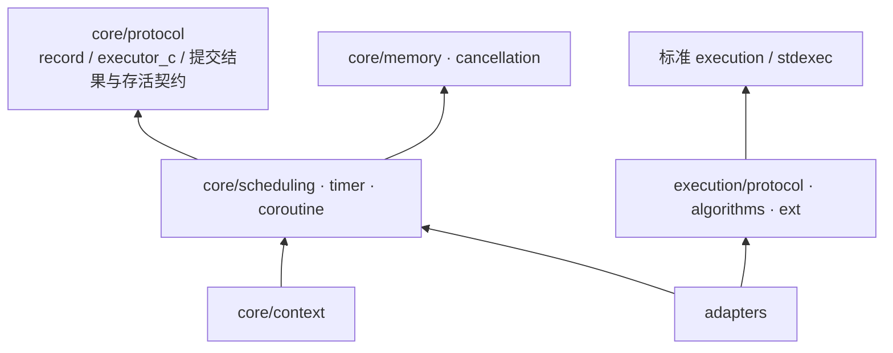
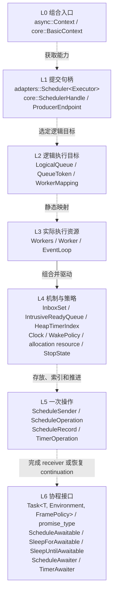
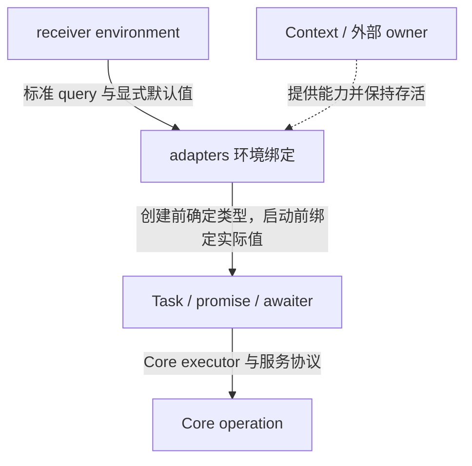

# Async Core 设计

本文规定 async 的目标架构、协议边界和运行时契约。当前 `include/async/core.h` 仍是骨架；execution 已提供 provider 选择、协议及组合算法重导出，`exec::ext` 尚未实现。下文的运行时类型和示例均是目标接口，不表示已经可以编译使用。

设计按使用者看到的组合关系自顶向下展开；实际开发顺序见 [CORE_DEVELOPMENT_PLAN.md](CORE_DEVELOPMENT_PLAN.md)。修改协议或行为时，应同步更新类型关系、资源与完成契约、验收条件及开发计划。

## 1. 目标、范围与命名

### 1.1 目标消费场景

首个消费目标是 LCFEngine 仓库 <https://github.com/mmmmmcree/LCFEngine.git> 的 `examples/shader_toy`，用于替换其 Asio 调度。本文提及该项目时均使用仓库 URL 与仓库内相对路径。

运行时必须能组合通用任务控制 loop、N 个 CPU worker，以及 render/gfx 等具有线程归属的外部 loop。专有系统通过注入的逻辑 scheduler 提交通用 CPU 工作，并显式选择完成目标；业务不读取物理 worker 下标，也不依赖其他系统的 scheduler 实现。

Core 应可嵌入、可由调用方驱动，独立支持 record、timer 和 coroutine。标准 sender/receiver 负责任务组合，adapters 将运行时能力接入该模型。普通 sender 业务使用 CPU workers 不以协程实现为前提。

### 1.2 架构不变量

- Core 头文件不包含 `async/execution/*`、stdexec 或 `<execution>`；execution 的通用算法不依赖 Core，adapters 同时依赖两边。
- 公共 Core 类型通过模板、concept、CPO、ADL 和组合扩展，不建立公共继承体系。`std::pmr::memory_resource` 是预留的标准虚函数资源边界。
- queue/timer 默认借用调用方嵌入的节点；需要拥有闭包或状态时，必须明确分配来源、存活范围和回收路径。
- 已启动操作恰好完成一次。取消、拒收或关闭不能以静默丢弃节点代替完成；请求停止与销毁对象是不同动作。
- 完成可能同步发生，完成函数可能销毁 operation。发布 record 或交付完成后，不得继续假定其所属状态仍存活。
- 跨执行域恢复必须经过目标提交协议。不能因当前线程相同而隐式 inline，也不能把其他域的 continuation 直接作为对称转移结果。
- Core 不提供硬实时保证。预算不能抢占已开始的 C++ 函数、协程段、析构或用户 callback；队列的进展性质也不等于完整提交路径的延迟保证。

### 1.3 命名规则

非 execution 层遵循 LCFEngine 的 `agent-workspace/conventions/cpp-style.md`：普通类型和别名使用 PascalCase，非静态成员函数使用 camelCase，静态成员函数、自由函数、参数及局部变量使用 snake_case，concept 使用 `snake_case_c`。数据成员使用 `m_`，普通常量使用 `k_`，枚举值使用 `ePascalCase`；配置对象保留 `_info`，指针和句柄变量使用约定的语义后缀。

CPO 是可调用接口，对象使用操作名的 snake_case，不加 `k_` 或 `_cpo`；实现类型使用 PascalCase，例如 `detail::TryEnqueue` 与 `try_enqueue`。普通类文件与类名一致，协议/自由函数集合文件使用 snake_case。

execution 沿用标准/provider 命名，包括 `exec::sender`、`schedule`、`get_env` 和 `exec::ext::then_expected`。adapters 的普通类型仍用项目命名，但 `connect/start/get_env`、`sender_concept`、`completion_signatures` 等协议定制名保留原样；语言要求的 `promise_type/await_suspend`、标准基础词汇和第三方引用亦不改名。

## 2. 分层、类型与所有权

### 2.1 编译依赖

当前没有必须由 Core 和 execution 共同依赖的 async 自定义协议，不预设统一的 `async/protocol/` 层。Core 与 adapters 共用运行时契约，execution 与 adapters 共用标准/provider 契约。



图中箭头表示“依赖”。Core 各组件只包含自己需要的协议，memory 不因上图分组而依赖 scheduling；Context 是组合层，不被 EventLoop/Worker 反向包含。

| 入口/目录 | 职责 | 依赖边界 |
| --- | --- | --- |
| `core/protocol.h`、`core/protocol/` | record、提交 CPO、`executor_c`、接纳结果和存活契约 | 配置及标准基础词汇；不含 queue/loop 实现或 execution |
| `core/memory`、`core/cancellation` | 资源策略、对象分配、取消状态与 registration | 按需使用标准资源/stop vocabulary |
| `core/scheduling`、`core/timer` | queue、EventLoop、Workers、逻辑目标、deadline 索引 | Core 协议和资源；不含 sender 算法或具体 promise |
| `core/coroutine` | Task、promise、awaiter、frame 与 continuation policy | Core 能力及语言协程协议 |
| `core/context` | 组合与管理 loop、Workers、映射和生命周期 | Core 组件；不拥有业务 root scope |
| `execution/protocol.h`、`execution/` | provider 协议重导出、标准算法和扩展算法 | 标准 execution/stdexec；不读取运行时内部结构 |
| `adapters/` | executor/scheduler、operation/sender、environment/coroutine 的转换 | 同时使用两套协议，不被底层反向包含 |

`core.h` 只聚合 Core；`execution.h` 只聚合 execution；`async.h` 可以作为总入口。纯 Core 用户不需要 execution provider 即可包含 `async/core.h`。

### 2.2 自顶向下的运行时类型图

以下箭头表示组合、能力获取或运行方向，不表示继承或头文件依赖。逻辑层次与实现先后顺序不同；sender 路径可在 operation 层完成，不必经过协程。



| 层 | 目标类型 | 定位与功能 | 所有权 |
| --- | --- | --- | --- |
| L0 | `core::BasicContext`、`async::Context` | 装配逻辑队列、执行资源和关闭协议；Context 是常用配置别名 | 拥有内部 loop、映射和 Workers；借用外部 loop |
| L0 | `core::ContextInfo`、`QueueRequest`、`QueueMode` | 描述 worker 预算、逻辑需求和 owner/隔离约束 | 初始化配置值 |
| L1 | `core::SchedulerHandle` | 引用运行时状态与逻辑队列身份；实现 Core 提交能力 | 可复制、非拥有，不延长 Context 寿命 |
| L1 | `adapters::Scheduler<Executor>` | 将 Core executor 适配成标准 scheduler | 常用实例包装 SchedulerHandle；普通 producer 持有 |
| L1 | `core::ProducerEndpoint` | 固定 producer 线程预登记的低延迟提交能力 | 借用目标 lane，保留单 producer 限制 |
| L2 | `core::LogicalQueue`、`QueueToken`、`WorkerMapping` | 维护逻辑语义、opaque token 及到 owner/worker 的映射 | Context 管理稳定状态 |
| L3 | `core::Worker`、`Workers` | 管理物理线程并驱动绑定的 loop，处理创建失败与 join | Workers 拥有线程；Worker 借用 loop |
| L3 | `core::BasicEventLoop`、`EventLoop` | 收取、等待和推进 ready/timer/完成 | 不创建线程；由 Worker 或外部 owner 驱动 |
| L4 | `MutexInbox`、`BoundedProducerLane`、`InboxSet` | 通用 MPSC、预分配 SPSC lane 和单 owner 汇合 | 节点借用；策略名称在契约稳定后决定是否公开 |
| L4 | `IntrusiveReadyQueue`、`HeapTimerIndex`、`TimerNode` | 本地 ready/backlog 与 deadline 索引 | node 嵌入 operation；动态 backing storage 来源明确 |
| L4 | `Clock`、`WakePolicy`、`std::pmr::memory_resource`、`allocation_resource_c`、`StopState` | 时钟、等待握手、标准/无异常分配能力与取消支持 | 策略或具体状态；资源引用非拥有 |
| L5 | `adapters::ScheduleSender`、`ScheduleOperation` | 描述调度；connect 后保存 receiver 和 record，start 时提交 | operation owner 持有稳定存储至最后访问 |
| L5 | `core::ScheduleRecord`、`TimerOperation` | 一次调度或计时操作的执行/完成状态 | queue/index 仅借用，不隐式拥有协程 |
| L6 | `core::Environment<Executor, Allocator, StopToken>` | 注入实际执行、分配及取消能力 | 持有能力值；引用的服务由各自 owner 保活 |
| L6 | `core::Task<T, Environment, FramePolicy>`、`promise_type` | 管理协程结果、环境、continuation 和 frame | Task/root owner 管理，不由 Context 自动接管 |
| L6 | `ScheduleAwaitable`、`SleepForAwaitable`、`SleepUntilAwaitable`、`ScheduleAwaiter`、`TimerAwaiter` | 描述 co_await 操作，注册挂起状态并恢复 | awaiter 嵌入或借用一次操作的状态 |

### 2.3 各层需要的协议

| 协议 | Core | execution | adapters |
| --- | --- | --- | --- |
| record、executor、接纳/拒收与存活 | 定义和实现 | 不需要 | 提交并映射完成 |
| queue、timer、clock、wake、资源/取消策略 | 按组件使用 | 不读取具体实现 | 按操作接入能力 |
| C++ coroutine/awaitable | 实现 | provider 协程工具按需使用 | 桥接 sender 与 awaitable |
| sender/receiver、completion signatures、operation state | 不需要 | 使用 provider 定义 | 实现具体适配类型 |
| `connect/start/set_value/set_error/set_stopped` | 不需要 | 使用 provider CPO | 连接、启动并翻译 Core 结果 |
| 标准 scheduler、environment/query/forwarding | 不直接依赖 | 使用 provider 协议 | 转换执行目标与环境 |
| allocator、stop token | 使用标准基础词汇和策略 | 通过标准 query 使用 | 保存、转发及适配 |

Core 可用静态完成函数或 continuation 交付结果，无需再定义一套 sender/receiver。只有出现确切的双方共用独立词汇时，才重新评估协议上提。

## 3. Core 提交协议与一次操作

### 3.1 Record 和 executor

最小调度单位是具有明确存活范围的 record，不是裸 coroutine handle。record 提供静态执行/完成入口，由 operation 或 awaiter 嵌入；异构队列确需擦除时可在边界使用 `void *` 加函数指针，不建立公共 OperationBase。

executor 只表示 record 提交能力，不捆绑 timer、allocator、loop 驱动或 scope 计数。以下是目标声明；CPO 的成员/ADL 检测和具体分发实现省略：

```cpp
namespace lcf::async::core {

enum class EnqueueResult
{
    eAccepted,
    eFull,
    eClosed,
};

namespace detail {

struct TryEnqueue
{
public:
    template <typename Executor>
        requires enqueue_target_c<Executor>
    EnqueueResult operator()(const Executor & executor, ScheduleRecord & record) const noexcept;
};

} // namespace detail

inline constexpr detail::TryEnqueue try_enqueue{};

template <typename Executor>
concept executor_c = requires(const Executor & executor, ScheduleRecord & record) {
    { try_enqueue(executor, record) } noexcept -> std::same_as<EnqueueResult>;
};

} // namespace lcf::async::core
```

`detail::enqueue_target_c` 先检测有效定制及其返回类型和 noexcept；不能用无约束 CPO 声明让 concept 对任意类型都成立。成员定制使用 `executor.tryEnqueue(record)`，ADL hook 使用 `enqueue_record(executor, record)`，与公共对象 `core::try_enqueue` 区分，避免同命名空间声明冲突。公共调用方只调用 CPO。

concept 只检查表达式；每个实现还需声明 producer 数量、线程限制、顺序、容量和进展性质。SchedulerHandle 可提供通用多 producer 能力，ProducerEndpoint 保留线程限制，二者不因满足同一 concept 就具有相同并发保证。

### 3.2 接纳与完成契约

| 事件 | record/operation 的责任 |
| --- | --- |
| 构造操作 | owner 持有输入与稳定状态，尚未发布；不隐式执行工作 |
| `eAccepted` | 运行时取得排队访问权；owner 仍负责存储存活，运行时必须执行或按取消/关闭契约交付完成 |
| `eFull/eClosed` | 不接管 record；operation/adapter 按声明处理拒收或保留为尚未提交的业务工作 |
| 执行、取消、到期竞争 | 只允许一个完成胜者；队列摘除不等于所有并发访问已经结束 |
| 完成交付 | 完成函数可能销毁 operation；交付后不得继续访问其成员 |
| 最后访问结束 | owner 才能释放或复用状态；节点脱链、取消 registration 和回收记录也需结束 |

提交不在调用线程 inline 执行 record，但其他 owner 可在发布后、提交返回前消费它。提交实现和 start 路径必须处理这种竞争，不能在发布后再次读取已可能销毁的 operation。

ready queue 和 timer index 不执行 receiver，也不在内部锁下调用用户代码。关闭必须兑现已接纳操作；continuation 入队失败时要有预留容量、有效完成通道或其他明确契约，不能丢失完成，也不能在错误线程直接恢复以伪装成功。

### 3.3 协议复用与边界

`using core::executor_c;` 可把同一 concept 引入其他命名空间；需要改名时，可定义转发 concept `runtime_executor_c = core::executor_c<Executor>`。concept 不是类型，不能用类型别名语法替代；通常不新增同义公共名字。

Core executor 不自动满足标准 scheduler，标准 scheduler 也不自动满足 `executor_c`。反向接入外部 scheduler 时，需要显式 adapter 管理 `schedule/connect/start` 的 operation state 和失败映射，不能强制要求其提供旧版 `enqueue/workStarted/workFinished` 等额外成员，也不能继承低延迟入口的保证。

## 4. 资源、取消与存活

### 4.1 存储来源

`memory_resource` 只解决字节分配，不决定对象共享、arena/pool 选择、并发访问和释放时机。这些由具体 policy 或值类型承担，不再定义带虚函数的 AllocationStrategy。

| 对象 | 资源来源与管理方式 |
| --- | --- |
| Context、内部 loop、映射、queue/timer backing storage | 宿主显式配置的 Core resource/容量策略 |
| record、timer node、connect 返回的 operation、adaptor 成员 | 优先嵌入 owner 的稳定存储，不因统一接口而强制堆分配 |
| async 自有操作的额外动态存储和 owning post 闭包 | receiver 环境可查询的 allocator 优先，否则使用操作绑定的显式 Context 默认值 |
| 无 Context 的 execution 操作 | 自身契约要求 allocator，或调用方显式选用默认资源 |
| coroutine frame | 创建前确定的 FramePolicy；不受后续 start 时环境更改追溯影响 |
| 用户值、异常对象、第三方算法、线程/系统对象 | 分别声明边界，不能声称全部受 Context PMR 控制 |

Core 的普通配置直接借用 `std::pmr::memory_resource`，例如 `ContextInfo::setMemoryResource(std::pmr::memory_resource &)`，不增加仅转发 allocate/deallocate 的 Handle。Context 内部保存非拥有引用，宿主让 resource 存活至最后一次释放；显式无异常分配能力另按第 4.4 节的协议选择。

资源来源显式绑定，不在深层偷偷调用全局 `get_default_resource()`；便捷兼容工厂如 `with_default_resource` 应明确命名。

标准 `get_allocator` 返回 allocator，不是裸 `memory_resource *`；PMR 可用 `std::pmr::polymorphic_allocator` 表达，普通 allocator 走其分配/释放协议，不能统一调用 `.resource()`。标准 query 本身没有 allocator fallback，Context 默认值由宿主/桥接入口显式提供。当前 `execution/protocol.h` 已重导出 provider 的 `get_allocator`，不新增同义查询。

### 4.2 分配和回收策略

| 策略 | 适用范围 | 必须说明的限制 |
| --- | --- | --- |
| 直接 resource / 显式 `new_delete_resource` | 基线和兼容路径 | 每次分配成本；不得作为隐藏默认 |
| `synchronized_pool_resource`、线程安全 slab | 跨线程短命状态 | 同步与上游成本 |
| `unsynchronized_pool_resource` | 严格单线程分配/释放 | loop 单 consumer 不代表资源只在该线程访问 |
| monotonic/arena | 一批对象整体结束 | 逐个取消不等于立即回收存储 |
| 固定块、recycling/free-list、inline storage | 已有数据支持的热点对象 | 容量耗尽、对齐、扩容及跨线程回收 |

每次分配必须保留释放所需的 allocator/resource、大小和对齐，或由 policy 保证可恢复；不能在释放时重新查询已变更的环境。producer 可能创建状态，worker 或 receiver 可能销毁它；使用线程安全资源，或显式将回收归并到 resource owner。回收记录计入未完成工作，owner/resource 必须保持到 drain。

资源验收覆盖正常/同步完成、构造失败、connect/await_suspend 失败、拒收、取消、关闭、完成中销毁及跨线程释放，不仅检查成功路径。

### 4.3 Hook、统计和特殊分配行为

标准 PMR 路径通过派生 `std::pmr::memory_resource`，在 `do_allocate/do_deallocate` 中包装上游 resource，加入统计、诊断或其他分配策略；`do_is_equal` 保持资源相等与可互相释放的契约。这里使用预留的标准虚函数边界，不新增 async 自有虚基类或转发 Handle。例如宿主可提供：

```cpp
app::TrackingMemoryResource tracked_resource{upstream_resource, statistics};
context_info.setMemoryResource(tracked_resource);
```

execution 的普通 allocator 可通过 allocator wrapper 加入同类行为。无异常 resource 则通过满足 `allocation_resource_c` 的组合装饰器包装 `tryAllocate/deallocate`；其 hook 也须不抛异常，不能因记录一次分配而递归触发被跟踪的分配器。

统计明确区分请求字节、成功/失败次数、当前存活字节、峰值和上游实际保留量。分配失败不增加存活字节，释放与原分配对应；多线程计数及记录状态遵守所选 resource 的并发契约。外层装饰器看到的是该层的请求，上游装饰器看到的是 pool/slab 的实际补充，二者不混为同一指标。

统计仅覆盖显式经过该 resource/allocator 的调用。独立 allocator、第三方内部存储和编译器消除的 coroutine frame 不会自动计入；装饰器、上游及统计状态均须覆盖最后访问。

### 4.4 无异常分配与失败返回

若要求分配失败返回错误码且调用 `noexcept`，保证必须由实际字节分配后端实现。`std::pmr::memory_resource::allocate` 和标准 allocator 的 `allocate` 都返回指针并采用失败抛异常的契约；不能只在外面加 `noexcept`、失败时返回 nullptr，或用统计 hook 改写成可恢复错误。

这项需求采用独立的 Core `allocation_resource_c` 协议，放在 `core/memory/allocation.h`，以模板和组合扩展，不依赖 execution，也不新增公共继承体系。C++20 基线用值类型表达结果，避免为基础分配协议要求 `std::expected`：

```cpp
namespace lcf::async::core {

struct AllocationResult
{
    void * m_storage_p;
    std::error_code m_error;
};

} // namespace lcf::async::core
```

| 层次 | 契约与责任 |
| --- | --- |
| 字节 resource | `tryAllocate(bytes, alignment) noexcept -> AllocationResult`；成功返回有效存储与空 error，失败返回 nullptr 与非空 error，且不遗留须调用方回收的分配；`deallocate` 不抛异常 |
| typed allocator/helper | 检查元素数量乘法溢出和对齐，调用后端并传递错误；构造失败时释放原存储。无异常创建还须约束构造/析构及实际使用的移动操作，字节分配不抛不能保证任意 T 的构造不抛 |
| operation/Task/宿主 | 在各自的创建、connect、start 或 frame 分配阶段交付失败；尚未建立 receiver 的失败用创建结果表达，不能假装已进入 sender error 通道 |

`AllocationResult` 的判别依据是 error；成功/失败的指针关系及零字节、过对齐、容量耗尽的具体规则在最小协议用例中冻结。为恢复原状态而使用的后端清理也在 `noexcept` 边界内。concept 检查返回类型和 noexcept，失败注入测试验证真实语义。

普通资源路径与显式无异常路径分别声明。严格路径从可报告失败的后端开始，不默认通过 try/catch 适配任意 PMR；若提供异常捕获兼容 adapter，必须显式命名并只在启用异常的配置使用。标准 allocator 的 allocate 入口仍须遵守标准契约，其额外 try 分配能力供 async 的受限路径使用；第三方代码只调用标准入口时，不自动获得错误码返回。

标准 `get_allocator` 本身不保证可恢复的无异常分配。受限 operation 对所选 allocator/resource 检查额外能力或声明其不分配条件；无法满足时明确诊断，不能忽略用户 allocator 覆盖而偷偷换成 Context 默认。严格资源的具体类型和值通过显式 ResourcePolicy/工厂绑定，静态类型在创建对应对象前确定，不能塞入普通 PMR 引用冒充同一契约。

仅有 hook、pool、slab、arena 或跨线程回收不要求新增分配接口；错误码和无异常失败语义才是上述扩展协议的依据。分配协议也不使线程创建、第三方算法或整个 execution pipeline 自动变为无异常。

### 4.5 取消与任务 owner

请求停止、操作响应取消、停止业务准入、最终关闭执行资源和销毁对象分别定义。可以复用标准 stop vocabulary，也可在满足资源/并发约束时实现 intrusive state/registration；选择不改变操作完成契约。

registration 处理注册与 request_stop 的竞争，以及析构期间 callback 正在运行的情况。用户 callback 不在 queue/timer 内部锁下执行；取消、到期和正常完成必须只有一个胜者。

业务 root owner/scope 管理稳定 operation 存储、stop source、未完成计数和结果交付。Context 管执行资源，不自动收集所有 root；空队列不代表没有挂起的 I/O、timer、子操作或回收工作。完整关闭顺序见第 9 节。

## 5. EventLoop、队列与 timer

### 5.1 单 owner 驱动

EventLoop 是可手动驱动的单 consumer 组件，其他线程只发布/通知。N 个 worker 不能同时调用同一个 EventLoop 的 run/poll。每个 worker 可以驱动自己的 loop；共享多 consumer 后端必须独立满足其契约。

| 成员入口 | 行为 |
| --- | --- |
| `pollOne()` | 不等待，最多执行一个 ready record；遇到暂不可取的入口也及时返回 |
| `poll(PollBudget)` | 非阻塞推进，在 record 间检查数量和时间预算，返回 PollReport |
| `runOne()` | 等待至一个可执行 record 或明确退出条件；最多执行一个 record |
| `run()` | 持续驱动，空闲时等待，收到新工作后继续；瞬时空队列不使其退出 |

空唤醒不计为执行记录。WakePolicy 协调 ready 状态、下一个 deadline 和 stop/close；必须避免“检查为空 → producer 发布并通知 → owner 入睡”的丢唤醒。timer 控制若只允许 owner 访问，则跨线程注册/取消通过控制 record 完成。

`pollOne` 限制的是 record 数量。record 可恢复协程直至下一挂起点，用户 awaitable 也可能同步恢复其他协程，不能把它解释为“一次 resume”或固定业务指令数。

### 5.2 队列职责与选择

| 位置 | 并发角色 | 首版选择 |
| --- | --- | --- |
| 跨线程入口 | 多 producer、单 owner | MutexInbox 正确性基线；固定 producer 可登记 BoundedProducerLane |
| owner 本地 ready/backlog | 单线程维护 | IntrusiveReadyQueue，借用节点，不额外分配 |
| 多入口汇合 | 单 owner 收取各 lane/inbox | InboxSet，有界批次和公平推进 |
| CPU 工作入口 | 首版每 worker 独立入口 | 由逻辑映射选定目标；不把 SPSC lane 交给多个 worker 共同 pop |

队列策略在构造/producer 登记时选择，业务不在每次提交时指定算法。基础运行时应提供可用的配套 endpoint、唤醒和存活规则，不要求专有系统自行拼接。策略声明顺序、容量、扩容、接纳/拒收、发布未完成状态、节点回收及 unregister/drain 条件；仅有同名 push/pop 不表示符合契约。

| 候选入口 | producer 成本 | consumer 限制 | 定位 |
| --- | --- | --- | --- |
| mutex + intrusive queue | 可能等待其他线程持锁 | 简单、易验证 | 通用基线 |
| CAS inbox，摘链后反转 | 竞争时重试 | 合批维护及本地 backlog | 数据支持后再引入 |
| exchange intrusive MPSC | exchange 与链接发布，无 CAS 重试循环 | producer 暂停可造成发布缺口 | 动态 producer 的后续候选 |
| 固定 producer 的预分配 SPSC ring | 无 producer 间共享入队锁，满时立即返回 | lane 生命周期、扫描和公平性 | 专有线程低延迟优先候选 |

若算法存在发布缺口，内部区分“可取/确认空/发布未完成”；poll 不自旋等待 producer，等待握手保证链接补齐后可再检查，也不能提前回收仍可能被 producer 写入的节点。合批摘链、反转和 timer 维护须有显式成本边界，避免一次 poll 实际变成全队列 drain。

### 5.3 专有 producer 的低延迟契约

目标是让 render/gfx 的已准备 record 不因 TaskSystem consumer 持队列锁而等待，允许 consumer 延后收取；不是设计一把偏向 producer 的通用锁。固定 producer 可按“producer/目标 owner”登记 SPSC lane，普通来源走独立 MPSC 入口，由单 owner 汇合。

```text
render producer --> render lane --+
gfx producer ----> gfx lane ------+--> target worker/loop owner --> local ready
other producers -> MPSC inbox ----+
```

登记、扩容、闭包/operation 构造及输入准备不放在提交快路径。`core::try_enqueue(endpoint, record)` 满时立即返回 eFull，关闭时返回 eClosed；不循环等待，不隐式转入带锁队列或堆分配 fallback。尚未提交的业务可留到下一帧重试；已接纳操作不能覆盖或静默合并。

有限容量、始终接纳、producer 永不等待和 consumer 无限落后不能同时保证。宿主明确容量与积压处理，owner 对各 lane 有界轮询；单 lane FIFO 不推导跨 lane 全局 FIFO。lane 不是逻辑队列身份，同一 producer 可投递多个逻辑目标。

完整提交还包含通知和拒收清理。通知可合并，但若采用周期检查，必须声明最大检查间隔；若立即唤醒，单独测量其同步/系统调用成本。不能仅凭队列没有 mutex 宣称整个 post 或完整路径 wait-free，也应避免每条 lane 每次争用同一全局计数器。

业务入口满载时，停止通知及已接纳操作的完成仍需可推进，例如预留完成容量或独立控制状态。关闭与内部完成的准入由运行时统一定义，不能仅靠一个 bounded queue 解决。

### 5.4 Timer 和推进预算

timer index 只管理 deadline 和借用 node，不持有 queue、不等待、不直接运行用户代码。首版用 intrusive binary min-heap：TimerNode 保存 heap index，取消/重排为 O(log n)，backing storage 来源显式，Clock 可替换为 fake clock。

| 索引能力 | 契约 |
| --- | --- |
| `insert` | 登记 node，报告是否需调整下一次等待 |
| `remove` | 摘除 node，遵守取消/到期竞争与最后访问规则 |
| `nextDeadline` | 查询最近 deadline，空索引语义明确 |
| `expire` | 有界收集到期 node 交给 loop，不在索引内部调用 callback |

单次等待先实现；若需要重复 timer，再明确周期相对时间、追赶/合并规则。timer 到期后转入 ready，由 operation 决定完成。大量同时到期、提前 timer 和取消控制记录都计入维护预算。

PollBudget 包含 record 数和持续时间限制；PollReport 的 `m_callbacks` 统计已开始并返回的 record，`m_elapsed` 包含维护、执行和必要清理。预算在 record 边界检查，耗时是软限制，无 ready 时不为达到预算而等待。计时使用可替换 Clock/诊断策略，不能强制所有低开销路径承担高精度计时成本。

## 6. Workers、逻辑队列与 Context

### 6.1 组件职责

EventLoop 管事件推进，不创建线程；Worker 管一条线程并驱动绑定 loop；Workers 管线程集合、创建失败回收及 join；Context 组合这些组件和逻辑映射。首版每 worker 一个单 owner loop，内部 loop 地址在句柄有效期间稳定。

Context 可以仅绑定外部手动 loop、拥有 CPU Workers，或混合拥有控制 loop/Workers 并借用 render/gfx loop。外部线程的创建、驱动和 join 仍由宿主管理；Context 不越线程归属代为推进。配置 CPU 资源时至少有一个 worker；没有 CPU 执行资源时拒绝相应队列请求，不把计算默默转到 main/render。

业务 scheduler 是非拥有能力句柄，不创建线程、不阻塞析构、不隐式延长整个 Context 寿命。scope 的操作存活与执行资源存活通过显式关闭协议协调。

### 6.2 逻辑目标与静态映射

借鉴 LCFEngine Vulkan core 的“逻辑需求 → 实际资源”映射：应用控制逻辑队列数量，宿主决定物理 worker 预算。队列可多对一映射；增加逻辑队列只增加潜在并行，不创造额外执行资源。

| 模式 | 承诺 | 首版映射 |
| --- | --- | --- |
| `QueueMode::eSerial` | 同一逻辑队列的 record 不重叠并具有串行同步关系 | 固定到一个 worker，多队列可共享 |
| `QueueMode::eThreadBound` | record 在指定 owner 线程执行 | main/render/gfx 等外部或内部 owner |
| `QueueMode::eParallel` | 独立 record 可以并发，无队列级全局串行顺序 | 后续独立多 worker 分发扩展 |

serial 约束一次 record，不保证整个异步任务跨挂起点独占队列，也不保证任务完成顺序。逻辑身份由运行时和 QueueToken 决定，不因映射到同一线程而相等；producer tag、lane 与 worker 下标不与之混用。

QueueRequest 描述 key、模式、所需能力、owner/affinity 和共享/独占要求。硬约束不足时创建失败；分散到不同 worker 可以是软偏好，业务需要物理隔离时必须声明为硬要求。`hardware_concurrency()` 只是提示，不是可用队列的硬件上限。

映射初始化后稳定，快路径不运行 solver、不创建线程或争用全局路由锁。首版新增配置需 quiesce/重建；动态迁移、work stealing 和权重优先级均为后续项。未来 serial 迁移必须验证唯一执行令牌、同步交接及关闭；thread-bound 不迁移。

参考源码为 LCFEngine 的 `libs/vk_core/src/context/DeviceContext.cpp`、`libs/vk_core/include/vk_core/queue/LogicalQueue.h`、`libs/vk_core/src/queue/QueueAccess.cpp`。借鉴逻辑映射不表示照搬其实际队列 mutex；异步提交的延迟仍由入口和 wake 路径决定。

### 6.3 Producer 和跨域工作

普通 producer 获取 `adapters::Scheduler<core::SchedulerHandle>`；固定线程另可登记 ProducerEndpoint。标准 sender 的构造、connect 和 start 可处于不同线程，SPSC 限制必须在实际提交线程满足，不能只看获取句柄或构造 sender 的线程。通用 scheduler 只有在 start 时验证绑定，或提供声明清楚的线程安全路由，才可利用 lane。

render 提交 CPU 工作必须支持两种显式路径：

- `render → CPU → render/gfx/main`：直接向目标 worker 提交，完成转回指定域，通常优先。
- `render → main → CPU → render`：需要统一准入或记账时，控制 loop 只执行短的提交 record。

main_loop 表示通用控制角色，不强制为进程主线程。往 main loop 投递普通函数不会自动并行；CPU 重工作必须选择 CPU scheduler。长期阻塞读取或 GPU 等待应由宿主接受占用 worker 的代价，或使用独立阻塞资源/后端。

为 render 优化 main loop 的队列并不改善直接 CPU 提交，低延迟 lane 必须配置到实际目标 worker；若使用共享 mutex 工作后端，经 main 转发只是把锁成本交给 main owner，不是消除了锁。任何共享多 consumer 替代后端单独验证，不直接复用 SPSC 消费路径。

## 7. execution、Environment 和 adapters

### 7.1 Scheduler 与一次调度

execution 继续重导出 provider 类型/CPO，不包装标准算法。adapters 的 ScheduleSender 保存 Core 执行目标，connect 建立 ScheduleOperation，start 才调用 Core 提交；operation 内嵌 record，运行或拒收后交付相应完成通道。

```text
schedule(scheduler) -> ScheduleSender
connect(sender, receiver) -> stable ScheduleOperation
start(operation) -> core::try_enqueue(executor, record)
record execution / rejection / cancellation -> receiver completion
```

adapter 必须满足选定 provider 的 scheduler/sender/receiver/operation_state concept，同时验证以下语义：

- schedule sender 成功完成为 `set_value_t()`，error/stopped 如实声明；不存在“只要符合 scheduler 就不会失败”的保证。
- 句柄复制、移动、赋值、比较和析构满足目标无异常契约；相等反映同一逻辑执行资源，不只比较物理线程。
- 标准要求可并发的复制、比较、schedule 不引入数据竞争，多个 producer 可启动各自 operation；同一 operation 仅 start 一次。
- scheduler 析构不等待已连接 receiver 完成，关闭/drain/join 归 owner。
- value completion scheduler 与 schedule 使用的句柄一致；error/stopped 仅在确能保证资源归属时提供对应查询。
- 标记、queryable 和 forward-progress query 按版本实现；手动 loop、绑定线程和 CPU workers 如实声明各自的推进能力。

当前工作草案与项目固定 stdexec 的 concept 检查项可能不同，不将某个 provider 接受的最小类型视为全部标准要求。升级或切换 provider 时重新核对。标准 scheduler 不要求 `post/execute/run/poll`；这些不是 Core executor 的标准化同义成员。

### 7.2 Environment 的查询与传播

Environment 是标准 execution 的可查询对象协议，不是固定字段结构体。`get_env(sender)` 返回 sender 属性，`get_env(receiver)` 返回操作接收环境；两者不会自动合并，空环境也不自动带上 Context。

| 查询 | 要求与使用边界 |
| --- | --- |
| `get_env(object)` | 查询不抛，返回 queryable 对象，结果遵守对象存活要求 |
| `get_scheduler(env)` | 有效时结果满足 scheduler；缺失不自动选择当前线程或 CPU pool |
| `get_allocator(env)` | 有效时结果满足对应 allocator 要求；资源优先级按第 4 节，不另建 query |
| `get_stop_token(env)` | 返回符合 stoppable-token 协议的对象；无定制时使用不可停止 token |
| `get_completion_scheduler<Tag>(get_env(sender))` | 描述 value/error/stopped 某通道的完成资源，实际完成必须遵守；不同于 receiver 的关联 scheduler |
| async timer/I/O 服务 query | 属扩展能力，由 adapters 定义类型、缺失诊断、forwarding 和引用存活规则 |

支持哪些属性由具体环境决定；标准规定有效查询的约束，不要求每个环境提供全部能力。标准 `forwarding_query` 和各 adaptor 语义控制转发；显式覆盖优先，scheduler 转移可能替换或屏蔽关联属性，不能无条件转发所有 query。自定义服务 query 同样明确 forwarding 行为。

Context 默认值由桥接入口显式组合，用户有效 allocator/stop token 覆盖得到保留；sender 属性不会自动覆盖 receiver 环境。必需服务静态缺失时给出约束诊断，动态不可用时按声明交付拒收/error/stopped。环境查询本身不切线程。

### 7.3 调度组合和完成域

`starts_on` 选择启动资源，`continues_on` 显式转移后续完成，普通 `then/let_value` 不自动选择 CPU worker。`starts_on` 不保证所有异步完成留在启动线程，也不自动回提交线程。使用具有返回原域语义的 `on` 时，必须具备有效接收环境 scheduler，并核对 provider 支持。

目标调度成功后才可依赖该域；转移被拒收、停止或失败时，不能承诺错误仍在目标 owner 交付。completion signatures 与 completion scheduler 查询必须相符。线程绑定的业务错误收尾通过 owner mailbox 或仍有效的目标调度路径处理，不在来源线程越权修改 render/gfx 状态。

### 7.4 `exec::ext::then_expected`

目标扩展接入 `noexcept` 的 `std::expected<T, E>` 任务函数。它在上游 value 到达时调用函数，不在 sender 构造时执行重工作，也不自行切换 scheduler。

| 输入/结果 | 下游行为 |
| --- | --- |
| 上游 value | 用值参数调用 F，F 必须 nothrow-invocable 并返回 expected |
| `expected<T, E>` 成功 | `set_value(T)` |
| `expected<void, E>` 成功 | `set_value()` |
| `unexpected(E)` | `set_error(E)`，后续 value 分支短路 |
| 上游 error/stopped | 原样传播，跳过 F |

适配器不使用 try/catch 转换异常，违反 noexcept 会按 C++ 规则终止。受限路径还需约束结果交付涉及的 T/E 移动及存储操作；构造、connect、资源分配和其他算法的失败契约分别声明，不能把局部 noexcept 扩大到整个 pipeline。

shader_toy 使用 `E = std::error_code`，但扩展不必局限该错误类型。裸 error_code 返回值如何适配另行设计，不在此接口中隐式推断。`std::expected` 需要 C++23 库能力；当前 C++20 基线下按能力启用该扩展，不默默提升整个 Core 的语言要求。

## 8. Core 协程与环境绑定

### 8.1 静态能力注入

Core 的 Environment 是能力容器，其 Executor 满足 `executor_c`；execution Environment 则是查询协议，二者由 adapters 连接，不要求 Core 引用标准 query tag。

```cpp
namespace lcf::async::core {

template <executor_c Executor, typename Allocator, typename StopToken>
struct Environment
{
    Executor m_executor;
    Allocator m_allocator;
    StopToken m_stop_token;
};

} // namespace lcf::async::core
```

Task 的 promise 组合结果存储、Environment、continuation、取消 registration 和 FramePolicy。awaiter 只通过 Core executor/服务能力工作；timer/I/O 单独注入，不经 executor 反查具体 EventSource 或 Context。



模板参数只确定类型，实际 executor/allocator/token 值仍需对象承载。`Task<T, Environment, FramePolicy>` 可由宿主提供 PascalCase 常用别名。协程返回类型与 promise 在编译时确定；connect 不能改变已经创建 frame 的类型。若从 receiver 推导静态环境，必须在其类型确定后调用 coroutine factory；固定类型字段也不能通过赋值切换成另一种 executor 类型。

Core Task 独立支持 Core awaitables。接入任意 sender 的 co_await 由 adapters 经泛型 promise 扩展入口或显式桥接完成；需要环境视图和转换策略时在协程创建时选定，不能把 stdexec 算法硬编码进 Core promise。具体桥接入口在协程阶段通过最小示例确定，再冻结其公开 API。

### 8.2 Frame、挂起与恢复

frame 可能在协程函数调用时分配，早于 connect/start。显式 frame context 参数或延迟调用 coroutine factory 在创建前选择资源；对子协程显式传播，不能依赖跨线程 TLS scope。保存原始释放信息，允许编译器消除 frame，不断言一定发生 allocate/deallocate。

采用无异常分配协议时，FramePolicy 还需结合 promise 的分配失败机制（包括适用的 `get_return_object_on_allocation_failure`）定义 Task 创建失败结果；后端返回 AllocationResult 不会自动改变语言的 frame 分配行为。

语言 Awaitable 协议不会自动传递 execution environment。execution-aware 桥接按 provider 提供 promise 环境视图，并在 await_transform/as_awaitable 路径连接 sender；Core 普通 awaitable 保持语言语义。标准默认 sender-to-awaitable 桥接含异常转换，不能当作 expected/error_code 的无异常实现；普通 await_resume 返回 expected 也不会自动让协程短路。

timer awaitable 使用独立环境服务，不从 executor 反查 EventLoop。`sleep_for(duration)` 与 `sleep_until(deadline)` 是显式操作；async Task 可通过 promise 的 `await_transform(std::chrono::duration)` 提供 `co_await 1ms` 语法糖。duration 转换与其他 awaitable/sender 分发互斥，缺少 timer 能力时明确诊断。相对 deadline 在挂起注册时按该服务的 Clock 计算，非正等待立即完成；让出执行权另用 schedule。timer 服务、恢复目标和取消状态分别注入，基础三字段 Environment 不自动带有 timer。

final_suspend 通过 continuation policy 选择目标提交；严格 loop 边界默认排队，inline 仅为显式策略。挂起发布前准备好结果存储、取消及恢复目标，处理同步完成与 await_suspend 的握手，保证协程不被重复恢复或销毁。环境、服务引用及取消状态覆盖最后访问，不能借用 connect/await_suspend 的临时局部对象。

### 8.3 旧 standalone 实现的取舍

旧提交 `dd81e559f5a928d1da2a87f97b0c3d4364728ece` 将 CoroutineEnvironment 固定为具体 Executor，start 将 `get_scheduler` 结果转换成该类型，awaiter 再调用 enqueue。CallbackExecutor 还要求 workStarted/workFinished，timer 通过 getEventSource 查找服务，因而仅满足标准 scheduler 的类型仍无法接入。

目标保留恢复域和任务存活语义，但分别交给 executor 协议、continuation policy、root owner/scope 和独立服务能力。Environment 模板化后不得再强制收窄为带额外私有要求的 Executor。旧代码可参考竞争处理，不能作为当前头文件依赖或资源默认值的模板。

## 9. shader_toy 目标用法与关闭

### 9.1 执行域与宿主装配

| 角色 | 当前消费端对象 | async 目标 |
| --- | --- | --- |
| 通用控制 | TaskSystem 的 `m_io_context`、`m_worker` | 单 owner 控制 loop，不自动执行 CPU 重工作 |
| CPU 计算 | `m_cpu_io_context`、当前两个 `m_cpu_workers` | 宿主配置 N 个 Workers，逻辑目标静态映射 |
| render | RenderTaskSystem 的 `m_render_io_context`、processOne/waitOne | 外部 owner 驱动 EventLoop，维护 render 状态 |
| gfx | `m_gfx_io_context`、`m_gfx_worker` | 指定 owner 执行上传与图形操作 |

宿主创建资源并注入 scheduler，RenderSystem 不创建共享 worker pool。下面假设宿主已声明 constexpr 逻辑 key，类型和 fluent 配置 API 尚待实现：

```cpp
namespace async = lcf::async;

// Explicitly configure Core resources/capacities before constructing the runtime.
auto context_info = async::core::ContextInfo{}
    .setMemoryResource(memory_resource)
    .setWorkerCount(worker_budget)
    .addSerialQueue(k_image_prepare)
    .addSerialQueue(k_shader_compile)
    .addSerialQueue(k_resource_prepare)
    .bindExternalQueue(k_gfx_submit, gfx_loop)
    .bindExternalQueue(k_render_apply, render_loop);

async::Context async_context{context_info};
async_context.start();

const auto task_context = ShaderToyTaskContext{
    .m_image_scheduler = async::adapters::as_scheduler(async_context.getSchedulerHandle(k_image_prepare)),
    .m_shader_scheduler = async::adapters::as_scheduler(async_context.getSchedulerHandle(k_shader_compile)),
    .m_resource_scheduler = async::adapters::as_scheduler(async_context.getSchedulerHandle(k_resource_prepare)),
    .m_gfx_scheduler = async::adapters::as_scheduler(async_context.getSchedulerHandle(k_gfx_submit)),
    .m_render_scheduler = async::adapters::as_scheduler(async_context.getSchedulerHandle(k_render_apply)),
    .m_device_context = device_context,
    .m_gfx_task_queue = gfx_task_queue,
};
```

前三条是不同 serial 逻辑队列，可在一个 worker 上正确串行推进，映射分散且物理资源足够时才有实际并行；gfx/render 绑定其 owner。外部 loop 也使用显式资源与容量策略。专有低延迟 endpoint 的登记和实际 start 线程约束按第 5、6 节处理。

### 9.2 expected 资源任务流水线

LCFEngine 的 `examples/shader_toy/render_system/src/private_include/ShaderToyResourceTasks.h` 声明了 load_image、upload_image、load_shader_source、compile_shader_source 等 noexcept expected 任务。下例的 `app::` 函数是目标宿主封装：同步任务返回 expected，批量 shader 封装保留该契约，真正异步的 gfx 操作用 sender helper 表达。

```cpp
namespace ex = async::exec;

auto images = ex::starts_on(task_context.m_image_scheduler,
        ex::just(image_path) | ex::ext::then_expected(app::load_image))
    | ex::continues_on(task_context.m_gfx_scheduler)
    | ex::ext::then_expected([task_context](Image pixels) noexcept {
        return app::upload_image(task_context, std::move(pixels));
    })
    | ex::let_value([task_context](const ImageResourceInfo & image_resource_info) {
        return app::create_cloud_sea_packet_sender(task_context, image_resource_info);
    });

auto shaders = ex::starts_on(task_context.m_shader_scheduler,
    ex::just(shader_paths)
        | ex::ext::then_expected(app::load_shader_sources)
        | ex::ext::then_expected(app::compile_shader_sources));

auto prepared = ex::when_all(std::move(images), std::move(shaders))
    | ex::continues_on(task_context.m_gfx_scheduler)
    | ex::let_value([task_context](const CloudSeaPacket & packet, const ShaderProgramInfoList & programs) {
        return app::prepare_passes_sender(task_context, packet, programs);
    })
    | ex::continues_on(task_context.m_resource_scheduler)
    | ex::let_value([task_context, swapchain_lease](const InstanceInfo & instance_info) {
        return app::build_instance_sender(task_context, swapchain_lease, instance_info);
    })
    | ex::continues_on(task_context.m_render_scheduler)
    | ex::let_value([render_state](PreparedCloudSea & result) {
        return app::install_render_state_sender(render_state, std::move(result));
    });

// The application owner constructs operation states at stable addresses.
resource_task_owner.connectAndStart(
    std::move(prepared), ResourceRootReceiver{completion_mailbox});
```

图片与 shader 分支独立启动，when_all 汇合；expected 失败经 error channel 跳过后续 value 阶段。线程绑定的异步 helper 必须声明完成域；如果 helper 不保证仍在 gfx，则下一步操作前再次 continues_on，不能仅靠最初 starts_on 推导线程归属。无异常承诺仅适用于各已声明的任务/适配路径。

helper 按值持有异步阶段需要的数据；路径、shader 名单、swapchain lease、render state、服务引用和图形资源由 root/宿主保活。ResourceTaskOwner 在稳定地址直接构造 connect 结果，不要求 operation state 可移动；登记完成追踪后再 start，完成回调中可安全回收。

ResourceRootReceiver 的 error/stopped 发布到线程安全 completion mailbox，由指定 owner 消费；目标调度拒收时，不能在错误来源线程修改 render 状态。`AsyncTaskChain/AsyncTaskFlow` 的共享 DAG、多订阅与一次启动语义须另行确认，when_all 不自动覆盖全部需求。这里是 sender 图，不依赖尚未实现的 Task。

### 9.3 关闭顺序

1. 停止新的业务 root 与 file watcher 等外部 producer；向已有 root 请求取消。
2. 保持 main/render/gfx 和 CPU 资源可推进，停止业务准入但允许已接纳操作所需的内部完成、取消与回收记录。
3. root owner/scope 追踪子操作、跨域完成、mailbox 和回收工作，等待全部 drain；owner 继续驱动，不能阻塞等待依赖自身的工作。
4. 确认没有后续投递者后解除外部 loop 借用，最终关闭内部执行资源，从安全的宿主线程 join 自有 Workers。
5. 最后释放 root 存储、外部 owner、图形资源和 allocator/resource。析构只回收已满足关闭前置条件的对象，不偷偷执行可能死锁的 drain/join。

thread-bound 完成必须在 owner 有效期间排空。若 scheduler 已关闭而拒收，按声明恰好交付失败/停止，不能强行恢复到来源线程。首版保证一次完整生命周期；若要兼容旧 TaskSystem 的 run/stop/run，需另定义 restart、旧句柄和残留状态的关系并验收。

## 10. 验收与性能基线

### 10.1 正确性验收矩阵

以下编号供开发计划引用。每项按可观察契约拆成测试，通过可控信号/gate 构造并发，不用线程 ID 抽样或计时猜测代替正确性。

| 编号 | 必须证明的行为 |
| --- | --- |
| V01 分层 | Core 单独包含/构建不引入 execution；标准 CPO 类型重导出保持 provider 身份；普通类型、concept 和 CPO 命名一致 |
| V02 操作存活 | 同步完成、发布后立即消费、完成中销毁、拒收、取消和关闭均恰好完成；operation/node 不早释放、不重复回收 |
| V03 入口与唤醒 | 多 producer 各自提交，单 owner 消费；空闲再投递、入睡竞态、stop/提前 timer 不丢唤醒；lane 满载不阻塞控制/完成 |
| V04 驱动预算 | pollOne 非阻塞且最多执行一个 record；runOne 等待且不将空唤醒计数；维护和长 callback 遵守软预算声明 |
| V05 Timer/取消 | fake clock 验证注册、取消、到期竞争和 burst 维护；registration 析构与 callback 竞争安全 |
| V06 映射与并行 | 1/2/N worker、逻辑队列多于 worker 均正确；serial 不重叠、thread-bound 命中 owner；硬隔离不足则失败，资源允许时用 gate 证明并行 |
| V07 组合与关闭 | 纯外部 loop、自有 Workers、混合配置均能 drain；关闭覆盖在途 CPU/跨域/回收/mailbox，不 join 自身、不接管外部线程 |
| V08 Scheduler | concept 及资源相等、跨线程构造/connect/start、并发 schedule/start、非阻塞析构、各完成通道及真实 completion scheduler |
| V09 Environment/资源 | 空环境、缺失能力诊断、覆盖/forwarding、不混淆 sender 属性；普通 allocator/PMR 与 hook 统计；无异常资源失败注入、能力负例、构造回滚、跨线程释放和失败回收 |
| V10 expected 扩展 | success/error/void、上游 error/stopped 跳过 F、nothrow 约束和 completion signatures；支持的无异常子集在禁用异常配置下单独验证 |
| V11 协程 | 两种 executor/环境实现接入同一 Core 协议；挂起握手、取消和恢复域正确；frame 创建早于环境绑定仍使用原资源，子协程传播明确 |
| V12 消费端 | 两条 render/CPU 路径、图片/shader 汇合、gfx/render owner、每阶段 error/stopped、root 输入寿命及 watcher 停止/完整 drain |
| V13 低延迟策略 | 暂停 consumer 时未满 lane 仍发布、满时立即拒收；其他 producer 暂停不阻塞独立 lane；若引入弱 MPSC，验证发布缺口、不自旋与安全回收 |

shader_toy 的 sender 迁移需要 V01–V10、V12–V13；使用 co_await 后再要求 V11。可选队列算法仅在启用时要求其专属测试，不用 benchmark 代替这些验收。

### 10.2 性能测量

| 范围 | 分离测量的项目 |
| --- | --- |
| 提交 | record 准备、发布、wake、拒收清理及完整提交；p50/p99/p99.9、观测最大值与积压峰值 |
| 消费与公平性 | 发布至收取/执行延迟、扫描/合批成本、各逻辑队列等待、通知合并及饥饿 |
| 驱动 | 空 poll、一次 record、预算达到、长 callback、维护和最终清理 |
| Timer | 不同 active 数量和 deadline 分布；插入/取消/重排、同时到期、精度、每 node 字节和 wake 次数 |
| 分配 | allocate/tryAllocate/deallocate、对齐、失败/构造回滚、跨线程回收、hook 成本、同步竞争、请求与上游次数、峰值保留及缓存局部性 |
| 协程与业务 | frame 创建/销毁、一次 resume、最终 callback；1/2/N worker 下完整任务图与阻塞工作占用 |

观测最大值不代表已证明的最坏时间上界。性能结果记录平台、负载与配置，作为版本基线；替换算法或默认策略须同时通过正确性和目标负载测量。

## 11. 实施边界与待决选择

目标首版采用单 owner loop、mutex MPSC 基线、固定 producer 的 SPSC lane、intrusive ready、heap timer、静态逻辑映射和显式 root owner。首个交付是 Context 驱动 execution 的 MVP：保留逻辑身份，由一个 Worker 驱动一个 EventLoop，通过标准 scheduler adapter 完成 sender/receiver 路径及关闭。MVP 同时交付 verify 和 benchmark 基线；多执行域、timer、低延迟入口和消费端集成都在这条可运行路径上迭代，每项优化同时验收正确性和目标负载数据。

| 已确定的边界 | 后续用实现和数据选择 |
| --- | --- |
| 队列可替换、线程约束不变 | 普通入口 mutex/exchange/CAS、lane 容量、扫描和 wake 策略 |
| serial/thread-bound 语义与静态逻辑身份 | 分散偏好和隔离配置细节；parallel、迁移和 work stealing 后置 |
| timer 只索引、loop 推进、资源显式 | heap backing 容量、tree/wheel/calendar 替代及重复 timer 规则 |
| frame 创建前选资源、环境不依赖具体 executor | coroutine factory/promise 绑定入口、显式 inline policy 及无异常桥接 |
| 跨线程回收必须安全、取消恰好完成 | synchronized resource 或 owner 回收，stop registration 的具体实现 |
| 普通配置借用 PMR；可恢复的无异常分配采用独立协议 | hook/统计的装饰位置、ResourcePolicy 绑定、typed helper 和错误交付，不为转发增加 Handle |
| 运行时存活与业务 scope 分离 | root scope 是否需要通用库封装；共享 DAG 和 restart 按消费需求确认 |

详细分层交付、依赖、阶段出口和迁移门槛见 [CORE_DEVELOPMENT_PLAN.md](CORE_DEVELOPMENT_PLAN.md)。这些选择不能靠新增继承体系或让 Core 依赖 execution 来掩盖。

## 12. 参考资料

标准链接跟随工作草案变化，具体实现以构建时选定 provider/版本为准。第三方源码仅作机制参考，不增加依赖或承诺照搬其默认资源/线程模型。

### 12.1 execution 与语言协议

- queryable、get_env、queries、forwarding：<https://eel.is/c++draft/exec.queryable>、<https://eel.is/c++draft/exec.get.env>、<https://eel.is/c++draft/exec.queries>、<https://eel.is/c++draft/exec.fwd.env>。
- scheduler、schedule、异步操作和完成资源：<https://eel.is/c++draft/exec.sched>、<https://eel.is/c++draft/exec.schedule>、<https://eel.is/c++draft/exec.async.ops>、<https://eel.is/c++draft/exec.get.compl.sched>。
- starts_on/continues_on 与协程适配：<https://eel.is/c++draft/exec.starts.on>、<https://eel.is/c++draft/exec.continues.on>、<https://eel.is/c++draft/exec.as.awaitable>。
- frame allocation、co_await 与跨线程恢复：<https://eel.is/c++draft/dcl.fct.def.coroutine>、<https://eel.is/c++draft/expr.await>、<https://eel.is/c++draft/coroutine.handle.resumption>。
- 标准资源、pool、allocator、stop token 与线程数提示：<https://eel.is/c++draft/mem.res>、<https://eel.is/c++draft/mem.res.pool>、<https://eel.is/c++draft/mem.poly.allocator>、<https://eel.is/c++draft/stoptoken>、<https://eel.is/c++draft/thread.thread.static>。

### 12.2 调度、队列与 timer

- Asio poll_one/post 及 intrusive op_queue：<https://think-async.com/Asio/asio-1.30.2/doc/asio/reference/io_context/poll_one.html>、<https://think-async.com/Asio/asio-1.30.2/doc/asio/reference/post/overload1.html>、<https://github.com/chriskohlhoff/asio/blob/asio-1-30-2/asio/include/asio/detail/op_queue.hpp>。
- libuv loop 阶段、驱动与合并通知：<https://docs.libuv.org/en/v1.x/design.html>、<https://docs.libuv.org/en/v1.x/loop.html>、<https://docs.libuv.org/en/v1.x/async.html>。
- exchange MPSC 发布缺口、CAS inbox 与 SPSC：<https://sites.google.com/site/1024cores/home/lock-free-algorithms/queues/intrusive-mpsc-node-based-queue>、<https://www.boost.org/latest/doc/html/doxygen/classboost_1_1lockfree_1_1mpsc__weak__queue.html>、<https://github.com/facebook/folly/blob/main/folly/AtomicIntrusiveLinkedList.h>、<https://www.boost.org/latest/doc/html/doxygen/classboost_1_1lockfree_1_1spsc__queue.html>。
- Asio timer heap 与 libuv heap/timer：<https://github.com/chriskohlhoff/asio/blob/asio-1-30-2/asio/include/asio/detail/timer_queue.hpp>、<https://github.com/libuv/libuv/blob/v1.48.0/src/heap-inl.h>、<https://github.com/libuv/libuv/blob/v1.48.0/src/timer.c>、<https://docs.libuv.org/en/v1.x/timer.html>。
- Seastar timer_set 与 Asio 串行执行契约：<https://github.com/scylladb/seastar/blob/master/include/seastar/core/timer-set.hh>、<https://www.boost.org/doc/libs/latest/doc/html/boost_asio/overview/core/strands.html>。

### 12.3 资源、协程与取消实现

- Asio associated allocator、frame 回收和取消 slot：<https://think-async.com/Asio/asio-1.30.2/doc/asio/overview/core/allocation.html>、<https://github.com/chriskohlhoff/asio/blob/asio-1-30-2/asio/include/asio/impl/awaitable.hpp>、<https://think-async.com/Asio/asio-1.30.2/doc/asio/overview/core/cancellation.html>。
- cppcoro 嵌入 operation、Task 与取消 registration：<https://github.com/lewissbaker/cppcoro/blob/master/include/cppcoro/static_thread_pool.hpp>、<https://github.com/lewissbaker/cppcoro/blob/master/include/cppcoro/task.hpp>、<https://github.com/lewissbaker/cppcoro/blob/master/include/cppcoro/cancellation_registration.hpp>。
- libuv 全局 allocator 的边界：<https://docs.libuv.org/en/v1.x/misc.html>；LLVM arena/recycling：<https://llvm.org/docs/ProgrammersManual.html#pointers-and-allocations>、<https://llvm.org/doxygen/classllvm_1_1RecyclingAllocator.html>。
- Boost.Context 分配策略与 EASTL allocator：<https://www.boost.org/doc/libs/1_85_0/libs/context/doc/html/context/stack.html>、<https://github.com/electronicarts/EASTL/blob/master/include/EASTL/allocator.h>。
