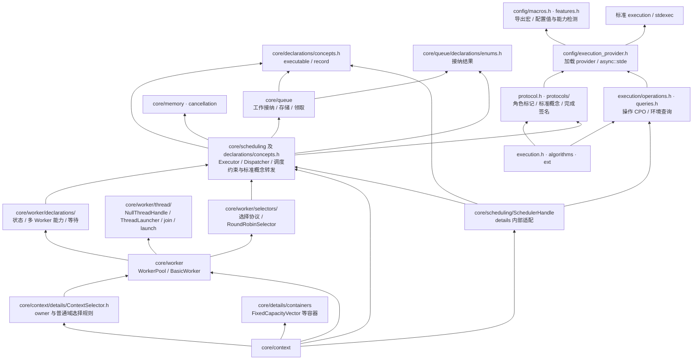
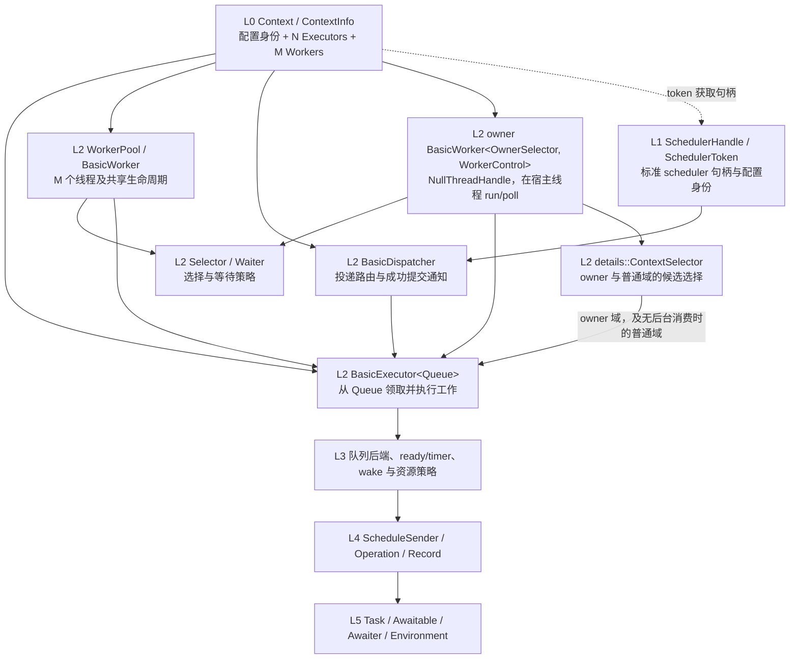
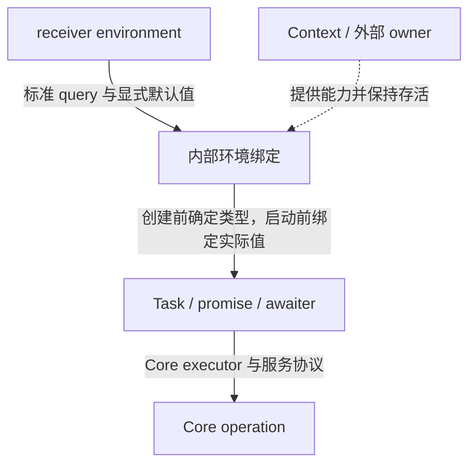
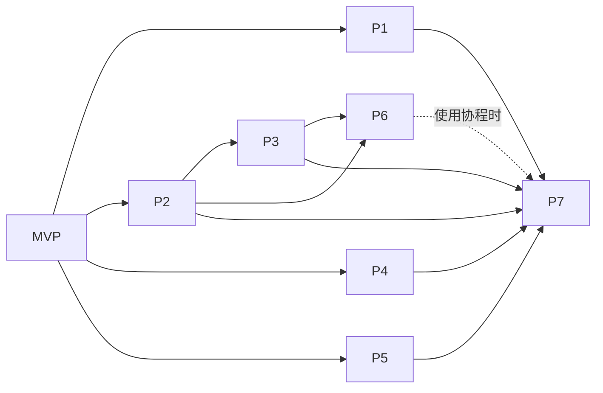

# Async Core 设计

本文规定 async 的目标架构、协议边界和运行时契约。当前 `include/async/core.h` 已接入 Context、Dispatcher、Executor 与统一的 BasicWorker/WorkerPool 组合，Context 的 owner 使用默认 NullThreadHandle 的 Worker；execution 提供 provider 选择、协议及组合算法重导出，`exec::ext` 尚未实现。当前代码按 C++23 构建；文中另行标明后续目标接口，当前运行示例位于 `tests/sandbox/sandbox.cpp`。

设计按使用者看到的组合关系自顶向下展开；后续能力顺序见本文第 12 节。修改协议或行为时，应同步更新类型关系、资源与完成契约及验收条件。

## 1. 目标、范围与命名

### 1.1 目标消费场景

首个消费目标是 LCFEngine 仓库 <https://github.com/mmmmmcree/LCFEngine.git> 的 `examples/shader_toy`，用于替换其 Asio 调度。本文提及该项目时均使用仓库 URL 与仓库内相对路径。

运行时组合 N 个 Executor、M 个 Worker，以及 render/gfx 等外部执行域。一个 Executor 专属 Context 的驱动线程，其他 Executor 由 Workers 消费；零 Worker 时宿主也能推进普通任务。专有系统通过 SchedulerHandle 选择提交目标和返回域，不读取物理 Worker 下标。

Core 应可嵌入、可由调用方驱动，独立支持 record、timer 和 coroutine。标准 sender/receiver 负责任务组合，公开 SchedulerHandle 直接满足标准 scheduler 协议，内部适配实现将运行时能力接入该模型。普通 sender 业务使用 CPU workers 不以协程实现为前提。

### 1.2 架构不变量

- Core 可以依赖标准 execution 协议及其操作/查询接口，provider 由公共 `config.h` 选择，统一别名为 `lcf::async::stde`。SchedulerHandle 直接实现标准 scheduler，适配细节留在 Core；仅需导出宏的基础声明、Queue 和容器按需包含 `config/macros.h`，调度概念统一通过 `protocol.h` 获取标准 execution 词汇。Core 不包含 execution.h、不调用 then/when_all 等组合算法，不使用 stdexec 私有类型；protocols 和 execution 的基础接口不反向依赖 Core。
- 公共 Core 类型通过模板、concept、CPO、ADL 和组合扩展，不建立公共继承体系。`std::pmr::memory_resource` 是预留的标准虚函数资源边界。
- queue/timer 默认借用调用方嵌入的节点；需要拥有闭包或状态时，必须明确分配来源、存活范围和回收路径。
- 已启动操作恰好完成一次。取消、拒收或关闭不能以静默丢弃节点代替完成；请求停止与销毁对象是不同动作。
- 完成可能同步发生，完成函数可能销毁 operation。发布 record 或交付完成后，不得继续假定其所属状态仍存活。
- 跨执行域恢复必须经过目标提交协议。不能因当前线程相同而隐式 inline，也不能把其他域的 continuation 直接作为对称转移结果。
- Core 不提供硬实时保证。预算不能抢占已开始的 C++ 函数、协程段、析构或用户 callback；队列的进展性质也不等于完整提交路径的延迟保证。

### 1.3 命名规则

非 execution 层遵循 LCFEngine 的 `agent-workspace/conventions/cpp-style.md`：普通类型和别名使用 PascalCase，非静态成员函数使用 camelCase，静态成员函数、自由函数、参数及局部变量使用 snake_case，concept 使用 `snake_case_c`。数据成员使用 `m_`，普通常量使用 `k_`，枚举值使用 `ePascalCase`；配置对象保留 `_info`，指针和句柄变量使用约定的语义后缀。

CPO 对象使用操作名的 snake_case，不加 k_ 或 _cpo；实现类型使用 PascalCase，标准 execution 的协议定制名保留标准形式。Core 当前直接使用满足 concept 的成员接口，不增加只有转发作用的 CPO。普通类文件与类名一致，集合文件使用 snake_case。模块内以 declarations/ 集中组织基础声明，按 concepts.h、enums.h、structs.h、aliases.h 分别存放概念、枚举、值结构体和模块级类型别名，内容较多时可按语义分组为 poll_structs.h 等；这些头包含使用所需的完整定义。declarations/ 只表示文件组织，不增加命名空间。类自身的类型别名保留在类内；独立的 AlgorithmTag 等类型仍可使用同名文件。不为分类创建空文件，也不用泛化的 types.h 混装不同职责。

core/declarations/concepts.h 仅保留跨模块的 executable 和 record 约束。EnqueueResult 描述 Queue 的接纳结果，归 queue/declarations/enums.h；Executor、Dispatcher 和调度适配沿用该结果，复用不改变其归属。Queue 约束归 queue/declarations/concepts.h；submitter、Executor、目标路由约束与标准 execution 概念转发统一归 scheduling/declarations/concepts.h。Worker 的状态、等待协议与多 Worker 能力归 worker/declarations/；线程入口别名、join/launch 协议及实现归 worker/thread/；通用选择器与选择协议归 worker/selectors/。Context 专属域的选择规则归 context/details/ContextSelector.h。同级头可用相对文件名，跨目录引用统一使用 <async/...>。

`core/` 是目录和依赖边界，不是 C++ 命名空间。Context、Executor、Worker、SchedulerToken、SchedulerHandle 与 Core concepts 位于 lcf::async。队列设施位于 core/queue，与 scheduling 并列；公开命名空间按 queue::intrusive/non_intrusive、mpmc/spmc/mpsc/spsc 分层，拓扑下的类名统一为 Queue，算法目录仅组织具体特化。标准角色词汇位于 protocols，标准操作、查询和算法位于 exec；实现细节使用各组件的 details。

execution 沿用标准/provider 命名，包括 `protocols::sender`、`exec::schedule`、`exec::get_env` 和 `exec::ext::then_expected`。`core/scheduling/declarations/concepts.h` 直接在 `lcf::async` 中用 `sender_c`、`receiver_c`、`scheduler_c`、`operation_state_c`、`receiver_of_c` 转发原概念；这些别名服务于 Core 的标准调度适配，execution 直接使用标准概念，不反向包含它们。SchedulerHandle 和内部适配的普通类型仍用项目命名，但 `connect/start/get_env`、`sender_concept`、`completion_signatures` 等协议定制名保留原样；语言要求的 `promise_type/await_suspend`、标准基础词汇和第三方引用亦不改名。适配实现位于 Core 的 details，用户直接取得 SchedulerHandle 并使用标准 CPO。

## 2. 分层、类型与所有权

### 2.1 编译依赖

标准 execution 协议是 Core 标准调度接口与 execution 算法共同使用的词汇。公共 config.h 聚合配置子头：config/macros.h 定义导出宏，config/features.h 检测能力并保留调用方/CMake 对 LCF_ASYNC_USE_STD_EXECUTION 的显式设置，config/execution_provider.h 加载选定 provider 并定义 async::stde。protocols/ 按角色重导出词汇，protocol.h 聚合这些头，不依赖项目 execution 目录。execution/operations.h 和 execution/queries.h 重导出操作及环境查询。core/scheduling/declarations/concepts.h 统一定义基础调度约束和标准概念转发，通过 protocol.h 加载 provider；Executor、Dispatcher、Worker 和 Selector 依赖该头，因而也间接加载 provider。基础 executable/record 约束、Queue 和线程协议仍可独立于 provider 编译。CPO 是实现形式，connect/start/schedule 也参与标准契约；这里按契约词汇、调用入口和组合算法的职责组织。基础工作机制仍由模块 declarations/ 与组件成员接口描述，不写进标准 sender 协议。



图中箭头表示“依赖”。core/queue 位于 scheduling 之下，不依赖调度类型或 execution provider。Core 各组件只包含自己需要的协议，memory 不因上图分组而依赖 scheduling；Context 是组合层，不被 Executor/Worker 反向包含。

| 入口/目录 | 职责 | 依赖边界 |
| --- | --- | --- |
| `config.h` | 聚合 macros、features 和 execution_provider 子头 | 包含它仍会加载 provider；不直接实现配置逻辑 |
| `config/macros.h`、`config/features.h` | 导出宏、能力检测与配置默认值；显式配置优先 | 不加载 execution provider；基础组件按需包含 |
| `config/execution_provider.h` | 加载标准 execution/stdexec 并定义 async::stde | 依赖 macros/features 和选定 provider；不依赖 Core、protocols 或项目 execution 层 |
| `core/declarations/concepts.h` | executable_c、work_record_c | 依赖公共宏和标准 concepts/type_traits；不依赖具体模块或 execution provider |
| `core/queue/declarations/enums.h` | EnqueueResult，队列接纳结果 | 只需公共宏；不包含 Queue 或 Executor 实现 |
| `core/queue/declarations/concepts.h` | work_queue_c、waiting_work_queue_c、stoppable_work_queue_c | 依赖基础工作协议与同目录 enums.h；不依赖 scheduling 或 provider |
| `core/scheduling/declarations/concepts.h` | work_notifier_c、record_submitter_c、indexed_record_submitter_c、work_executor_c、可选等待/停止能力及标准 sender/receiver/scheduler/operation_state 概念的 _c 转发 | 依赖基础工作协议、queue/declarations/enums.h 和 protocol.h，统一加载 provider |
| `core/worker/declarations/` | WorkerState、多 Worker 能力与等待协议 | enums.h 只需公共宏；concepts.h 依赖 scheduling/declarations/concepts.h |
| `core/worker/thread/` | NullThreadHandle、ThreadLauncher、ThreadEntry、join/launch 协议及 owner 线程绑定 | 独立线程词汇不依赖 execution provider；不包含选择器或 Context |
| `core/worker/selectors/` | executor_selector_c 与通用选择策略；当前提供 RoundRobinSelector | 依赖调度概念，不依赖线程句柄或 Context；具体 Context 策略留在 context/details/ |
| `core/worker/details/` | WorkSignal 的版本通知与 WorkerControl 的停止/关闭等待状态 | 不依赖 Dispatcher；Dispatcher 只通过 work_notifier_c 消费通知能力，不包含这些内部实现 |
| `protocol.h`、`protocols/` | 按角色重导出标准标记、概念、完成签名，位于 async::protocols | 直接依赖 config/execution_provider.h；不依赖项目 execution 层或 Core |
| `execution/operations.h`、`execution/queries.h` | 操作 CPO、查询及其类型，位于 async::exec | 直接依赖 config/execution_provider.h；不包含 Core 或组合算法聚合头 |
| `execution/factories.h`、`continuations.h`、`composition.h`、`scheduling.h` | sender 工厂、完成接续、合流、调度切换算法，位于 async::exec | 各自直接依赖 config/execution_provider.h；由 execution.h 聚合；Core 不包含算法头 |
| `core/memory`、`core/cancellation` | 资源策略、对象分配、取消状态与 registration | 按需使用标准资源/stop vocabulary |
| `core/details/containers` | 容器的元素生命周期、容量、布局与访问；内部 FixedCapacityVector 的容量在运行期确定，之后不扩容 | 使用显式 allocator；不依赖 Context、execution 或具体 queue；memory 负责资源策略，容器负责管理元素 |
| `core/queue` | 工作接纳、存储、领取及并发/存活契约；按存储结构、拓扑和算法组织 | 与 scheduling 并列；当前实现只依赖本模块 declarations/enums.h、具体节点和标准同步设施，不包含 concepts.h、Executor、Worker、Context 或 execution provider |
| `core/scheduling` | Executor、Dispatcher 与标准 scheduler 句柄 | Dispatcher 路由提交，Executor 消费 Queue；不包含 Worker、Context 或事件源管理 |
| `core/worker` | 统一执行驱动、消费选择与等待策略、Worker 及后台池的生命周期 | BasicWorker 驱动选中的 Executor，默认使用 NullThreadHandle 在调用线程运行，显式 launcher 可启动后台线程；不包含 Context |
| `core/context/details/ContextSelector.h` | 组合 owner Executor 与普通消费选择，判断宿主可消费的域 | 借用普通 WorkerPool 与 owner Executor；不执行工作或等待 |
| 后续 `core/timer`、原生事件后端 | deadline 索引、计时操作与事件就绪 | 事件循环通过 owner Worker 的 Selector/Waiter 组合，不再另写一套驱动循环 |
| `core/coroutine` | Task、promise、awaiter、frame 与 continuation policy | Core 能力及语言协程协议 |
| `core/context` | 拥有并组装 N 个 Executor、Dispatcher、后台 WorkerPool 与一个本线程 owner Worker | Context 提供创建、启动及 run/poll 预算入口；owner 与后台 Worker 共用 BasicWorker 的执行循环，不拥有业务 root scope |
| `execution.h`、后续扩展算法 | 聚合标准词汇、操作/查询接口、标准算法和扩展算法 | 复用统一协议；不依赖 Core |
| `core/scheduling/details/` | 内部 sender/operation 的接纳、执行与完成适配 | 使用 Core 提交接口、概念别名和标准 operations/queries；不建立公开 adapters API，不被基础 queue/executor 反向包含 |

`core.h` 聚合 Core；`execution.h` 聚合标准协议和算法，`async.h` 是总入口。这些入口均加载 provider。基础 executable/record、Queue、独立的枚举/别名和值结构体头仍可单独使用，无需 stdexec include 路径；包含调度概念或依赖它的运行时组件时则需要所选 provider。标准协议依赖与编译成本分别评估：当前 stdexec 入口可能包含大量实现，不能仅由命名为 protocol 就推断编译成本很低。

当前运行时文件组织如下；timer、coroutine 和原生事件后端没有增加占位实现：

```text
core/
├─ declarations/concepts.h
├─ scheduling/
│  ├─ declarations/concepts.h
│  ├─ BasicExecutor.h
│  ├─ BasicDispatcher.h
│  ├─ SchedulerHandle.h
│  └─ details/
│     ├─ dispatch_targets.h
│     └─ exec_schedule_adapters.h
├─ worker/
│  ├─ BasicWorker.h
│  ├─ WorkerPool.h
│  ├─ declarations/
│  │  ├─ concepts.h
│  │  └─ enums.h
│  ├─ thread/
│  │  ├─ NullThreadHandle.h
│  │  ├─ ThreadLauncher.h
│  │  ├─ declarations/
│  │  │  ├─ concepts.h
│  │  │  └─ aliases.h
│  │  └─ details/OwnerThreadBinding.h
│  ├─ selectors/
│  │  ├─ declarations/concepts.h
│  │  └─ RoundRobinSelector.h
│  └─ details/
│     ├─ WorkSignal.h
│     └─ WorkerControl.h
├─ context/
│  ├─ BasicContext.h
│  ├─ ContextInfo.h
│  ├─ declarations/poll_structs.h
│  └─ details/ContextSelector.h
├─ details/containers/FixedCapacityVector.h
└─ queue/
   ├─ declarations/
   │  ├─ concepts.h
   │  └─ enums.h
   └─ intrusive/
```

### 2.2 自顶向下的运行时类型图

箭头表示组合、提交或驱动关系，不表示继承。Context 内的 SchedulerHandle 借用 Dispatcher 并携带逻辑目标身份；独立使用时仍可直接借用 Executor。Dispatcher 选择提交入口，消费选择策略决定尝试哪个 Executor，Executor 从 Queue 取出并执行工作；线程资源由 Worker 持有。逻辑调度目标数量与物理 Worker 数量相互独立。



| 层 | 目标类型 | 定位与功能 | 所有权 |
| --- | --- | --- | --- |
| L0 | `BasicContext`、`async::Context` | 组合配置身份、资源和工作流生命周期入口 | 拥有普通 Executor 数组、专属 Executor、Dispatcher、后台 WorkerPool、本线程 owner Worker 及其控制/绑定状态 |
| L0 | `ContextInfo` | 配置 Worker 数量与 allocator，登记逻辑目标并计算存储需求 | 保存配置域、计数和借用的资源；后续按需加入 QueueConfig |
| L1 | `SchedulerToken` | 配置阶段签发的域 ID 与目标下标，供 Context 创建后查询句柄 | 两个 uint32_t，可复制；与 SchedulerHandle 同在 SchedulerHandle.h |
| L1 | `SchedulerHandle<Submitter>` | 自带逻辑身份，满足标准 scheduler；Context 句柄向 Dispatcher 提交，独立句柄可向 Executor 提交 | 保存非拥有 submitter 指针、域 ID 和下标；可复制，不延长资源寿命 |
| L1 | `ProducerEndpoint` | 固定 producer 预登记的低延迟提交入口 | 借用专用 lane，遵守 producer 限制 |
| L2 | `BasicExecutor<Queue>` | 接纳 Record，从 Queue 取出可执行对象并调用 execute；不创建线程 | 持有 Queue，可由多个 Worker 和宿主并发驱动 |
| L2 | `BasicDispatcher<Executor, OwnerExecutor, Notifier>` | 逻辑目标到普通/owner Queue 的投递路由，成功后通知相应驱动者 | 借用稳定 Executor 数组、owner Executor 和两个满足 work_notifier_c 的通知对象；不执行工作或依赖具体 Worker 类型 |
| L2 | `RoundRobinSelector<Executor>` | 通过 visitNext 提供有限个候选 Executor，每次成功后从下一项继续 | 位于 worker/selectors/，借用 Executor span；游标属于每个 Worker，不使用共享原子游标 |
| L2 | `BasicWorker<Selector, Waiter, ThreadHandle = NullThreadHandle>` | 组合选择、单步执行及等待循环，维护运行状态；显式 launcher 构造可启动后台执行 | 拥有 Selector、状态与 join 句柄，借用 Waiter，析构自动 join；Null 句柄的构造/join 均为空操作，不关闭借用执行域 |
| L2 | `WorkerPool<Executor, ThreadHandle>` | 创建 Worker 存储、启动与 join，管理共享停止/关闭状态 | 拥有 Worker 数组和 WorkerControl，借用普通 Executor span 与通知信号 |
| L2 | `details::ContextSelector` | 为 owner Worker 提供普通/专属 Executor 候选，并保持两类工作的轮转 | 借用 owner Executor、WorkerPool 和普通 Executor span；后台线程运行期间只选择 owner 域 |
| L2 | `NullThreadHandle`、`ThreadLauncher<ThreadHandle>` | 统一无线程句柄与真实线程句柄的构造、观察和 join | 位于 worker/thread/；Null launcher 不启动 entry，真实后端按契约在独立线程执行 entry |
| L3 | `details::WorkSignal` | Worker 内部的版本通知及等待握手，防止丢唤醒 | 位于 worker/details/，两个信号由 Context 保活并作为 Notifier 注入 Dispatcher |
| L3 | `queue::intrusive::mpmc::Queue<>`、`queue::intrusive::spmc::Queue<>`、后续 non_intrusive 后端、`BoundedProducerLane`、`InboxSet` | 实现 producer 入口、多 consumer 消费及公平/优先级选择 | node 借用；实际策略兑现并发与进展契约 |
| L3 | `IntrusiveReadyQueue`、`HeapTimerIndex`、`TimerNode` | owner-local ready/backlog 与 deadline 索引 | node 嵌入 operation；动态 backing storage 来源明确 |
| L3 | `Clock`、`WakePolicy`、`std::pmr::memory_resource`、`allocation_resource_c`、`StopState` | 时钟、等待握手、分配能力与取消支持 | 策略或具体状态；资源引用非拥有 |
| L4 | `details::ScheduleSender`、`details::ScheduleOperation` | connect 后保存 receiver/record，start 时经句柄向 submitter 提交 | operation owner 持有稳定存储至最后访问 |
| L4 | 满足 `work_record_c` 的 operation record、`TimerOperation` | 一次调度/计时操作的执行与完成状态 | Queue/index 仅借用；Core 不提供公共 operation 基类 |
| L5 | `Environment<Executor, Allocator, StopToken>` | 注入执行、分配及取消能力 | 持有能力值；服务由各自 owner 保活 |
| L5 | `Task<T, Environment, FramePolicy>`、`promise_type` | 管理协程结果、环境、continuation 与 frame | Task/root owner 管理，不由 Context 自动接管 |
| L5 | `ScheduleAwaitable`、`SleepForAwaitable`、`SleepUntilAwaitable`、`ScheduleAwaiter`、`TimerAwaiter` | 描述 co_await 操作，注册挂起状态并恢复 | awaiter 嵌入或借用一次操作状态 |

### 2.3 各层需要的协议

| 协议 | Core 基础机制 | execution 通用层 | Core 调度接口/内部适配 |
| --- | --- | --- | --- |
| record、executor、接纳/拒收与存活 | 定义和实现 | 不需要 | 提交并映射完成 |
| queue、timer、clock、wake、资源/取消策略 | 按组件使用 | 不读取具体实现 | 按操作接入能力 |
| C++ coroutine/awaitable | 实现 | provider 协程工具按需使用 | 桥接 sender 与 awaitable |
| sender/receiver、completion signatures、operation state | 按实际需要使用标准定义 | 使用 provider 定义 | 实现具体 sender/operation；用 _c 概念转发约束 |
| `connect/start/set_value/set_error/set_stopped` | 驱动 queue 本身不需要 | 使用 provider CPO | 连接、启动并翻译 Core 结果 |
| 标准 scheduler、environment/query/forwarding | queue/executor 不必实现 | 使用 provider 协议 | SchedulerHandle 直接满足 scheduler；环境按标准查询 |
| allocator、stop token | 使用标准基础词汇和策略 | 通过标准 query 使用 | 保存、转发及适配 |

基础 record 可用静态完成函数或 continuation 交付结果；Core 的标准调度接口直接复用已有 sender/receiver 协议，无需再定义一套替代协议。

## 3. Core 提交协议与一次操作

### 3.1 可执行对象、Record 和提交者

最小提交单位是具有明确存活范围的 record，不是裸 coroutine handle。Core 按消费方所需能力定义三种约束：`executable_c` 描述可执行对象，`work_record_c` 描述提供可执行对象的工作记录，二者定义在 `core/declarations/concepts.h`；`record_submitter_c<Submitter, Record>` 描述对实际 Record 的接纳能力，定义在 `core/scheduling/declarations/concepts.h`。接纳结果 EnqueueResult 定义在 `core/queue/declarations/enums.h`，基础 executable/record 约束不依赖它。

```cpp
namespace lcf::async {

enum class EnqueueResult
{
    eAccepted,
    eFull,
    eClosed,
};

template <typename Executable>
concept executable_c = requires(Executable & executable) {
    { executable.execute() } noexcept -> std::same_as<void>;
};

template <typename Record>
concept work_record_c = requires(Record & record) {
    { record.getExecutable() } noexcept;
    requires std::is_lvalue_reference_v<decltype(record.getExecutable())>;
    requires executable_c<std::remove_reference_t<decltype(record.getExecutable())>>;
};

template <typename Submitter, typename Record>
concept record_submitter_c = work_record_c<Record> and
    requires(Submitter & submitter, Record & record) {
        { submitter.tryEnqueue(record) } noexcept -> std::same_as<EnqueueResult>;
    };

} // namespace lcf::async
```

`Executable` 不要求是节点、继承某个类型或存储队列链接；只要求 `execute() noexcept -> void`。Record 通过 `getExecutable()` 返回可执行对象的稳定左值引用。引用所指对象可以内嵌于 operation 或独立存储，由 owner 保活到最后访问。具体 Queue 是否接纳这个对象，由 BasicExecutor 的实际提交接口检查；`ExecutionNode` 只是默认侵入式队列采用的实现类型。

concept 检查成员表达式、返回类型和 noexcept；运行时直接调用 `record.getExecutable()` 与 `submitter.tryEnqueue(record)`。Core 不为这些成员增加同义 CPO 转发层。只有出现需要支持的独立定制协议时，才在实际边界引入定制点。标准 execution 的 CPO 继续复用 provider。

`record_submitter_c<Submitter, Record>` 按 Submitter 的实际 cv 限定检查；const handle 可经借用指针访问非 const executor，不需要将 queue 整体标为 mutable。提交能力不捆绑工作驱动、timer、allocator 或 scope 计数。`eFull` 属于未来有界入口；MVP 的无界 intrusive queue 只需 `eAccepted/eClosed`。

接口检查不能证明线程安全、地址稳定或恰好一次。实现还需声明 producer 数量、线程限制、顺序、容量和进展性质；这些语义由实现与验证兑现。

### 3.2 接纳与完成契约

| 事件 | record/operation 的责任 |
| --- | --- |
| 构造操作 | owner 持有输入与稳定状态，尚未发布；不隐式执行工作 |
| `eAccepted` | 运行时取得排队访问权；owner 仍负责存储存活，运行时必须执行或按取消/关闭契约交付完成 |
| `eFull/eClosed` | 不接管 record；operation/adapter 按声明处理拒收或保留为尚未提交的业务工作 |
| 执行、取消、到期竞争 | 只允许一个完成胜者；队列摘除不等于所有并发访问已经结束 |
| 完成交付 | 完成函数可能销毁 operation；交付后不得继续访问其成员 |
| 最后访问结束 | owner 才能释放或复用状态；节点脱链、取消 registration 和回收记录也需结束 |

提交不在调用线程 inline 执行 record，但其他 owner 可在发布后、提交返回前消费它。提交实现和 start 路径必须处理这种竞争，不能在发布后再次读取已可能销毁的 operation。

ready queue 和 timer index 不执行 receiver，也不在内部锁下调用用户代码。关闭必须兑现已接纳操作；continuation 入队失败时要有预留容量、有效完成通道或其他明确契约，不能丢失完成，也不能在错误线程直接恢复以伪装成功。

### 3.3 协议复用与边界

`using lcf::async::record_submitter_c;` 可把同一 concept 引入其他命名空间；需要改名时，可定义带完整参数的转发 concept `runtime_submitter_c = record_submitter_c<Submitter, Record>`。concept 不是类型，不能用类型别名语法替代；通常不新增同义公共名字。

约束放在实际消费能力的位置。BasicContext<Executor, ThreadHandle, LoopExecutor> 只对普通 Executor 要求 multi_worker_executor_c；专属 LoopExecutor 使用 work_executor_c。BasicWorker 分别约束 executor_selector_c、worker_waiter_c 与 join_handle_c；等待约束位于 core/worker/declarations/concepts.h，选择约束位于 core/worker/selectors/declarations/concepts.h，线程约束位于 core/worker/thread/declarations/concepts.h。当前两种具体 Executor 均须可默认构造：专属对象随 Context 构造，普通对象在 create 中构造；启动阶段检查 thread_launcher_c，不增加单独的工厂类型或工厂概念。SchedulerHandle 在实际 tryEnqueue 成员上按 Record 检查 record_submitter_c 或 indexed_record_submitter_c，不人为选择 probe record；内部 receiver_of_c 复用标准完成签名。

indexed_record_submitter_c 定义在 scheduling/declarations/concepts.h，描述 tryEnqueue(uint32_t target_index, Record &) noexcept -> EnqueueResult。Context 的 Dispatcher 实现该路由接口；独立 Executor 保留不带目标下标的提交接口。SchedulerHandle 对具备索引提交能力的对象传递逻辑目标，下标只表示执行域，不是 Worker 编号。该能力不要求 submitter 具备 executeOne、等待或线程接口。

Core executor 不自动满足标准 scheduler，标准 scheduler 也不自动满足 `record_submitter_c`。反向接入外部 scheduler 时，需要显式 adapter 管理 `schedule/connect/start` 的 operation state 和失败映射，不能强制要求其提供旧版 `enqueue/workStarted/workFinished` 等额外成员，也不能继承低延迟入口的保证。

## 4. 资源、取消与存活

### 4.1 存储来源

`memory_resource` 只解决字节分配，不决定对象共享、arena/pool 选择、并发访问和释放时机。这些由具体 policy 或值类型承担，不再定义带虚函数的 AllocationStrategy。

| 对象 | 资源来源与管理方式 |
| --- | --- |
| Context 配置与固定运行时数组 | ContextInfo 保存域、计数与资源绑定；普通 Executor 与 Worker 各一块固定 typed storage；专属 Executor 和等待状态内嵌 |
| queue/timer backing storage | 各自存储 owner 消费的容量与 allocator/policy；不自动使用 Context 数组 allocator |
| record、timer node、connect 返回的 operation、adaptor 成员 | 优先嵌入 owner 的稳定存储，不因统一接口而强制堆分配 |
| async 自有操作的额外动态存储和 owning post 闭包 | receiver 环境可查询的 allocator 优先，否则使用操作绑定的显式 Context 默认值 |
| 无 Context 的 execution 操作 | 自身契约要求 allocator，或调用方显式选用默认资源 |
| coroutine frame | 创建前确定的 FramePolicy；不受后续 start 时环境更改追溯影响 |
| 用户值、异常对象、第三方算法、线程/系统对象 | 分别声明边界，不能声称全部受 Context PMR 控制 |

`memory_resource` 提供字节后端，`polymorphic_allocator<T>` 把元素数量转换为带对齐的申请。PMR 容器从 resource 指针构造是合法便捷接口，不能把接受一个 resource 参数等同于完整的资源设计。每项存储仍需声明数量、容量、分配/释放线程、失败行为与寿命。

ContextInfo 默认构造后通过 setWorkerCount、setAllocators 和 addScheduler 配置，setter 返回 Self &，addScheduler() noexcept 直接返回 token。context_info.storageRequirements<Executor, ThreadHandle>() 按实际后端报告普通 Executor 数组和 Worker 数组的字节数/对齐，默认参数对应 Context；专属 LoopExecutor 内嵌，不计入数组申请。ContextAllocators 分别绑定两块数组资源；未绑定时使用 null_memory_resource，零普通目标、零 Worker 的配置也可直接创建。

普通 Executor 和 Worker 固定数组由 `core/details/containers/FixedCapacityVector.h` 管理：默认构造为空，带容量和 allocator 的构造函数申请存储，逐步构造元素且不迁移已有对象；每个非空数组一次 typed allocation。容器不提供 create 延迟创建接口；Context::create 构造临时容器并移动赋值替换成员，失败回滚时用空容器替换。移动只转移缓冲区及其释放资源，不移动元素。Context::create 建好 Executor 并预留 Worker 存储，startWorkers/run 再创建线程；创建后的 Executor 地址保持稳定。

FixedCapacityVector 使用标准容器命名与类型别名，提供 emplace_back、pop_back、clear、data、size、capacity、empty 及正向、反向和 const 迭代器。内部 span 仅描述已构造元素，单独保存分配容量和释放资源；span 不接管对象生命周期。使用 range-for 和标准 ranges 算法遍历，需要视图时直接构造 std::span{container}，不提供 values() 包装接口。

有效下标、非空访问和剩余容量属于调用前置条件，仅以 assert 诊断，不抛出越界或容量耗尽异常，也不提供 at。emplace_back 使用 noexcept(std::is_nothrow_constructible_v<Value, Args...>)，只允许元素构造异常，并在构造成功后更新已构造范围；带容量构造的异常来自 allocator。平凡析构类型的 pop_back 只缩短范围，clear 直接清空范围；非平凡类型逐个析构。

数量确定后，用正确对齐的有界缓冲区和 null upstream 可以证明元数据无堆 fallback；合并多个数组时必须计入各段对齐，pool 的 chunk/缓存量不能用元素字节数代替。兼容的生命周期与线程需求允许宿主显式共用 resource，但不能默认把所有需求汇入一个 Context resource。运行示例按配置查询容量并为两块数组绑定有界资源；无异常分配能力另按本文第 4.4 节选择。

资源来源显式绑定，不在深层偷偷调用全局 `get_default_resource()`；便捷兼容工厂如 `with_default_resource` 应明确命名。

标准 `get_allocator` 返回 allocator，不是裸 `memory_resource *`；PMR 可用 `std::pmr::polymorphic_allocator` 表达，普通 allocator 走其分配/释放协议，不能统一调用 `.resource()`。标准 query 本身没有 allocator fallback，Context 默认值由宿主/桥接入口显式提供。`execution/queries.h` 重导出 provider 的 `exec::get_allocator`，不新增同义查询。

### 4.2 分配和回收策略

| 策略 | 适用范围 | 必须说明的限制 |
| --- | --- | --- |
| 直接 resource / 显式 `new_delete_resource` | 基线和兼容路径 | 每次分配成本；不得作为隐藏默认 |
| `synchronized_pool_resource`、线程安全 slab | 跨线程短命状态 | 同步与上游成本 |
| `unsynchronized_pool_resource` | 严格单线程分配/释放 | executor 单 consumer 不代表资源只在该线程访问 |
| monotonic/arena | 一批对象整体结束 | 逐个取消不等于立即回收存储 |
| 固定块、recycling/free-list、inline storage | 已有数据支持的热点对象 | 容量耗尽、对齐、扩容及跨线程回收 |

每次分配必须保留释放所需的 allocator/resource、大小和对齐，或由 policy 保证可恢复；不能在释放时重新查询已变更的环境。producer 可能创建状态，worker 或 receiver 可能销毁它；使用线程安全资源，或显式将回收归并到 resource owner。回收记录计入未完成工作，owner/resource 必须保持到 drain。

资源验收覆盖正常/同步完成、构造失败、connect/await_suspend 失败、拒收、取消、关闭、完成中销毁及跨线程释放，不仅检查成功路径。

### 4.3 Hook、统计和特殊分配行为

标准 PMR 路径通过派生 `std::pmr::memory_resource`，在 `do_allocate/do_deallocate` 中包装上游 resource，加入统计、诊断或其他分配策略；`do_is_equal` 保持资源相等与可互相释放的契约。这里使用预留的标准虚函数边界，不新增 async 自有虚基类或转发 Handle。例如宿主可提供：

```cpp
app::TrackingMemoryResource tracked_resource{upstream_resource, statistics};
ContextInfo context_info;
context_info.setWorkerCount(worker_count).setAllocators(ContextAllocators{
    std::pmr::polymorphic_allocator<std::byte>{&tracked_resource},
    std::pmr::polymorphic_allocator<std::byte>{&tracked_resource}});
Context context;
if (auto error = context.create(context_info)) { return error; }
```

这里的 hook 跟踪 Context 运行时普通 Executor 与 Worker 数组。ContextInfo 登记目标只计数并借用资源；后续 QueueConfig 容器的配置期分配与运行时 typed storage 分开管理。

execution 的普通 allocator 可通过 allocator wrapper 加入同类行为。无异常 resource 则通过满足 `allocation_resource_c` 的组合装饰器包装 `tryAllocate/deallocate`；其 hook 也须不抛异常，不能因记录一次分配而递归触发被跟踪的分配器。

统计明确区分请求字节、成功/失败次数、当前存活字节、峰值和上游实际保留量。分配失败不增加存活字节，释放与原分配对应；多线程计数及记录状态遵守所选 resource 的并发契约。外层装饰器看到的是该层的请求，上游装饰器看到的是 pool/slab 的实际补充，二者不混为同一指标。

统计仅覆盖显式经过该 resource/allocator 的调用。独立 allocator、第三方内部存储和编译器消除的 coroutine frame 不会自动计入；装饰器、上游及统计状态均须覆盖最后访问。

### 4.4 无异常分配与失败返回

若要求分配失败返回错误码且调用 `noexcept`，保证必须由实际字节分配后端实现。`std::pmr::memory_resource::allocate` 和标准 allocator 的 `allocate` 都返回指针并采用失败抛异常的契约；不能只在外面加 `noexcept`、失败时返回 nullptr，或用统计 hook 改写成可恢复错误。

这项需求采用独立的 Core `allocation_resource_c` 协议，放在 `core/memory/allocation.h`，以模板和组合扩展，不依赖 execution，也不新增公共继承体系。C++20 基线用值类型表达结果，避免为基础分配协议要求 `std::expected`：

```cpp
namespace lcf::async {

struct AllocationResult
{
    void * m_storage_p;
    std::error_code m_error;
};

template <typename Resource>
concept allocation_resource_c = requires(
    Resource & resource,
    std::size_t bytes,
    std::size_t alignment,
    void * storage_p) {
    { resource.tryAllocate(bytes, alignment) } noexcept -> std::same_as<AllocationResult>;
    { resource.deallocate(storage_p, bytes, alignment) } noexcept -> std::same_as<void>;
};

} // namespace lcf::async
```

| 层次 | 契约与责任 |
| --- | --- |
| 字节 resource | `tryAllocate(bytes, alignment) noexcept -> AllocationResult`；成功返回有效存储与空 error，失败返回 nullptr 与非空 error，且不遗留须调用方回收的分配；`deallocate` 不抛异常 |
| typed allocator/helper | 检查元素数量乘法溢出和对齐，调用后端并传递错误；构造失败时释放原存储。无异常创建还须约束构造/析构及实际使用的移动操作，字节分配不抛不能保证任意 T 的构造不抛 |
| operation/Task/宿主 | 在各自的创建、connect、start 或 frame 分配阶段交付失败；尚未建立 receiver 的失败用创建结果表达，不能假装已进入 sender error 通道 |

`AllocationResult` 的判别依据是 error；成功/失败的指针关系及零字节、过对齐、容量耗尽的具体规则在最小协议用例中冻结。为恢复原状态而使用的后端清理也在 `noexcept` 边界内。concept 检查返回类型和 noexcept，失败注入测试验证真实语义。

普通资源路径与显式无异常路径分别声明。严格路径从可报告失败的后端开始，不默认通过 try/catch 适配任意 PMR；若提供异常捕获兼容 adapter，必须显式命名并只在启用异常的配置使用。标准 allocator 的 allocate 入口仍须遵守标准契约，其额外 try 分配能力供 async 的受限路径使用；第三方代码只调用标准入口时，不自动获得错误码返回。

标准 `get_allocator` 本身不保证可恢复的无异常分配。受限 operation 对所选 allocator/resource 检查额外能力或声明其不分配条件；无法满足时明确诊断，不能忽略用户 allocator 覆盖而偷偷换成 Context 默认。严格资源的具体类型和值通过显式 ResourcePolicy/工厂绑定，静态类型在创建对应对象前确定，不能塞入普通 PMR 引用冒充同一契约。

资源策略的扩展落在实际存储 owner 上：Queue、timer、operation 和 FramePolicy 各自消费所需能力。ContextAllocators 只覆盖对象数组；当前普通与专属 Executor 均默认构造，后续确有 Queue 参数时由对应创建配置承载。默认 intrusive Queue 没有动态 backing storage，不接收无用 allocator。PMR 装饰器支持统计，无需增加只有转发作用的 ResourcePolicy。

线程资源独立于容器。`std::thread` 的启动状态、栈和系统句柄没有标准 PMR 注入接口；MVP 用 `BasicWorker<Selector, Waiter, ThreadHandle>`、`join_handle_c` 和 `thread_launcher_c<Launcher, ThreadHandle>` 暴露后端，线程词汇定义在 core/worker/thread/。真实线程后端由 launcher 在独立线程恰好调用一次 entry，返回句柄代表该执行；join 等待该执行结束并与其完成同步。NullThreadHandle 也满足 join_handle_c，提供空的 `(ThreadEntry, void *)` 构造、恒为 false 的 joinable 和空 join；ThreadLauncher 统一构造所选句柄，Null 构造不调用 entry。通用代码不对 Null 类型特化，也不把空启动误作同步执行；本线程执行由 worker.run/executeOne 显式发起。检查表达式不能证明实际线程行为，语义须由实现及集成测试兑现。ThreadLauncher<std::thread> 的线程资源不受 allocator 控制；严格路径用受控后端或本线程 Worker 推进 Executor。mutex/CV 的平台资源、provider 算法、异常对象和用户值同样单独审查。

`allocation_resource_c` 是供无异常存储 helper/FramePolicy 消费的另一种能力；它不能直接替换标准 PMR allocator。当前 Context::create 提供 noexcept 错误码边界，内部仍捕获标准 PMR 与系统资源构造异常；这不等于禁用异常的实现。全无异常创建还需要实际不抛异常的分配与线程后端。新增存储策略必须覆盖原资源释放、构造回滚、容量失败和跨线程回收；具体结构及默认策略仍由 benchmark 决定。

仅有 hook、pool、slab、arena 或跨线程回收不要求新增分配接口；错误码和无异常失败语义才是上述扩展协议的依据。分配协议也不使线程创建、第三方算法或整个 execution pipeline 自动变为无异常。

### 4.5 取消与任务 owner

请求停止、操作响应取消、停止业务准入、最终关闭执行资源和销毁对象分别定义。可以复用标准 stop vocabulary，也可在满足资源/并发约束时实现 intrusive state/registration；选择不改变操作完成契约。

registration 处理注册与 request_stop 的竞争，以及析构期间 callback 正在运行的情况。用户 callback 不在 queue/timer 内部锁下执行；取消、到期和正常完成必须只有一个胜者。

业务 root owner/scope 管理稳定 operation 存储、stop source、未完成计数和结果交付。Context 管执行资源，不自动收集所有 root；空队列不代表没有挂起的 I/O、timer、子操作或回收工作。完整关闭顺序见第 9 节。

## 5. Dispatcher、执行驱动、队列与 timer

### 5.1 投递、消费选择与执行驱动

`BasicExecutor<Queue>` 负责接纳和单步执行，不选择物理 Worker、不创建线程。独立使用时可通过 waitAndExecuteOne 等待自己的 Queue。Context 中的投递由 Dispatcher 路由，消费选择由 Selector 决定，BasicWorker 调用候选 Executor 的 executeOne；不能逐个阻塞等待某个 Queue。Queue 的发布、关闭和节点存活契约保持独立。

Context 中的普通 Executor 由 M 个同类后台 Worker 共享。BasicDispatcher 依据稳定目标下标直接投递普通或 owner Queue：普通工作通知后台等待者与 owner Worker，owner 工作只通知 owner Worker。Dispatcher 通过 work_notifier_c 仅要求 notifyOne() noexcept，不包含 Worker 内部实现；Context 注入两个 WorkSignal。投递不扫描 Worker 状态、不新增全局队列锁，投递后不再访问 record。当前映射是一目标一 Executor，后续路由策略可改变映射而保留句柄身份。

每个 BasicWorker 持有自己的 Selector。后台 Worker 使用 RoundRobinSelector，owner Worker 使用 ContextSelector；选择过程有限，不通过全局原子游标竞争。选择器通过 visitNext(visitor) 访问一个候选，返回 false 表示本轮耗尽；BasicWorker 提供 visitor 并调用候选的 executeOne。该接口允许不同具体类型的 Executor 共用一轮选择，不要求共同基类或类型擦除，也不为每次扫描创建 generator 协程帧。选择器不提前领取或预留工作；实际领取与执行仍属于 Executor。WorkerControl 提供停止/关闭状态与版本等待，后台集合与 owner 分别使用实例。BasicWorker 在扫描前 observe，扫描无工作后按相同版本 wait，避免发布与入睡竞争丢唤醒。后台信号与 owner 信号分离，后台 Worker 不会抢走 owner 工作的唤醒。

WorkSignal 位于 worker/details/WorkSignal.h，服务于后台和本线程 Worker。其序号表示通知版本，wait(observed) 等待版本变化；通知不代表可领取的任务数，也不提供等待计数达到指定目标的接口。因此保留 WorkSignal 命名；TimelineSemaphore 通常表达等待单调计数达到目标值的协议，与当前版本通知语义不同。Notifier 的概念只检查通知接口；实际等待后端仍须兑现发布与休眠之间不丢唤醒的语义。

Context 的 owner Worker 使用默认 NullThreadHandle，与后台 Worker 共用 BasicWorker 的执行循环。ContextSelector 决定消费范围：没有可 join 的后台句柄时，宿主轮转推进 owner 与普通 Executor；后台集合运行期间只选择 owner 域。WorkerPool 按实际句柄的 joinable 状态建立运行标记，空句柄的 Worker 数量不会阻止宿主参与普通工作。首次 run/poll/pollOne 的线程由 worker/thread/details/OwnerThreadBinding 建立 owner，后续驱动保持同一线程，禁止重入或并发驱动。后台 Selector 不包含 owner Executor。只有普通共享 Executor 要求 multi_worker_executor_c；专属 LoopExecutor 只要求 work_executor_c。

BasicWorker 在构造时直接保存 Selector、绑定 Waiter 并初始化运行状态；只接收 Selector/Waiter 的构造不启动线程，随后在本线程 run/executeOne/waitAndExecuteOne。RoundRobinSelector 的默认状态为空候选范围；WorkerControl 在构造时绑定通知信号。BasicWorker 需要有效的 Waiter，不提供未绑定的默认状态或 create；Context 随自身构造就绑定空 Pool、owner Worker 与相应控制对象。接收 launcher 的构造在初始化选择器、等待对象与状态后才调用 launcher；后台入口直接使用这些已初始化成员，不读取尚在构造中的线程句柄。默认句柄为空时启动无效果，真实句柄则持有后台执行。所有句柄共用相同代码路径，析构统一 join；本线程驱动前应先 join 已启动的后台执行，同一个 Worker 不得并发驱动。

事件循环表示 owner Worker 与事件源、ready 域和等待后端的组合。当前只有工作通知，直接复用 WorkerControl；不保留重复的 ContextDriver/EventLoop 轮询包装。原生事件后端后续实现所需的 Waiter 与就绪能力：等待时处理事件到达并发布 ready work，BasicWorker 仍负责统一的执行循环。Context 自身保留 poll 的预算和 owner 入口约束。

WorkerState 的 eIdle、eSearching、eExecuting、eWaiting、eStopped 是运行状态快照，不是任务优先级或执行资格。当前执行是非抢占式，多个 Worker 竞争领取不表示抢占 callback。Selector 与 Waiter 分别是消费选择和等待策略的扩展点；优先级、公平性、窃取、主动轮询及容量预留后续独立实现，不把这些属性固化成不同 Worker 类。状态只能辅助决策，不能替代领取和休眠唤醒的同步协议。

| 成员入口 | 行为 |
| --- | --- |
| `Executor::executeOne()` | 尝试取出并执行一个 ready record；不等待新工作，但可能等待 Queue 的内部锁 |
| `Executor::waitAndExecuteOne()` | 独立 Executor 的可选等待驱动；Context 使用集合级等待 |
| `Context::startWorkers(launcher)` | 仅启动后台 Workers，调用线程返回；重复调用不增加线程 |
| `Context::run(launcher)` | 启动尚未启动的后台 Workers，在当前线程运行 owner Worker，直到停止或可消费的域关闭且排空 |
| `Context::pollOne()` | 不启动线程；在 owner 线程至多执行一项；无运行中的 Workers 时也推进普通域 |
| `Context::poll(PollBudget = {})` | 同一驱动范围，按 record 数和软时间预算推进；不等待新工作 |
| `BasicWorker::executeOne()` | 根据选择策略尝试 Executor，不等待新工作；不创建线程 |
| `BasicWorker::waitAndExecuteOne()/run()` | 组合选择策略与等待策略，在工作边界响应停止/关闭 |
| `Worker::run()/executeOne()` | 显式驱动当前线程上的 Driver；要求不存在未 join 的后台句柄 |
| `Worker::join()/isJoinable()` | 统一访问所选线程句柄；Null 句柄的 join 为空操作且不可 join |

executeOne/pollOne 限制 record 数量，不限制函数链长度；预算不能抢占一个 record。空查询与无工作返回不证明业务 root 已完成。requestStop 唤醒两种驱动者并在 record 边界退出；close 先关闭准入，再发布集合关闭状态并唤醒，允许未停止的驱动者排空。标准单队列等待与 Context 集合等待是两种组合方式，不应叠加阻塞等待。

scheduling/declarations/concepts.h 的 work_executor_c 描述 executeOne/close/isEmpty，waiting_work_executor_c 独立描述单 Executor 的 waitAndExecuteOne；Queue 的领取/等待/停止约束归 queue/declarations/concepts.h。worker/declarations/concepts.h 的 multi_worker_executor_c 增加多 Worker 能力声明，worker_waiter_c 描述 observe/wait 和停止/关闭。worker/selectors/declarations/concepts.h 的 executor_selector_c 描述有限候选访问，具体选择策略位于同模块；线程协议则位于 worker/thread/declarations/。BasicWorker 直接组合这些协议，实现执行、等待与状态观察。概念检查不能证明线程安全、恰好一次或生命周期语义，仍需实现及测试验证。

`PollBudget` 和 `PollReport` 属于 `Context::poll()`，位于 `core/context/declarations/poll_structs.h`。protocols/execution 不依赖这些 Core 值类型。timer、文件监听等事件源后续接入 owner Worker 的等待后端，不加入 Queue 或 BasicExecutor 的基础协议。

### 5.2 队列职责与选择

队列设施直接位于 `core/queue/`，与 `core/scheduling/` 并列。Queue 负责接纳、存储和领取；Executor 取出后调用 execute，Worker 驱动 Executor。依赖方向为 scheduling → queue；具体 Queue 不包含 Executor、Worker、Context 或 execution provider。

目录和公开类型按三个维度组织：

| 维度 | 目录/命名空间 | 契约 |
| --- | --- | --- |
| 侵入方式 | intrusive / non_intrusive | 是否使用任务对象内嵌的链接或结构元数据 |
| 并发拓扑 | mpmc / spmc / mpsc / spsc | 允许并发调用的 producer/consumer 数量 |
| 具体算法 | mutex/、exchange_linked/ 等实现目录；由 AlgorithmTag 选择 | 顺序、进展、存储与回收要求；算法目录不增加公开命名空间 |

各存储类别、拓扑分别定义 `AlgorithmTag`，类名统一为 `Queue`。MVP 提供 `queue::intrusive::mpmc::Queue<>`，默认 eMutex；`queue::intrusive::spmc::Queue<>` 默认 eExchangeLinked。枚举只登记已有实现；不同拓扑的枚举是不同类型，跨拓扑标识不能传入主模板。intrusive 与 non_intrusive 可以各有同名 eMutex，但分别维护适用算法，公共实现细节按需复用。

`queue_declarations.h` 包含本拓扑的 AlgorithmTag 和主模板声明；`mutex/Queue.h` 等具体算法头包含声明并定义特化，可独立包含；拓扑的 `Queue.h` 聚合已经提供的实现。主模板仅声明，没有实现的标识不能实例化，不隐式回退。新增内置算法时在本地枚举登记并增加特化；自定义 Queue 仍可直接满足 work_queue_c 注入 BasicExecutor。

```cpp
namespace async = lcf::async;
namespace mpmc = async::queue::intrusive::mpmc;
namespace spmc = async::queue::intrusive::spmc;

using GeneralQueue = mpmc::Queue<mpmc::AlgorithmTag::eMutex>;
using SubmitQueue = spmc::Queue<spmc::AlgorithmTag::eExchangeLinked>;
using Executor = async::BasicExecutor<SubmitQueue>;
```

侵入方式与所有权正交。intrusive 后端通常借用外部节点；non_intrusive 后端可以在自有槽位中保存外部 Executable 指针，也可以拥有其存储包装。保存外部指针的预分配 ring 是非侵入式、非拥有的队列。non_owning 描述生命周期，不能作为 intrusive 的对立分类或并列存储类别。

最终版本支持 intrusive 与 non_intrusive 的调度后端；优先提供至少一种预分配、有界、保存可执行对象指针的后端，服务专有 producer lane、容量预算和无逐次分配场景。新增后端保持统一的接纳、领取、停止、关闭和 drain 契约；出队返回前结束对任务对象的队列访问，允许完成回调立即销毁 operation。有界入口明确 eFull 及 sender 的 error/stopped 完成语义，不把容量耗尽当成队列关闭。标准 schedule adapter 后续按后端选择 record/hook，非侵入式后端不携带无用的链表字段；MVP 暂沿用 ExecutionNode。

以下为算法家族的调研分类，不是预先登记的可用选项。每种算法须在具体存储类别和拓扑下分别实现、验证；默认实现通过 benchmark 比较后选定。

| 候选家族 | 核心机制与典型拓扑 | 选择时关注 |
| --- | --- | --- |
| eMutex | 单锁保护链表或槽位；通用拓扑 | 同一锁上的提交/领取竞争 |
| eTwoLock | 入队、出队分别加锁；典型 MPMC | 两侧可并行，各侧仍串行；节点存活仍需适配 |
| eExchangeLinked | exchange 后发布前驱链接；典型 MPSC | producer 步骤固定，存在发布缺口；当前 SPMC 增加 consumer mutex |
| eMichaelScott | CAS 链表与协助推进；典型 MPMC | 安全回收及 dummy 节点存活，经典 intrusive 实现不能直接满足当前立即销毁契约 |
| eBatchReverse | CAS 压栈、批量摘链反转；典型 MPSC 入口 | 提交重试和消费侧 O(n) 整理成本，不能假设 pollOne 恒定开销 |
| eIndexRing | producer/consumer 各自发布索引；典型 SPSC | 预分配容量、满载返回和原子操作前提 |
| eSequenceRing | 槽位序号配合位置竞争；典型有界 MPMC | 无逐次分配；原子 RMW 本身不证明整个算法 lock-free |

算法参考：[双锁队列](https://github.com/khizmax/libcds/blob/master/cds/container/rwqueue.h)、[Michael–Scott intrusive 回收契约](https://github.com/khizmax/libcds/blob/master/cds/intrusive/msqueue.h)、[Folly 批量反转](https://github.com/facebook/folly/blob/main/folly/AtomicIntrusiveLinkedList.h)、[Boost SPSC ring](https://github.com/boostorg/lockfree/blob/develop/include/boost/lockfree/spsc_queue.hpp)、[Vyukov sequence ring](https://sites.google.com/site/1024cores/home/lock-free-algorithms/queues/bounded-mpmc-queue)。producer 分片属于可组合的多入口策略，优先级、公平性、等待方式和分配来源分别声明，不混入算法家族标签。eExchangeLinked 的 consumer 仍有 mutex，不代表整个队列 lock-free。

| 位置 | 并发角色 | 首版选择 |
| --- | --- | --- |
| 逻辑调度目标入口 | 多 producer；CPU pool 可有多个 consumer | queue::intrusive::mpmc::Queue<> 正确性基线；明确标记多 consumer 能力 |
| owner 本地 ready/backlog | 单线程维护 | IntrusiveReadyQueue，借用节点，不额外分配 |
| 多 producer 专用入口 | 固定 producer 或一般 producer | 可登记 BoundedProducerLane；由符合其消费契约的 Executor 收取 |
| CPU 工作执行 | M 个 Worker 消费多个普通 Executor | 集合级统一唤醒；Executor 数与 Worker 数独立，专属域仅由 owner 驱动 |

公开的 work_queue_c<Queue> 要求 Queue::Executable 满足 executable_c，并提供 tryEnqueue/tryPop/close/isEmpty。等待与停止由 waiting_work_queue_c、stoppable_work_queue_c 表达。Executable 不暗示节点布局；Record 返回可执行对象的稳定左值引用，BasicExecutor 在实际提交点检查 Queue 是否接纳它。

Queue 必须显式定义编译期 bool 常量 k_supports_multiple_producers 与 k_supports_multiple_consumers；work_queue_c 检查存在性、bool 类型与常量表达式可用性，false 也是合法能力声明。BasicExecutor 直接引用它们，分别暴露 k_supports_multiple_producers 与 k_supports_multiple_workers，不提供缺省检测。multi_worker_executor_c 要求后者为 true。声明是实现者对线程安全的承诺；close/enqueue、排空、唤醒、容量和进展仍须由实现兑现。

默认 ExecutionNode 为 queue::intrusive::mpmc::Queue<> 和标准 schedule adapter 共用的 intrusive hook。链表链接与 queued 标记属于该 Queue 实现，不是所有 Queue/Node 的要求。自定义 Queue 可以使用不同节点；若要接入当前标准 schedule adapter，还须接纳其 operation 内嵌的 ExecutionNode，或提供匹配的 operation adapter。最终适配按后端选择 record/hook，保持可执行语义与侵入式链接分离。

队列策略由逻辑目标或 producer 登记选择，用户经 SchedulerHandle 提交，不挑物理 Worker。MVP 每个普通目标有独立 FIFO Queue，全部由 Worker 集合轮转领取；后续 QueueConfig 再描述提交延迟、容量、优先级、公平性、顺序、并发上限与亲和性。

| 候选入口 | producer 成本 | consumer 限制 | 定位 |
| --- | --- | --- | --- |
| mutex + intrusive queue | 可能等待其他线程持锁 | 可多 Worker 并发 pop，回调在锁外 | 正确性基线 |
| producer-only atomic linked inbox + consumer mutex | producer 不获取 worker 侧 mutex；并发 consumer 互斥取出 | 单 producer、多 consumer；consumer 可能互相等待 | 专有系统向 CPU worker pool 快速提交 |
| CAS inbox，摘链后反转 | 竞争时重试 | 合批维护与本地 backlog；需多 consumer 安全摘取 | 数据支持后再引入 |
| exchange intrusive SPMC | 单 producer 固定次数原子发布 | consumer 侧串行处理发布缺口；producer 不获取 consumer mutex | MVP 的 CPU 提交路径 |
| 固定 producer 的预分配 SPSC ring | 无 producer 间共享入队锁，满时立即返回 | 必须指定唯一 consumer，或由 owner 汇入多 consumer Executor | 专有线程低延迟候选 |

MVP 提供显式可选的 BasicExecutor<queue::intrusive::spmc::Queue<>>。默认 Context 使用 queue::intrusive::mpmc::Queue<>，示例 Context 的唯一工作入口使用 SPMC，caller 是唯一 producer。record 内嵌稳定节点；提交不分配、不获取 consumer mutex，以固定次数原子操作交换 head 并发布前驱链接。consumer mutex 串行 pop，发布缺口返回空而不自旋，发布完成后通知等待者。close 阻止新提交并等待在途 producer；关闭、producer 静止且为空时等待驱动才退出。一个共享 SPMC inbox 只允许一个 producer，多个 producer 若共享一个 SPMC 目标仍违反契约；当前不同 token 有各自 Queue，可由不同单 producer 提交。

该模式限制的是 producer 发布路径的队列操作量：不获取 consumer mutex、不扫描 backlog、不进行 CAS 重试循环。consumer 的 poll 仍可能等待其他 consumer 持锁。atomic notification 的库实现、平台调度/中断和 cache miss 都影响实际时间，因此不能由源码操作数量推出完整 enqueue 的硬实时墙钟上界。benchmark 分别测量发布、通知、consumer 争用及 receiver 执行；严格平台仍需单独分析 WCET。

参考资料提供的是可借鉴构件而非端到端实时保证：Boost `spsc_queue` 展示单 producer 的预分配发布模型；1024cores 的 intrusive MPSC 展示 exchange/link 原子发布方式及 consumer 如何处理发布缺口。本设计将其方向用于单 producer/多 consumer，并在 consumer 侧互斥领取；仍须独立验证多 consumer 安全、close 与提交竞争、通知不丢失和节点存活契约。

若算法存在发布缺口，内部区分“可取/确认空/发布未完成”；poll 不自旋等待 producer，回收不能早于 producer 最后一次访问。合批摘链、反转和 timer 维护须有显式成本边界。

### 5.3 专有 producer 的低延迟契约

render/gfx 的逻辑调度目标应能选择独立的低延迟 ingress，避免在 TaskSystem 通用入口的锁竞争上等待；CPU 工作仍由 Worker 集合中的可用线程执行。producer 选择的是逻辑调度目标及其入口策略，不是物理 Worker。MVP 的 queue::intrusive::spmc::Queue<> 是一个单 producer lane，由 N 个 Worker 共同消费；它不是可供多个系统任意并发提交的通用 CPU scheduler。后续多个 producer 各自使用独立 lane，再由 Executor 汇合消费。

```text
render producer --> render SPMC lane --+
gfx producer ----> gfx SPMC lane -------+--> CPU Executor --> any eligible Worker
other producers -> general ingress -----+
```

注册、扩容、operation 构造与输入准备不放在提交快路径。endpoint.tryEnqueue(record) 满时立即返回 eFull，关闭时返回 eClosed；不循环等待，不隐式转入带锁队列或堆分配 fallback。未提交业务可留到下一帧重试，已接纳操作不能覆盖或静默合并。

有限容量、始终接纳、producer 永不等待和 consumer 无限落后不能同时保证。宿主明确容量与积压处理；多个 ingress 的优先级、合批和公平性由 Executor 声明。每条 SPMC lane 的 FIFO 不推导跨 lane 全局 FIFO，lane 也不是逻辑调度目标身份。MVP lane 复用 operation 内嵌节点，enqueue 不分配；它不提供固定容量或队列满拒收，容量受仍存活且未完成的 operation 数量约束。

完整提交还包含通知和拒收清理。通知可以合并，但周期检查须声明最大检查间隔；立即唤醒则需单独测量同步与系统调用成本。不能仅凭队列没有 mutex 宣称完整 post 路径 wait-free。

业务入口满载时，停止通知及已接纳操作的完成仍需可推进，例如预留完成容量或独立控制状态。关闭与内部完成的准入由运行时统一定义。

### 5.4 Timer 和推进预算

timer index 只管理 deadline 与借用 node，不持有 Queue、不直接执行用户代码。owner 驱动时通过独立 timer service 收集到期操作，再发布给相应 Executor；BasicExecutor 不承担 deadline 索引和 I/O reactor。首版用 intrusive binary min-heap：TimerNode 保存 heap index，取消/重排为 O(log n)，backing storage 来源显式，Clock 可替换为 fake clock。

| 索引能力 | 契约 |
| --- | --- |
| `insert` | 登记 node，报告是否需要调整下一次等待 |
| `remove` | 摘除 node，遵守取消/到期竞争与最后访问规则 |
| `nextDeadline` | 查询最近 deadline，空索引语义明确 |
| `expire` | 有界收集到期 node 交给 Executor，不在索引内部调用 callback |

PollBudget 包含 record 数和持续时间限制；PollReport 的 `m_records` 统计已开始并返回的 record，`m_elapsed` 包含维护、执行和必要清理。预算在 record 边界检查，耗时是软限制，无 ready 时不为达到预算而等待。一次 poll 返回无工作只表示本次未执行 record，不证明挂起操作、外部 producer 或业务 root 已完成。

## 6. Workers、逻辑调度目标与 Context

### 6.1 组件职责和启动模式

`BasicContext<Executor, ThreadHandle, LoopExecutor>` 组合 N ≥ 1 个 Executor、M ≥ 0 个后台 Worker 槽位和一个使用 NullThreadHandle 的 owner Worker。N 包含一个事件循环专属 Executor；其余为普通执行域。MVP 的每次 addScheduler 登记一个普通目标，Context::create 为它创建一个 Executor；因此 N = 普通 scheduler 数 + 1，M 与 N 独立。后台默认使用 std::thread，只有 owner 执行域的配置也有效。

默认构造建立空对象并构造内嵌专属 Executor 和 owner Worker，create 初始化普通 Executor 的稳定存储、绑定通知并预留后台 Worker 存储，两者均不创建线程。startWorkers 为 M 个后台槽位构造 Worker 并调用指定 launcher，宿主可继续自己的控制流；run 再在调用线程运行 owner Worker。已有宿主循环可以调用 startWorkers 后自行 poll/pollOne。poll 不隐式启动后台线程。线程启动器由 startWorkers/run 接收，移动专用启动器也可使用；NullThreadHandle 的启动为空操作，普通任务继续由 owner 驱动。

```cpp
// Choose the entry for the host's execution model.
context.startWorkers();           // Background execution; returns to the host.
// Or, on another Context:
other_context.run();              // Workers plus this thread's event loop.
// A host-managed loop can call context.poll() after startWorkers().
```

run 所在线程不强制是进程主线程。专属 scheduler 的已接纳任务只在 owner 驱动时执行；仅启动 Workers 时，宿主必须避免依赖无人驱动的事件循环完成。普通工作不绑定某个 Worker；Worker 为零时也能由 run/poll 推进，但耗时 CPU record 会延迟单线程事件处理。

### 6.2 SchedulerHandle 与用户可观察策略

配置阶段 addScheduler 返回 SchedulerToken，create 成功后 getSchedulerHandle(token) 获取普通提交目标。getEventLoopSchedulerHandle() 返回 owner 目标。二者都借用同一个 Dispatcher，具体类型相同，身份由 submitter 地址、配置域和目标下标区分；可复制且不拥有执行资源。独立 Executor 仍可直接构造 SchedulerHandle{executor}，其 submitter 类型不同，业务通常用 auto 或模板保存。

MVP 每个普通 token 对应独立 Executor/Queue，所有普通域共享 Worker 集合。不同 token 不绑定不同线程，同一队列也允许多 Worker 消费，不提供串行或完成顺序保证。轮转扫描用于基础可用性，不承诺优先级或时间上界；后续 QueueConfig 再描述入口、容量、公平性、并发上限和亲和性。逻辑目标仍是用户语义，当前的一目标一 Executor 是 MVP 映射，不要求未来保持一一对应。

默认普通域使用 intrusive::mpmc::Queue<>；示例的两个普通域显式使用 intrusive::spmc::Queue<>，各自遵守单 producer 契约。专属域默认使用支持多 producer 的 BasicExecutor<>，接纳 Worker 返回的 completion。只有 owner 消费专属域，不意味着其 producer 也是单线程。低延迟队列的 producer 保证不自动涵盖统一通知的系统成本，也不等于通用硬实时上界。

### 6.3 配置、内存和生命周期

ContextInfo 的写法参考 LCFEngine 仓库 <https://github.com/mmmmmcree/LCFEngine.git> 的 `libs/vk_core/include/vk_core/context/info_structs.h`：默认构造、链式 setter、私有配置成员与 getter；Context::create(const ContextInfo &) noexcept 借用配置并返回 std::error_code。Worker 数直接使用 uint32_t。getSchedulerCount 返回普通目标数，getExecutorCount 返回总数，包含专属 Executor。addScheduler noexcept 只签发计数 token，数组分配发生在 create。token 和 handle 定义在 SchedulerHandle.h；token 的 domain/index 仍为两个 uint32_t，不默认构造、不允许数值伪造，不保活 Context。

getSchedulerHandle 检查配置域，将 token 身份与 Dispatcher 引用组合为句柄；Dispatcher 在实际投递时按目标下标选择稳定 Executor。Context 不可移动，数组创建后不扩容；专属 Executor 内嵌。ContextInfo::storageRequirements<Executor, ThreadHandle>() 按普通 Executor 和 WorkerPool::Worker 的实际类型报告两块固定数组的字节数和对齐，setAllocators 分别绑定资源；不覆盖 Queue 内部 backing storage、线程栈或 OS 资源。普通数组直接保存 Executor，Worker 数组由 WorkerPool 管理，Selector、运行状态和线程句柄内嵌于各 Worker。没有可选 Storage、通知 Executor 包装或额外目标对象数组。

Dispatcher、WorkerPool 与 owner Worker 在构造时建立借用或初始化所属资源；ContextSelector 保存候选范围，两个 WorkerControl 分别在构造时绑定后台/owner 信号。Context 随自身构造绑定这些成员，初始使用空数组和空 Worker 存储，保留有效的空状态。create 先在局部固定容器中分配两块数组并构造普通 Executor；准备阶段的异常转换为错误码，局部容器自动释放，不修改原有成员。准备完成后通过无异常的移动赋值转移数组存储，原地替换 WorkerPool、owner 控制与 owner Worker，并赋值替换 Dispatcher；不移动已被 Worker 借用的控制对象，也不引入 optional 占位。失败重试不重建专属 Executor。自定义专属 Executor 随 Context 构造，其异常向调用方传播，Context 默认构造采用条件 noexcept。

配置域由普通 uint32_t 计数器签发，ContextInfo 的构造由宿主串行进行；运行时提交不依赖该计数器。create 不消费配置，布局不变的配置可用于创建多个 Context，token 在各实例中指向同一配置下标；具体 SchedulerHandle 因 Dispatcher 地址不同而不相等。配置移动转移域和计数，移出对象不能用于创建或登记目标。

create 逐项初始化并回滚失败部分，失败后 Context 保持空状态，可使用修正后的配置重试；成功只在全部资源就绪后提交配置域 ID。重复创建返回 operation_in_progress，移出配置返回 invalid_argument；分配失败返回 not_enough_memory，容量无法表示时返回 value_too_large，系统错误保留原 error_code，其余构造失败返回 io_error。默认或创建失败的 Context 可直接析构，isEmpty 为 true；调度与驱动接口在 create 成功后使用。不提供重复表达内部状态的 isCreated 接口。

startWorkers/run 启动线程失败时，持久停止整个 Context，join 已启动 Worker 后重抛；已接纳 record 保留供宿主手动排空，不能直接销毁。Context 的 start/drive/join 生命周期操作由宿主串行调用；requestStop/close 和符合 Queue producer 契约的提交可以跨线程。启动只进行一次；停止后不自动重启。

requestStop 停止后台集合及 owner Worker 的等待循环，不关闭准入、不取消 root。joinWorkers 等待后台访问结束后，poll 可排空普通域和专属域，且仍遵守 owner。close 关闭全部域并唤醒等待者；仅后台 Workers 模式不会执行专属任务，run 关闭退出也不替代 joinWorkers。isEmpty 只观察各队列，不证明没有执行中的 callback、挂起 root 或后续 producer。

BasicContext 析构自动 requestStop 并 joinWorkers，在释放 Executor、等待信号和线程存储之前结束自有 Worker 的访问；正常离开作用域及异常展开均不要求重复手动 join。WorkerPool 自身也先停止并 join 其 Worker。BasicWorker 析构自动 join 自己拥有的线程，但不停止或关闭其借用的执行域；共享执行域的 owner 负责先发出停止或关闭并唤醒全部等待者。单独销毁 Worker 不能替其他消费者关闭共享执行域。显式 join 接口保留，用于确定业务所需的同步边界；已 join 的线程在析构中不重复 join。

自动 join 只保证线程退出，不保证全部操作完成。Context 和 BasicExecutor 保留队列非空的析构诊断，不在析构线程领取并执行剩余 record；业务 root、operation 存储和跨域完成必须由宿主或后续拥有操作的 Scope 在析构前追踪并排空。operation 常在 Context 后构造、先于它销毁，不能等到 Context 析构才访问借用节点；owner 任务也不能在另一析构线程恢复。析构可能等待正在运行的 callback 返回，不提供耗时上界；销毁不得与 Context 驱动或外部提交并发，也不得在其自有 Worker 上销毁 Context 或 join 自身。

文件监听等轻量服务的注册、注销和状态处理应归 owner Worker，后端通知经专属 scheduler 交付短任务；读取、解析、编译交给普通 scheduler，完成后 continues_on(loop_scheduler) 返回 owner。公共服务接口通过 Context 或操作所需的能力句柄提供。MVP 已提供工作通知与专属执行域；原生文件监听、timer 与可等待事件源注册仍是后续事件后端能力，通过 Selector/Waiter 扩展组合事件循环，不能通过阻塞文件读取占住 owner 来模拟异步监听。

后续 EventCommandQueue 接收注册、取消和修改命令，服务注册表持有持续状态，事件后端处理 I/O 通知，TimerQueue/index 管理尚未就绪的 deadline。它们和 Ready Queue 分开表达；事件就绪后按显式目标经 Dispatcher 发布，不能自动猜测某个 callback 应被搬到 CPU Worker。Timer 控制何时就绪，优先级控制就绪后的选择；确有隔离需求时再配置 WorkerGroup 或预留容量，不默认创建 TimerWorker。

start(operation) 只启动异步操作，不保证进入 EventLoop。当前 sandbox 启动的是一次性任务图，最先向普通 Dispatcher 目标提交，随后显式切换到 owner 和外部 caller。持久 coroutine 服务由 root scope 保活，循环等待一次性 watcher.next 操作；普通 sender 的单次完成语义不变。服务退出需要取消源、解除注册并等待最后完成；队列为空不能替代这些生命周期步骤。本次重构只建立职责和调用边界，未增加服务注册、timer、coroutine 或优先级功能。

验证覆盖仅后台 Workers、后台加 owner Worker、零后台 Worker 的 run/poll、专属域线程归属、多个普通队列唤醒、跨域 sender 合流以及启动回滚。分层验证还覆盖 Null launcher 不调用 entry、本线程 Worker 显式驱动、Null 句柄池的普通任务推进、Dispatcher 目标隔离与通知、替换 Selector/Waiter、扫描后入睡前发布和执行中释放 record。并行证明只在测试中使用 gate，业务不承担同步控制。逻辑/物理资源分离参考 LCFEngine 仓库 <https://github.com/mmmmmcree/LCFEngine.git> 的 vk_core DeviceContext、LogicalQueue 和 QueueAccess，CPU 实现不照搬 Vulkan 的物理队列映射。

### 6.4 Producer 和跨域工作

普通 producer 调用 `context.getSchedulerHandle(token)`，直接取得标准 SchedulerHandle；固定线程可登记 ProducerEndpoint。endpoint 约束的是投递入口及 producer 身份，不是目标 Worker。标准 sender 的构造、connect 和 start 可在不同线程发生，SPSC 限制必须在实际提交线程满足。

render 提交通用工作时选择由 addScheduler 登记的 scheduler，完成后显式 continues_on(render_scheduler) 回到所属执行域。若需统一准入或记账，可先在宿主指定的 scheduler 上提交短操作，再发起后续工作；执行位置由该 scheduler 的实际契约决定。

main_loop 表示宿主驱动的事件循环，可使用 Context 的专属执行域，不强制是进程主线程。重型或阻塞任务交给普通 Executor；零 Worker 时宿主能完成这些任务，但不会获得后台并行或事件延迟隔离。

render 的低延迟 ingress 通过逻辑调度目标与 CPU Executor 相连。专用 SPSC lane 若由单 owner 汇入共享池，应明确这一步的批次、通知与延迟；若允许任意 Worker 直接消费，则必须采用支持该 consumer 拓扑的队列。多 consumer 队列替换需单独验证线程安全和锁竞争，不推断 SPSC 的性能保证。

## 7. execution、Environment 和内部适配

### 7.1 Scheduler 与一次调度

execution 继续重导出 provider 类型/CPO，不包装标准算法。公开 SchedulerHandle 直接实现 scheduler_concept/schedule/相等比较，保存一个非拥有 submitter 指针与两个 uint32_t 身份字段。schedule 返回内部 details::ScheduleSender，connect 建立 details::ScheduleOperation，start 才经句柄向 Dispatcher 或独立 Executor 提交；operation 内嵌 record，运行或拒收后交付相应完成通道。用户只使用句柄和标准 CPO，不命名内部类型、不显式调用适配转换。

```text
schedule(scheduler) -> ScheduleSender
connect(sender, receiver) -> stable ScheduleOperation
start(operation) -> submitter.tryEnqueue(record)
record execution / rejection / cancellation -> receiver completion
```

adapter 必须满足选定 provider 的 scheduler/sender/receiver/operation_state concept，同时验证以下语义：

- schedule sender 成功完成为 `set_value_t()`，error/stopped 如实声明；不存在“只要符合 scheduler 就不会失败”的保证。
- 句柄复制、移动、赋值、比较和析构满足目标无异常契约；相等反映同一逻辑执行资源，不只比较物理线程。
- 标准要求可并发的复制、比较、schedule 不引入数据竞争，多个 producer 可启动各自 operation；同一 operation 仅 start 一次。
- scheduler 析构不等待已连接 receiver 完成，关闭/drain/join 归 owner。
- value completion scheduler 与 schedule 使用的句柄一致；error/stopped 仅在确能保证资源归属时提供对应查询。
- 标记、queryable 和 forward-progress query 按版本实现；手动 executor、绑定线程和 CPU workers 如实声明各自的推进能力。

当前工作草案与项目固定 stdexec 的 concept 检查项可能不同，不将某个 provider 接受的最小类型视为全部标准要求。升级或切换 provider 时重新核对。标准 scheduler 不要求 `post/execute/run/poll`；这些不是 Core executor 的标准化同义成员。

### 7.2 Environment 的查询与传播

Environment 是标准 execution 的可查询对象协议，不是固定字段结构体。`get_env(sender)` 返回 sender 属性，`get_env(receiver)` 返回操作接收环境；两者不会自动合并，空环境也不自动带上 Context。

| 查询 | 要求与使用边界 |
| --- | --- |
| `get_env(object)` | 查询不抛，返回 queryable 对象，结果遵守对象存活要求 |
| `get_scheduler(env)` | 有效时结果满足 scheduler；缺失不自动选择当前线程或 CPU pool |
| `get_allocator(env)` | 有效时结果满足对应 allocator 要求；资源优先级按第 4 节，不另建 query |
| `get_stop_token(env)` | 返回符合 stoppable-token 协议的对象；无定制时使用不可停止 token |
| `get_completion_scheduler<Tag>(get_env(sender))` | 描述 value/error/stopped 某通道的完成资源，实际完成必须遵守；不同于 receiver 的关联 scheduler |
| async timer/I/O 服务 query | 属扩展能力，由内部适配实现定义类型、缺失诊断、forwarding 和引用存活规则 |

支持哪些属性由具体环境决定；标准规定有效查询的约束，不要求每个环境提供全部能力。标准 `forwarding_query` 和各 adaptor 语义控制转发；显式覆盖优先，scheduler 转移可能替换或屏蔽关联属性，不能无条件转发所有 query。自定义服务 query 同样明确 forwarding 行为。

Context 默认值由桥接入口显式组合，用户有效 allocator/stop token 覆盖得到保留；sender 属性不会自动覆盖 receiver 环境。必需服务静态缺失时给出约束诊断，动态不可用时按声明交付拒收/error/stopped。环境查询本身不切线程。

### 7.3 调度组合和完成域

`starts_on` 选择启动资源，`continues_on` 显式转移后续完成，普通 `then/let_value` 不自动选择 CPU worker。`starts_on` 不保证所有异步完成留在启动线程，也不自动回提交线程。使用具有返回原域语义的 `on` 时，必须具备有效接收环境 scheduler，并核对 provider 支持。

Receiver 本身是 completion 的接收对象，不拥有“运行线程”属性；哪个线程调用 `set_value/set_error/set_stopped`，对应回调就在该线程执行。`continues_on` 存储上游完成数据并提交调度操作，由目标执行资源推进后再调用下游；`get_completion_scheduler` 描述保证，不负责迁移。最终 Receiver 的三个完成通道都需要调用方线程归属时，显式选择调用方驱动的返回 scheduler，并让该执行域保持到完成返回。

目标调度成功后才可依赖该域；转移被拒收、停止或失败时，不能承诺错误仍在目标 owner 交付。completion signatures 与 completion scheduler 查询必须相符。线程绑定的业务错误收尾通过 owner mailbox 或仍有效的目标调度路径处理，不在来源线程越权修改 render/gfx 状态。

### 7.4 `exec::ext::then_expected`

目标扩展接入 `noexcept` 的 `std::expected<T, E>` 任务函数。它在上游 value 到达时调用函数，不在 sender 构造时执行重工作，也不自行切换 scheduler。

| 输入/结果 | 下游行为 |
| --- | --- |
| 上游 value | 用值参数调用 F，F 必须 nothrow-invocable 并返回 expected |
| `expected<T, E>` 成功 | `set_value(T)` |
| `expected<void, E>` 成功 | `set_value()` |
| `unexpected(E)` | `set_error(E)`，后续 value 分支短路 |
| 上游 error/stopped | 原样传播，跳过 F |

适配器不使用 try/catch 转换异常，违反 noexcept 会按 C++ 规则终止。受限路径还需约束结果交付涉及的 T/E 移动及存储操作；构造、connect、资源分配和其他算法的失败契约分别声明，不能把局部 noexcept 扩大到整个 pipeline。

shader_toy 使用 `E = std::error_code`，但扩展不必局限该错误类型。裸 error_code 返回值如何适配另行设计，不在此接口中隐式推断。`std::expected` 需要 C++23 库能力；当前 C++20 基线下按能力启用该扩展，不默默提升整个 Core 的语言要求。

## 8. Core 协程与环境绑定

### 8.1 静态能力注入

Core 的 Environment 是能力容器；具体 operation 使用哪种 record 时，再检查 `record_submitter_c<Executor, Record>`。execution Environment 则是查询协议，二者由内部适配实现连接，不要求 Core 引用标准 query tag。

```cpp
namespace lcf::async {

template <typename Allocator>
concept allocator_c = requires { typename Allocator::value_type; } && requires(
    Allocator & allocator,
    std::size_t count,
    typename std::allocator_traits<Allocator>::pointer storage_p) {
    typename std::allocator_traits<Allocator>::value_type;
    typename std::allocator_traits<Allocator>::pointer;
    { std::allocator_traits<Allocator>::allocate(allocator, count) }
        -> std::same_as<typename std::allocator_traits<Allocator>::pointer>;
    std::allocator_traits<Allocator>::deallocate(allocator, storage_p, count);
};

template <typename StopToken>
concept stop_token_c = requires(const StopToken & stop_token) {
    { stop_token.stop_requested() } noexcept -> std::convertible_to<bool>;
    { stop_token.stop_possible() } noexcept -> std::convertible_to<bool>;
};

template <typename Executor, allocator_c Allocator, stop_token_c StopToken>
struct Environment
{
    using executor_type = Executor;
    using allocator_type = Allocator;
    using stop_token_type = StopToken;

    Executor m_executor;
    Allocator m_allocator;
    StopToken m_stop_token;

    const Executor & executor() const noexcept { return m_executor; }
    const Allocator & allocator() const noexcept { return m_allocator; }
    const StopToken & stop_token() const noexcept { return m_stop_token; }
};

template <typename Type>
concept environment_c = requires(const Type & environment) {
    typename Type::executor_type;
    typename Type::allocator_type;
    typename Type::stop_token_type;
    { environment.executor() } -> std::same_as<const typename Type::executor_type &>;
    { environment.allocator() } -> std::same_as<const typename Type::allocator_type &>;
    { environment.stop_token() } -> std::same_as<const typename Type::stop_token_type &>;
} && allocator_c<typename Type::allocator_type>
   && stop_token_c<typename Type::stop_token_type>;

template <typename FramePolicy>
concept frame_policy_c = requires(
    FramePolicy & policy,
    std::size_t bytes,
    std::size_t alignment,
    void * storage_p) {
    { policy.allocate(bytes, alignment) } noexcept -> std::same_as<AllocationResult>;
    { policy.deallocate(storage_p, bytes, alignment) } noexcept -> std::same_as<void>;
};

template <typename Value, environment_c Environment, frame_policy_c FramePolicy>
class Task;

template <typename Type>
struct is_duration : std::false_type {};

template <typename Rep, typename Period>
struct is_duration<std::chrono::duration<Rep, Period>> : std::true_type {};

template <typename Duration>
concept duration_c = is_duration<std::remove_cvref_t<Duration>>::value;

template <typename Type>
struct is_time_point : std::false_type {};

template <typename Clock, typename Duration>
struct is_time_point<std::chrono::time_point<Clock, Duration>> : std::true_type {};

template <typename TimePoint>
concept time_point_c = is_time_point<std::remove_cvref_t<TimePoint>>::value;

template <duration_c Duration>
struct SleepForAwaitable;

template <time_point_c TimePoint>
struct SleepUntilAwaitable;

template <typename Rep, typename Period>
    requires duration_c<std::chrono::duration<Rep, Period>>
auto sleep_for(std::chrono::duration<Rep, Period> duration);

template <time_point_c TimePoint>
auto sleep_until(TimePoint deadline);

} // namespace lcf::async
```

这里的限定按协议语义划分，而不是为每个模板参数机械添加 concept。Environment 保存 Executor 时尚不知道具体 Record，保留 `typename Executor`；具体 operation 再按环境访问器实际返回的 cv/ref 类型检查提交，例如 `record_submitter_c<const Executor, Record>`。`Allocator` 使用标准 allocator 形状的 `allocator_c`，先检测 `value_type`，再实例化 allocator_traits，避免 int 等无效候选在检测阶段硬报错；它与第 4.4 节可报告错误的 `allocation_resource_c` 是两种不同能力。`StopToken` 使用 C++20 兼容的 `stop_token_c`，至少提供 `stop_requested()` 和 `stop_possible()`，registration 另由取消协议定义。`Environment` 通过关联类型和访问器满足 `environment_c`，不要求继承具体 Core 类型，也不把 execution 的 query tag 直接写入 Core。

`FramePolicy` 不是任意 tag，必须提供无异常的 frame 分配和释放契约；其 `AllocationResult` 形状与 frame 分配失败的 promise 机制一起冻结。`Task::Value` 暂不增加宽泛的值类型 concept，因为是否支持 `void`、引用和不可移动结果取决于 Task 的结果存储策略；在该策略确定后再定义精确的 `task_value_c`。chrono awaitable 则分别用 `duration_c` 和 `time_point_c` 识别标准 `duration`/`time_point` 特化，避免错误类型落入通用 awaitable 转发。

Task 的 promise 组合结果存储、Environment、continuation、取消 registration 和 FramePolicy。awaiter 只通过 Core executor/服务能力工作；timer/I/O 单独注入，不经 executor 反查具体 EventSource 或 Context。



模板参数只确定类型，实际 executor/allocator/token 值仍需对象承载。`Task<T, Environment, FramePolicy>` 可由宿主提供 PascalCase 常用别名。协程返回类型与 promise 在编译时确定；connect 不能改变已经创建 frame 的类型。若从 receiver 推导静态环境，必须在其类型确定后调用 coroutine factory；固定类型字段也不能通过赋值切换成另一种 executor 类型。

Core Task 独立支持 Core awaitables。接入任意 sender 的 co_await 由内部适配实现经泛型 promise 扩展入口或显式桥接完成；需要环境视图和转换策略时在协程创建时选定，不能把 stdexec 算法硬编码进 Core promise。具体桥接入口在协程阶段通过最小示例确定，再冻结其公开 API。

### 8.2 Frame、挂起与恢复

frame 可能在协程函数调用时分配，早于 connect/start。显式 frame context 参数或延迟调用 coroutine factory 在创建前选择资源；对子协程显式传播，不能依赖跨线程 TLS scope。保存原始释放信息，允许编译器消除 frame，不断言一定发生 allocate/deallocate。

采用无异常分配协议时，FramePolicy 还需结合 promise 的分配失败机制（包括适用的 `get_return_object_on_allocation_failure`）定义 Task 创建失败结果；后端返回 AllocationResult 不会自动改变语言的 frame 分配行为。

语言 Awaitable 协议不会自动传递 execution environment。execution-aware 桥接按 provider 提供 promise 环境视图，并在 await_transform/as_awaitable 路径连接 sender；Core 普通 awaitable 保持语言语义。标准默认 sender-to-awaitable 桥接含异常转换，不能当作 expected/error_code 的无异常实现；普通 await_resume 返回 expected 也不会自动让协程短路。

timer awaitable 使用独立环境服务，不从 executor 反查 Executor。`sleep_for(duration)` 与 `sleep_until(deadline)` 是显式操作；async Task 可通过 promise 的 `await_transform(std::chrono::duration)` 提供 `co_await 1ms` 语法糖。duration 转换与其他 awaitable/sender 分发互斥，缺少 timer 能力时明确诊断。相对 deadline 在挂起注册时按该服务的 Clock 计算，非正等待立即完成；让出执行权另用 schedule。timer 服务、恢复目标和取消状态分别注入，基础三字段 Environment 不自动带有 timer。

final_suspend 通过 continuation policy 选择目标提交；严格 executor 边界默认排队，inline 仅为显式策略。挂起发布前准备好结果存储、取消及恢复目标，处理同步完成与 await_suspend 的握手，保证协程不被重复恢复或销毁。环境、服务引用及取消状态覆盖最后访问，不能借用 connect/await_suspend 的临时局部对象。

### 8.3 旧 standalone 实现的取舍

旧提交 `dd81e559f5a928d1da2a87f97b0c3d4364728ece` 将 CoroutineEnvironment 固定为具体 Executor，start 将 `get_scheduler` 结果转换成该类型，awaiter 再调用 enqueue。CallbackExecutor 还要求 workStarted/workFinished，timer 通过 getEventSource 查找服务，因而仅满足标准 scheduler 的类型仍无法接入。

目标保留恢复域和任务存活语义，但分别交给 executor 协议、continuation policy、root owner/scope 和独立服务能力。Environment 模板化后不得再强制收窄为带额外私有要求的 Executor。旧代码可参考竞争处理，不能作为当前头文件依赖或资源默认值的模板。

## 9. shader_toy 目标用法与关闭

### 9.1 执行域与宿主装配

| 角色 | 当前消费端对象 | async 目标 |
| --- | --- | --- |
| 通用控制 | TaskSystem 的 m_io_context、m_worker | 与 CPU 工作统一为通用 Context；有 owner 亲和性要求时显式分离执行域 |
| CPU 计算 | m_cpu_io_context、当前两个 m_cpu_workers | 多个普通 Executor 共享同类 Worker 集合；逻辑目标不绑定线程 |
| render | RenderTaskSystem 的 `m_render_io_context`、processOne/waitOne | 外部 owner 驱动 Executor，维护 render 状态 |
| gfx | `m_gfx_io_context`、`m_gfx_worker` | 指定 owner 执行上传与图形操作 |

宿主创建资源并注入 scheduler，RenderSystem 不创建共享 worker pool。下面展示未来外部 executor 登记的目标接口；addExternalScheduler 尚未进入 MVP，allocator、容量和执行域由宿主先规划：

```cpp
namespace async = lcf::async;

async::ContextInfo context_info;
context_info.setWorkerCount(worker_budget).setAllocators(context_allocators);
const auto image_token = context_info.addScheduler();
const auto shader_token = context_info.addScheduler();
const auto resource_token = context_info.addScheduler();
const auto gfx_token = context_info.addExternalScheduler(gfx_loop);
const auto render_token = context_info.addExternalScheduler(render_loop);

// Creation does not start workers or enter the event loop.
async::Context async_context;
if (auto error = async_context.create(context_info)) { return error; }

const auto task_context = ShaderToyTaskContext{
    .m_image_scheduler = async_context.getSchedulerHandle(image_token),
    .m_shader_scheduler = async_context.getSchedulerHandle(shader_token),
    .m_resource_scheduler = async_context.getSchedulerHandle(resource_token),
    .m_gfx_scheduler = async_context.getSchedulerHandle(gfx_token),
    .m_render_scheduler = async_context.getSchedulerHandle(render_token),
    .m_device_context = device_context,
    .m_gfx_task_queue = gfx_task_queue,
};
```

前三条是不同的逻辑 CPU 目标，MVP 各有一个普通 Executor，Worker 集合动态领取；多个 Worker 可并行，一个或零 Worker 也能正确推进。专属 EventLoop scheduler 用于宿主轻量服务；gfx/render 仍绑定各自 owner。不同普通 token 不自动获得串行、优先级或硬隔离保证。

### 9.2 expected 资源任务流水线

LCFEngine 的 `examples/shader_toy/render_system/src/private_include/ShaderToyResourceTasks.h` 声明了 load_image、upload_image、load_shader_source、compile_shader_source 等 noexcept expected 任务。下例的 `app::` 函数是目标宿主封装：同步任务返回 expected，批量 shader 封装保留该契约，真正异步的 gfx 操作用 sender helper 表达。

```cpp
namespace ex = async::exec;

auto images = ex::starts_on(task_context.m_image_scheduler,
        ex::just(image_path) | ex::ext::then_expected(app::load_image))
    | ex::continues_on(task_context.m_gfx_scheduler)
    | ex::ext::then_expected([task_context](Image pixels) noexcept {
        return app::upload_image(task_context, std::move(pixels));
    })
    | ex::let_value([task_context](const ImageResourceInfo & image_resource_info) {
        return app::create_cloud_sea_packet_sender(task_context, image_resource_info);
    });

auto shaders = ex::starts_on(task_context.m_shader_scheduler,
    ex::just(shader_paths)
        | ex::ext::then_expected(app::load_shader_sources)
        | ex::ext::then_expected(app::compile_shader_sources));

auto prepared = ex::when_all(std::move(images), std::move(shaders))
    | ex::continues_on(task_context.m_gfx_scheduler)
    | ex::let_value([task_context](const CloudSeaPacket & packet, const ShaderProgramInfoList & programs) {
        return app::prepare_passes_sender(task_context, packet, programs);
    })
    | ex::continues_on(task_context.m_resource_scheduler)
    | ex::let_value([task_context, swapchain_lease](const InstanceInfo & instance_info) {
        return app::build_instance_sender(task_context, swapchain_lease, instance_info);
    })
    | ex::continues_on(task_context.m_render_scheduler)
    | ex::let_value([render_state](PreparedCloudSea & result) {
        return app::install_render_state_sender(render_state, std::move(result));
    });

// The application owner constructs operation states at stable addresses.
resource_task_owner.connectAndStart(
    std::move(prepared), ResourceRootReceiver{completion_mailbox});
```

图片与 shader 分支独立启动，when_all 汇合；expected 失败经 error channel 跳过后续 value 阶段。线程绑定的异步 helper 必须声明完成域；如果 helper 不保证仍在 gfx，则下一步操作前再次 continues_on，不能仅靠最初 starts_on 推导线程归属。无异常承诺仅适用于各已声明的任务/适配路径。

helper 按值持有异步阶段需要的数据；路径、shader 名单、swapchain lease、render state、服务引用和图形资源由 root/宿主保活。ResourceTaskOwner 在稳定地址直接构造 connect 结果，不要求 operation state 可移动；登记完成追踪后再 start，完成回调中可安全回收。

ResourceRootReceiver 的 error/stopped 发布到线程安全 completion mailbox，由指定 owner 消费；目标调度拒收时，不能在错误来源线程修改 render 状态。`AsyncTaskChain/AsyncTaskFlow` 的共享 DAG、多订阅与一次启动语义须另行确认，when_all 不自动覆盖全部需求。这里是 sender 图，不依赖尚未实现的 Task。

### 9.3 关闭顺序

1. 停止新的业务 root 与 file watcher 等外部 producer；向已有 root 请求取消。
2. 保持 main/render/gfx 和 CPU 资源可推进，停止业务准入但允许已接纳操作所需的内部完成、取消与回收记录。
3. root owner/scope 追踪子操作、跨域完成、mailbox 和回收工作，等待全部 drain；owner 继续驱动，不能阻塞等待依赖自身的工作。
4. 确认没有后续投递者后解除外部 executor 借用，最终关闭内部执行资源。需要提前建立线程完成边界时，从安全的宿主线程显式 join 自有 Workers；否则由 Context 析构停止并 join。
5. 最后释放 root 存储、外部 owner 和图形资源；allocator/resource 必须活过 Context 的存储回收。Context/Worker 析构负责自有线程的 join；任务 drain 由拥有并追踪 operation 的 root owner/scope 在相关存储释放前完成，析构不自动执行排队任务。

thread-bound 完成必须在 owner 有效期间排空。若 scheduler 已关闭而拒收，按声明恰好交付失败/停止，不能强行恢复到来源线程。首版保证一次完整生命周期；若要兼容旧 TaskSystem 的 run/stop/run，需另定义 restart、旧句柄和残留状态的关系并验收。

## 10. 验收与性能基线

### 10.1 正确性验收矩阵

以下编号供开发计划引用。每项按可观察契约拆成测试，通过可控信号/gate 构造并发，不用线程 ID 抽样或计时猜测代替正确性。

| 编号 | 必须证明的行为 |
| --- | --- |
| V01 分层 | core/queue 与 scheduling 并列且依赖单向，具体算法头和聚合头可独立包含，具体 Queue 不加载 execution provider；Core 调度层可依赖标准 execution 协议，基础 executor/worker 头可独立使用；Core 不调用组合算法或 provider 私有类型；_c 概念转发保持原约束，CPO 重导出保持 provider 身份 |
| V02 操作存活 | 同步完成、发布后立即消费、完成中销毁、拒收、取消和关闭均恰好完成；operation/node 不早释放、不重复回收 |
| V03 入口与唤醒 | 多普通队列和独立 owner 队列不丢唤醒；Worker-only 不消费专属域；零 Worker 由 owner 推进全部；SPMC 发布、close 与 producer 契约正确 |
| V04 驱动预算 | Context 的 pollOne/poll 实际驱动 execution 并完成 receiver；SPMC producer 固定次数原子操作且不获取 consumer mutex；consumer poll 可能等待其他 consumer；poll 遵守数量/软时间预算；维护和长 callback 遵守软预算声明 |
| V05 Timer/取消 | fake clock 验证注册、取消、到期竞争和 burst 维护；registration 析构与 callback 竞争安全 |
| V06 映射与并行 | N Executor/M Worker 独立；gate 证明不同普通域可并行；专属任务只在 owner 执行；单 consumer LoopExecutor 可用 |
| V07 组合与关闭 | 纯外部 executor、自有 Workers、混合配置均能 drain；关闭覆盖在途 CPU/跨域/回收/mailbox；正常退出及异常展开自动停止并 join 自有 Workers，等待在途 callback 返回，显式 join 不重复；不 join 自身、不接管外部线程 |
| V08 Scheduler | concept 及资源相等、跨线程构造/connect/start、并发 schedule/start、非阻塞析构、各完成通道及真实 completion scheduler |
| V09 Environment/资源 | 空环境、缺失能力诊断、覆盖/forwarding、不混淆 sender 属性；普通 allocator/PMR 与 hook 统计；无异常资源失败注入、能力负例、构造回滚、跨线程释放和失败回收 |
| V10 expected 扩展 | success/error/void、上游 error/stopped 跳过 F、nothrow 约束和 completion signatures；支持的无异常子集在禁用异常配置下单独验证 |
| V11 协程 | 两种 executor/环境实现接入同一 Core 协议；挂起握手、取消和恢复域正确；frame 创建早于环境绑定仍使用原资源，子协程传播明确 |
| V12 消费端 | 两条 render/CPU 路径、图片/shader 汇合、gfx/render owner、每阶段 error/stopped、root 输入寿命及 watcher 停止/完整 drain |
| V13 低延迟策略 | 暂停 consumer 时未满 lane 仍发布、满时立即拒收；其他 producer 暂停不阻塞独立 lane；若引入弱 MPSC，验证发布缺口、不自旋与安全回收 |

shader_toy 的 sender 迁移需要 V01–V10、V12–V13；使用 co_await 后再要求 V11。可选队列算法仅在启用时要求其专属测试，不用 benchmark 代替这些验收。

### 10.2 性能测量

| 范围 | 分离测量的项目 |
| --- | --- |
| 提交 | record 准备、发布、wake、拒收清理及完整提交；p50/p99/p99.9、观测最大值与积压峰值 |
| 消费与公平性 | 发布至收取/执行延迟、扫描/合批成本、各逻辑调度目标等待、通知合并及饥饿 |
| 驱动 | 空 `pollOne` 与空 `poll`、一次 no-op record、预算达到、长 callback、维护和最终清理；单独记录 receiver 执行时间 |
| CPU 提交路径 | `queue::intrusive::spmc::Queue<>` 的 producer 提交成本、consumer mutex 等待、多个 Worker 的领取延迟和吞吐；分开测量队列 dispatch 与 receiver，不把用户 callback 时间算作 executor 开销 |
| Timer | 不同 active 数量和 deadline 分布；插入/取消/重排、同时到期、精度、每 node 字节和 wake 次数 |
| 分配 | allocate/tryAllocate/deallocate、对齐、失败/构造回滚、跨线程回收、hook 成本、同步竞争、请求与上游次数、峰值保留及缓存局部性 |
| 协程与业务 | frame 创建/销毁、一次 resume、最终 callback；1/2/N worker 下完整任务图与阻塞工作占用 |

观测最大值不代表已证明的最坏时间上界。性能结果记录平台、负载与配置，作为版本基线；替换算法或默认策略须同时通过正确性和目标负载测量。

每次优化先固定目标 workload 和可观察契约，保存当前基线，再替换一个机制；完成后运行相关 verify 与 Context 集成回归，并在相同 workload/配置下比较性能。结果记录 commit、provider/编译器、构建配置、平台、worker/producer 数、容量和 workload。尾延迟使用逐操作采样或直方图，不能从 Google Benchmark 整轮均值推导 p99。

## 11. 实施边界与待决选择

目标架构区分逻辑目标、Executor、Worker 和 EventLoop。当前最小实现已进入 include，组合 N 个 Executor/M 个 Worker，支持错误码 create、显式 startWorkers 和 run、独立 owner 执行域，零 Worker 时由 run/poll 推进全部。以 execution 的多域驱动、唤醒、停止、关闭、创建/启动回滚和内存验证为基线，再用 verify/benchmark 推进 QueueConfig、原生事件源、timer 与专有入口。

| 已确定的边界 | 后续用实现和数据选择 |
| --- | --- |
| 队列可替换、线程约束不变 | 普通入口 mutex/exchange/CAS、lane 容量、扫描和 wake 策略 |
| 稳定逻辑身份与共享 CPU 执行域 | 后续 QueuePolicy 的 serial/并行上限、优先级/公平性、容量和隔离；动态迁移与 work stealing 后置 |
| timer 只索引、executor 推进、资源显式 | heap backing 容量、tree/wheel/calendar 替代及重复 timer 规则 |
| frame 创建前选资源、环境不依赖具体 executor | coroutine factory/promise 绑定入口、显式 inline policy 及无异常桥接 |
| 跨线程回收必须安全、取消恰好完成 | synchronized resource 或 owner 回收，stop registration 的具体实现 |
| 普通配置借用 PMR；可恢复的无异常分配采用独立协议 | hook/统计的装饰位置、ResourcePolicy 绑定、typed helper 和错误交付，不为转发增加 Handle |
| 运行时存活与业务 scope 分离 | root scope 是否需要通用库封装；共享 DAG 和 restart 按消费需求确认 |

具体实现不得靠新增继承体系、调用上层组合算法或使用 provider 私有类型来掩盖运行时接口问题；标准 execution 协议是允许的直接依赖。长期能力按第 12 节演进，每阶段仍须满足本章的正确性和性能验收。

## 12. 能力演进路线

MVP 完成后沿既有 Context → execution 路径扩展；阶段可以并行安排，但各自的前置契约和验收不得省略。

| 阶段 | 前置 | 能力范围 | 验收矩阵 |
| --- | --- | --- | --- |
| P1 队列策略与外部映射扩展 | MVP 已验证 Context 的 poll/pollOne、run/requestStop 和 CPU SPMC producer contract | intrusive/non_intrusive 后端、预分配有界指针队列及相应 record/hook 适配、eFull 的完成语义；多 producer 场景的独立 SPMC lanes 与汇合、Dispatcher 路由策略、Selector 的优先级/公平性及 Waiter 的等待策略；外部 Executor 的通用注册/借用及 thread-bound 路由 | V02–V04、V06–V08、V13 |
| P2 环境与资源扩展 | MVP；多域回收验证依赖 P1 | allocator 覆盖与 forwarding、PMR/allocator hook、`allocation_resource_c` 和 typed helper、无异常失败交付、取消 registration 与跨线程回收 | V02、V09 |
| P3 timer | MVP、P2；等待驱动依赖 P1 | 独立 timer service、`HeapTimerIndex`、`TimerOperation`、fake Clock、跨线程控制 record、一次性等待和提前 deadline 唤醒 | V03–V05 |
| P4 专有 producer 入口 | MVP；多目标路由依赖 P1 | 预分配 `BoundedProducerLane`、`ProducerEndpoint`、有界公平汇合与 unregister/drain；满载明确拒收，不隐式退化到阻塞队列或动态分配 | V03、V13 |
| P5 expected 扩展 | MVP | execution 独立的 `then_expected`，覆盖 value/error/void、上游短路、nothrow 约束和 completion signatures | V10 |
| P6 协程 | P2、P3；多域恢复另需 P1 | Core `Environment`、`Task`、`FramePolicy`、schedule/sleep awaitable、duration `await_transform`，随后在内部桥接 sender | V02、V09、V11 |
| P7 shader_toy 接入 | P1–P5；协程可选依赖 P6 | 迁移 LCFEngine 仓库 <https://github.com/mmmmmcree/LCFEngine.git> 的 `examples/shader_toy`；分阶段打通 render/CPU/gfx 调度、expected 任务图、owner mailbox、停止与完整关闭 | V01–V10、V12–V13；使用协程时加 V11 |

依赖关系概览：



阶段边界：P2 的错误码分配是独立能力，不通过包装 PMR 或增加转发 Handle 实现；标准 stop vocabulary 优先，确有并发/资源需要才新增状态。P3 先实现单次等待；重复 timer 与 timing wheel 后置。P6 分开完成 Core Task 与 sender 桥接，并按 promise/frame 机制处理分配失败。P7 先覆盖 `render → CPU → render/gfx` 和 `render → main → CPU → render`，再接图片/shader 汇合及真正异步 gfx 操作；thread-bound error/stopped 由 owner mailbox 收尾。

## 13. 参考资料

标准链接跟随工作草案变化，具体实现以构建时选定 provider/版本为准。第三方源码仅作机制参考，不增加依赖或承诺照搬其默认资源/线程模型。

### 13.1 execution 与语言协议

- queryable、get_env、queries、forwarding：<https://eel.is/c++draft/exec.queryable>、<https://eel.is/c++draft/exec.get.env>、<https://eel.is/c++draft/exec.queries>、<https://eel.is/c++draft/exec.fwd.env>。
- scheduler、schedule、异步操作和完成资源：<https://eel.is/c++draft/exec.sched>、<https://eel.is/c++draft/exec.schedule>、<https://eel.is/c++draft/exec.async.ops>、<https://eel.is/c++draft/exec.get.compl.sched>。
- starts_on/continues_on 与协程适配：<https://eel.is/c++draft/exec.starts.on>、<https://eel.is/c++draft/exec.continues.on>、<https://eel.is/c++draft/exec.as.awaitable>。
- frame allocation、co_await 与跨线程恢复：<https://eel.is/c++draft/dcl.fct.def.coroutine>、<https://eel.is/c++draft/expr.await>、<https://eel.is/c++draft/coroutine.handle.resumption>。
- 标准资源、pool、allocator、stop token 与线程数提示：<https://eel.is/c++draft/mem.res>、<https://eel.is/c++draft/mem.res.pool>、<https://eel.is/c++draft/mem.poly.allocator>、<https://eel.is/c++draft/stoptoken>、<https://eel.is/c++draft/thread.thread.static>。

### 13.2 调度、队列与 timer

- Asio poll_one/post 及 intrusive op_queue：<https://think-async.com/Asio/asio-1.30.2/doc/asio/reference/io_context/poll_one.html>、<https://think-async.com/Asio/asio-1.30.2/doc/asio/reference/post/overload1.html>、<https://github.com/chriskohlhoff/asio/blob/asio-1-30-2/asio/include/asio/detail/op_queue.hpp>。
- libuv event loop 阶段、驱动与合并通知：<https://docs.libuv.org/en/v1.x/design.html>、<https://docs.libuv.org/en/v1.x/loop.html>、<https://docs.libuv.org/en/v1.x/async.html>。
- libunifex 的本地/远程提交、I/O 与 timer 分工：<https://github.com/facebookexperimental/libunifex/blob/main/include/unifex/linux/io_uring_context.hpp>。
- stdexec 的 Worker 选择、窃取、休眠唤醒状态，以及 oneTBB 的执行域优先级/并发配置：<https://github.com/NVIDIA/stdexec/blob/main/include/exec/static_thread_pool.hpp>、<https://github.com/uxlfoundation/oneTBB/blob/master/include/oneapi/tbb/task_arena.h>。当前实现只借鉴职责划分，未引入窃取、优先级或预留线程功能。
- exchange MPSC 发布缺口、CAS inbox 与 SPSC：<https://sites.google.com/site/1024cores/home/lock-free-algorithms/queues/intrusive-mpsc-node-based-queue>、<https://www.boost.org/latest/doc/html/doxygen/classboost_1_1lockfree_1_1mpsc__weak__queue.html>、<https://github.com/facebook/folly/blob/main/folly/AtomicIntrusiveLinkedList.h>、<https://www.boost.org/latest/doc/html/doxygen/classboost_1_1lockfree_1_1spsc__queue.html>。
- Asio timer heap 与 libuv heap/timer：<https://github.com/chriskohlhoff/asio/blob/asio-1-30-2/asio/include/asio/detail/timer_queue.hpp>、<https://github.com/libuv/libuv/blob/v1.48.0/src/heap-inl.h>、<https://github.com/libuv/libuv/blob/v1.48.0/src/timer.c>、<https://docs.libuv.org/en/v1.x/timer.html>。
- Seastar timer_set 与 Asio 串行执行契约：<https://github.com/scylladb/seastar/blob/master/include/seastar/core/timer-set.hh>、<https://www.boost.org/doc/libs/latest/doc/html/boost_asio/overview/core/strands.html>。

### 13.3 资源、协程与取消实现

- Asio associated allocator、frame 回收和取消 slot：<https://think-async.com/Asio/asio-1.30.2/doc/asio/overview/core/allocation.html>、<https://github.com/chriskohlhoff/asio/blob/asio-1-30-2/asio/include/asio/impl/awaitable.hpp>、<https://think-async.com/Asio/asio-1.30.2/doc/asio/overview/core/cancellation.html>。
- cppcoro 嵌入 operation、Task 与取消 registration：<https://github.com/lewissbaker/cppcoro/blob/master/include/cppcoro/static_thread_pool.hpp>、<https://github.com/lewissbaker/cppcoro/blob/master/include/cppcoro/task.hpp>、<https://github.com/lewissbaker/cppcoro/blob/master/include/cppcoro/cancellation_registration.hpp>。
- libuv 全局 allocator 的边界：<https://docs.libuv.org/en/v1.x/misc.html>；LLVM arena/recycling：<https://llvm.org/docs/ProgrammersManual.html#pointers-and-allocations>、<https://llvm.org/doxygen/classllvm_1_1RecyclingAllocator.html>。
- Boost.Context 分配策略与 EASTL allocator：<https://www.boost.org/doc/libs/1_85_0/libs/context/doc/html/context/stack.html>、<https://github.com/electronicarts/EASTL/blob/master/include/EASTL/allocator.h>。
