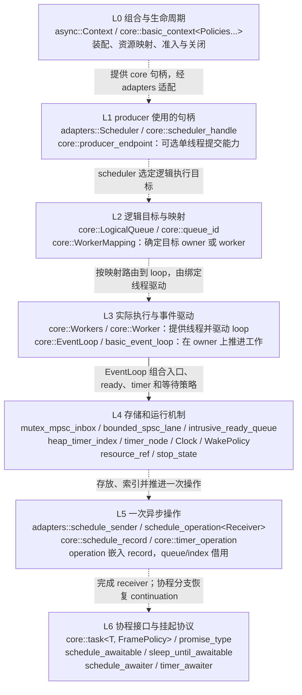

# Async Core 设计参考

本文是 async runtime 开始实现前的设计约束和参考资料。它描述目标和边界，不表示相关功能已经实现。实现过程中如果需要改变这里的方案，应先更新依赖图、资源契约和验收条件，再修改代码。

## 1. Core 要解决什么问题

async 的 core 是一个可嵌入、可由调用方驱动的协程运行时。它不负责定义 sender/receiver 算法，也不应要求使用者采用某个线程模型。它需要提供以下能力：

1. 在调用方指定的线程或 scheduler 上推进 ready operation。
2. 将后台工作、I/O 或 timer 的完成恢复到指定 scheduler。
3. 让调用方可以区分通信/驱动开销和最终业务回调开销。
4. 对 async 自己拥有的动态存储给出可追踪的资源来源。
5. 支持取消、关闭、到期和完成之间的竞争，并保证已启动操作恰好完成一次。
6. 允许 coroutine task、timer、queue 和后续 I/O 后端使用同一套静态协议。
7. 允许 execution 层把 core operation 适配成 sender，但 core 不依赖 execution。

core 不提供硬实时保证。`poll_one` 可以限制一次从 ready queue 取出的调度记录数量，但不能抢占已经开始运行的 C++ 函数、协程段、析构函数或用户回调。用户 awaitable 也可能通过 `await_suspend` 直接恢复另一个 coroutine handle，所以只有 core 自己定义的 scheduler 边界可以提供执行范围约束。

## 2. 不变量

以下不变量比具体类名更重要：

- core 的头文件不能包含 `async/execution/*`、stdexec 或 `<execution>`。
- execution 适配器可以依赖 core；反向依赖会形成架构倒置。
- 公共 core 类型不通过继承复用行为。优先使用模板参数、concept、CPO、ADL 和组合对象。
- `std::pmr::memory_resource` 是唯一预留的运行时虚函数边界。它是标准的资源接口，不是 async 自己定义的基类。
- queue 节点、timer 节点和 operation state 默认由调用方嵌入并借用，不因统一性而强制堆分配。
- 需要自行拥有生命周期的记录，例如 `post(fn)` 的闭包，必须明确使用哪个 resource 分配，并在完成、取消、拒收和关闭路径回收。
- 跨 scheduler 恢复必须通过目标 scheduler 的 enqueue/post 协议。不能把一个目标 scheduler 的 handle 直接作为当前 `await_suspend` 的对称转移结果。
- 完成可能同步发生。receiver 或用户回调可以销毁 operation；完成调用返回后不得继续访问已完成 operation 的成员。
- stop、cancel、close 和 destroy 是不同动作。丢弃节点不能代替完成通知。

## 3. 依赖分层

建议的依赖方向如下：

```text
公共配置/词汇类型
        |
        +--> async/core/memory
        +--> async/core/cancellation
        +--> async/core/scheduling
        +--> async/core/timer
        +--> async/core/coroutine

async/core/* --> async/core/context（组合，不引入 execution）
std::execution/stdexec --> async/execution/*
async/core/* + async/execution/* --> async/adapters/*
```

更具体的目录职责：

| 层 | 责任 | 可以依赖 | 不应依赖 |
| --- | --- | --- | --- |
| `async/config.h` | 公共宏和可见性 | 标准头 | execution、运行时实现 |
| `core/memory` | `memory_resource` 引用、对象分配辅助、资源策略 | `<memory_resource>` | queue、timer、execution |
| `core/scheduling` | ready queue、scheduler、event loop、逻辑执行队列与 worker 映射、CPU pool、wake/wait | memory、标准同步设施 | sender 算法、具体 coroutine promise |
| `core/timer` | clock、timer node、deadline index | memory、intrusive node | queue 的实现细节、sender |
| `core/cancellation` | stop state、registration、取消竞态 | memory、标准 stop vocabulary | execution 算法 |
| `core/coroutine` | task、promise、frame allocation、continuation | scheduling、memory、语言 coroutine | stdexec 算法 |
| `core/context` | 组合 loop、Workers、逻辑队列映射、资源和运行时生命周期；提供 `async::Context` 预设 | core 各组件、配置 | execution、adapters、业务 task scope |
| `execution` | sender/receiver、组合算法和 ext | stdexec 或标准 execution | core 的底层实现细节 |
| `adapters` | 把 core operation/scheduler/task 接到 execution 协议 | core、execution/protocol | 被 core 反向包含 |

`core.h` 只聚合纯 core 入口。`execution.h` 只聚合 execution 入口。独立的 `adapters/` 层可以同时包含两者，但不能被任一底层层级反向包含。`async.h` 可以作为总入口聚合 core、execution 和 adapters；纯 core 用户应能只包含 `async/core.h` 编译。

如果某个定义同时被 core 和 adapters 需要，应先判断它是不是运行时本身的词汇：scheduler handle、enqueue record、timer operation 和 cancellation state 可以上提到 `core`；sender、receiver、completion signatures、`connect` 和 `start` 只能留在 `execution`。不能因为 adapters 需要某个 sender 类型，就把 execution protocol 放进 core。

## 3.1 CPO 和 ADL

### CPO

CPO（Customization Point Object，定制点对象）是一个对象，它的 `operator()` 提供稳定调用入口，再在内部按规定顺序寻找具体类型的定制实现。典型形式是：

```cpp
namespace lcf::async::core {

struct enqueue_t {
    template<class Scheduler, class Record>
    constexpr auto operator()(Scheduler& scheduler, Record& record) const
        noexcept(/* 由定制实现决定 */)
        -> decltype(/* 选择的 enqueue 定制 */);
};

inline constexpr enqueue_t enqueue{};

} // namespace lcf::async::core
```

调用方只写 `core::enqueue(scheduler, record)`，不需要知道实现是 scheduler 的成员函数、同命名空间的非成员函数，还是内部 fallback。标准库的 `std::ranges::begin` 和 execution 的 `connect`、`start`、`set_value` 都采用这一类协议。

CPO 的价值是把扩展点集中在一个对象上：可以使用 concepts 限制合法类型，可以统一处理 `noexcept` 和返回类型，也不会把一组同名自由函数全部暴露给普通重载解析。CPO 不等于虚函数；满足协议的类型仍然由模板静态分发。

### ADL

ADL（Argument-Dependent Lookup，参数相关查找）是 C++ 的非限定函数查找规则。调用：

```cpp
enqueue(scheduler, record);
```

时，编译器除了当前作用域，还会根据 `scheduler` 和 `record` 的类型查找它们所属命名空间中的 `enqueue`。因此第三方类型可以在自己的命名空间提供定制函数，而不需要修改 async 的头文件。

ADL 适合做协议的窄入口，但裸露的非限定调用容易被无关同名函数干扰。core 应把 ADL 放在受约束的 CPO 实现内部，先用 concepts/检测表达式确认候选，再调用；公共代码直接调用 CPO 对象。execution 的 sender CPO 继续由标准库/stdexec 提供，core 自己只定义 runtime CPO，例如 `enqueue`、`cancel` 或 `poll_one`，两组 CPO 不混用。

### async 的协议归属

| 协议 | 定义位置 | 例子 | 允许谁依赖 |
| --- | --- | --- | --- |
| core runtime CPO | `core` | `enqueue`、`poll_one`、timer 操作、取消请求 | core、adapters |
| execution CPO | `execution`/提供方 | `connect`、`start`、`set_value`、`set_error` | execution、adapters |
| bridge adapter | `adapters` | core scheduler -> execution scheduler/sender | adapters |

## 3.2 自顶向下的类型总览

以下为目标类型图和拟定类名，不表示这些类型已经实现或名称已冻结。当前代码主要提供 execution protocol/算法的重导出，`core.h` 仍是入口骨架。`exec::scheduler`、`exec::sender`、`exec::operation_state` 是 provider 的 concept，不能当作本库的具体类名。

图按“组合入口 -> 调度句柄 -> 逻辑目标与执行资源 -> 机制 -> 一次操作 -> 协程接口”展开，每个框汇总一层的类型。实线表示机制组合，虚线表示句柄获取、目标解析或运行时调用；所有边都不是继承，也不等同于头文件 include 依赖。完整所有权关系见下表和 4.11；`awaitable` 位于协程分支的底部视图，普通 sender/receiver 工作可以在 operation 层结束，不必经过协程。



### 3.2.1 每层的类名、定位和功能

下表中的 `core::` 和 `adapters::` 分别指 `lcf::async::core` 与 `lcf::async::adapters`；`async::Context` 指 `lcf::async::Context`。策略具体类型先放在内部命名空间，待契约稳定后再决定是否公开。

| 层 | 拟定类名/类型 | 定位及功能 | 所有权与公开边界 |
| --- | --- | --- | --- |
| L0 | `core::basic_context<Policies...>`、`async::Context` | 运行时组合根；初始化逻辑队列/worker 映射，管理资源及准入、停止、drain、join | `Context` 为纯 core 的常用配置别名；拥有内部状态，不依赖 execution |
| L0 | `core::ContextOptions`、`core::QueueRequest` | 初始化描述：线程预算、逻辑 key、执行模式、owner/隔离要求、容量与资源 | 配置值类型；不创建 operation，不进入投递快路径 |
| L1 | `core::scheduler_handle` | 稳定的逻辑执行目标引用，概念上保存运行时状态引用与逻辑队列 ID | 可复制、非拥有；不创建线程，不延长 Context 寿命 |
| L1 | `adapters::Scheduler` | 包装 core handle，满足 provider 的 scheduler 协议；`schedule` 产生原生可组合 sender | producer 通常持有的业务句柄；仅 adapters 层同时依赖 core 和 execution |
| L1 | `core::producer_endpoint` | 可选的预登记提交能力，引用某个 producer/目标 owner 的 SPSC lane，尝试提交已准备 record | 绑定提交线程、非拥有；不直接宣称满足通用 execution scheduler 协议 |
| L2 | `core::LogicalQueue`、`core::queue_id` | 保存逻辑执行语义、生命周期、容量/诊断信息及 owner 本地 backlog；queue ID 是逻辑身份 | 状态由 Context 管理；同 worker 的不同逻辑队列仍分别标识 |
| L2 | `core::WorkerMapping` | 初始化时将逻辑目标映射到 worker loop 或外部 owner，校验硬约束 | Context 拥有；首版运行期间映射不变 |
| L3 | `core::Worker` | 一条受管理的线程及其 loop 绑定；在线程上调用驱动入口，响应唤醒与退出 | 管理自己的线程，借用 loop；不另外拥有一套逻辑队列或 timer |
| L3 | `core::Workers` | Worker 集合；统一处理线程创建、启动失败回收、停止通知与 join | Context 的可选组件；不承担逻辑队列声明或全局业务调度 |
| L3 | `core::basic_event_loop<Policies...>`、`core::EventLoop` | 收取入口、推进本地 ready/timer/完成，提供 `poll_one/poll/run_one/run` | `EventLoop` 为常用策略别名；不创建线程，可独立使用或由 Worker/外部 owner 驱动 |
| L4 | `mutex_mpsc_inbox`、`bounded_spsc_lane`、`inbox_set` | 通用 MPSC、专有 producer 的有界 SPSC、单 owner 的多入口汇合 | 内置入口 policy 的拟定实现名；仅搬运 record，遵守接纳、发布和回收契约 |
| L4 | `intrusive_ready_queue` | owner 本地无同步 FIFO，维护 ready/backlog | 仅 owner 消费和维护；节点嵌入 operation，默认不额外分配 |
| L4 | `heap_timer_index`、`core::timer_node` | deadline 索引与借用节点，支持插入、取消、查询及到期转移 | index 不执行回调；node 嵌入 operation，backing storage 来源明确 |
| L4 | `Clock`、`WakePolicy` | 时钟注入及发布/检查/等待/唤醒握手 | 模板策略角色，无公共虚基类；独立声明通知成本与线程要求 |
| L4 | `core::resource_ref`、`core::stop_state` | 显式 PMR 引用、取消状态与 registration 支持 | 资源引用非拥有；stop state 的存储和线程安全性由其 owner 声明 |
| L5 | `adapters::schedule_sender` | 描述一次在逻辑 scheduler 上调度的异步操作，保存 core 目标句柄 | sender 是操作工厂；构造/`schedule` 本身不代表已入队 |
| L5 | `adapters::schedule_operation<Receiver>` | `connect` 的具体 operation state；保存 receiver、调度 record 和完成状态，在 `start` 时尝试入队 | caller/任务 scope 持有至协议允许销毁；接纳、拒收、取消最终恰好完成一次 |
| L5 | `core::schedule_record`、`core::timer_operation` | 最小执行记录与 timer 生命周期状态，保存调度目标、完成入口或 continuation | 非继承体系；由 operation state/awaiter 嵌入，queue/index 借用 |
| L6 | `core::task<T, FramePolicy>`、其具体 `promise_type` | 协程返回对象及 frame 中的结果、continuation、scheduler 和取消上下文 | frame 按显式 FramePolicy 管理；task 所有权/启动方式另行声明，不由 Context 隐式接管 |
| L6 | `core::schedule_awaitable`、`core::sleep_until_awaitable` | 协程可 `co_await` 的调度/等待描述，保存目标或 deadline | 纯 core 便利类型；分别产生对应 awaiter，不依赖 sender 算法 |
| L6 | `core::schedule_awaiter`、`core::timer_awaiter` | 实现 `await_ready/await_suspend/await_resume`，保存挂起状态并注册/入队，完成后恢复协程 | 嵌入或借用 L5 operation/node；挂起状态须覆盖队列和取消方的最后访问 |

`Worker` 驱动 `EventLoop`，`EventLoop` 执行 record，record 可以完成 receiver，也可以恢复 coroutine。协程挂起方向则是 `task -> co_await -> awaiter -> core operation/record -> queue`；两条方向共同形成异步往返，不能据此让 queue/EventLoop 反向依赖具体 promise 或 execution receiver。

### 3.2.2 对象持有与业务使用

Context 拥有内部 loop、Workers、逻辑队列和映射；Worker 只借用它要驱动的 loop。外部 render loop 由 RenderSystem 拥有，Context 通过显式借用登记；由 render 线程手动推进。scheduler/endpoint 都不拥有这些对象。需要用到外部 loop 的任务 drain 完成后才能解除登记或销毁 loop。

普通 producer 使用 scheduler 构造任务，任务 owner 持有 operation state。下面是规划中的便利入口示意，尚不能用当前代码编译：

```cpp
namespace ax = lcf::async;
namespace ex = ax::exec;

ax::Context context{options};
auto cpu = ax::adapters::as_scheduler(context.get_scheduler_handle(cpu_key));
auto work = ex::starts_on(cpu, ex::just() | ex::then(prepare_cpu));
auto operation = ex::connect(std::move(work), receiver);
ex::start(operation); // 实际提交点；可能与构造 work 的线程不同。
// 保持 operation 及所有借用资源存活，直到完成和最后访问结束。
```

`Context::get_scheduler_handle` 仅返回 core handle，`adapters::as_scheduler` 才构造 execution scheduler；这样只包含 `async/core.h` 仍可使用完整运行时，不引入 execution。核心的概念可概括为：Context 管装配和生命周期，scheduler 标识逻辑目标，Workers 提供线程，EventLoop 推进工作，queue 承接发布，operation/awaiter 持有一次异步状态。

## 4. 调度记录和 event loop

### 4.1 最小调度单位

ready queue 的元素不是 coroutine handle，而是一个具有明确生命周期的 operation/record。一个 record 至少需要一个静态可调用入口：

```cpp
template<class Record>
void run_record(Record&) noexcept;
```

实现可以是 intrusive node 加模板函数；若一个异构队列确实需要类型擦除，边界处使用 `void*` 加函数指针即可，不建立 `operation_base` 虚基类。

`poll_one` 的契约应是：非阻塞地取出至多一个 ready record，执行该 record 的入口，然后返回实际执行数量。record 内部可以恢复协程并运行到下一个挂起点，因此这不是“一次 `resume()`”或“一次 `co_await`”的承诺。

如果需要把终结操作的开销从通信操作中分开，完成路径必须显式把终结 record 放入目标 event loop；不能因为当前线程恰好相同而隐式 inline。这样调用方可以分别测量：

```text
worker/I/O completion -> loop enqueue/wake -> loop final record
```

event loop 的构造应组合 queue、timer index、clock 和 wake policy：

```cpp
template<class ReadyQueue, class TimerIndex, class Clock, class WakePolicy>
class basic_event_loop;
```

queue 不反向持有 timer service，timer index 不调用 callback，event loop 负责锁、等待、关闭、预算和两者之间的协调。

### 4.2 并发模型

第一版 event loop 采用单 consumer、多 producer（MPSC）模型。event loop 的 owner 线程是唯一 consumer，其他线程只 enqueue 和 wake；不能让 N 个 CPU worker 同时调用同一个 `basic_event_loop` 的 `run/poll`。CPU 并行执行由独立的 worker pool 提供，见 4.5。这样可以把 loop 的复杂度集中在 enqueue/wake 的内存序和关闭竞态，而不需要一开始实现通用无锁 MPMC queue。

若 record 嵌入 operation state，enqueue 不分配内存。若 `post` 接收临时闭包并需要在调用返回后继续存活，则建立显式 owning record：它保存调用时的 resource、大小和对齐，完成前不释放。

### 4.3 PollBudget 和 PollReport

归档 standalone 的：

```cpp
PollReport poll(PollBudget budget = {});
```

相比 Asio 的 `poll_one()`/`poll()` 只返回执行数量，这组 API 更适合由上层控制 event loop。归档的 `PollBudget` 同时包含最大 callback 数量和最大持续时间，`PollReport` 返回实际 callback 数量、耗时，以及数量/时间限制是否达到。它把“这次驱动做了多少工作”作为可观察结果暴露给调用方，适合渲染帧、主循环或服务端的软预算。

建议保留这一组语义：

- `poll_one()` 是最小的非阻塞调度原语，最多取出一个 ready record；
- `poll(PollBudget)` 在每个 record 前检查数量和时间预算，调用 `poll_one()`，完成后更新 report；
- `m_callbacks` 只统计已经开始并返回的 record，不统计入队数量；
- `m_elapsed` 包含本次驱动中的 queue/timer 维护、record 执行和必要清理；
- 时间限制是软边界。一个已经开始的 callback、同步协程段或析构函数不能被抢占，可能使最终耗时超过预算；
- 没有 ready record 时提前返回，不能为了达到时间预算而等待；
- `poll()` 的计时应通过可替换的 `Clock` 或诊断策略实现，正常低开销路径不能被强制的高精度计时拖慢。

`PollReport` 的字段和计数规则属于运行时 API；具体的计时实现、timer 维护批量和队列批量仍属于可优化策略。benchmark 必须分别测量空轮询、达到 callback 上限、达到时间上限、callback 超预算和清理成本，不能只看总任务耗时。

### 4.4 参考实现

- Asio `io_context::poll_one` 的定义是“最多执行一个 ready handler”，这与 record 粒度的契约相符，但它没有归档 `PollBudget/PollReport` 这样的组合预算和可观测结果，handler 内部仍可继续同步调用其他代码：<https://think-async.com/Asio/asio-1.30.2/doc/asio/reference/io_context/poll_one.html>
- Asio `post` 明确保证函数对象入队，返回前不会在当前线程调用：<https://think-async.com/Asio/asio-1.30.2/doc/asio/reference/post/overload1.html>
- Asio 的 intrusive `op_queue` 只保存 next 指针并负责 push/pop/destroy，可参考其无额外节点分配的结构：<https://github.com/chriskohlhoff/asio/blob/asio-1-30-2/asio/include/asio/detail/op_queue.hpp>
- libuv 的 event loop 将 timer、pending callbacks、I/O poll、close callback 分成阶段；它还明确 `UV_RUN_ONCE`/`UV_RUN_NOWAIT` 的阻塞差异：<https://docs.libuv.org/en/v1.x/design.html>、<https://docs.libuv.org/en/v1.x/loop.html>
- libuv `uv_async_send` 会合并多次通知，所以通知计数不能当作 callback 计数：<https://docs.libuv.org/en/v1.x/async.html>
- cppcoro 的 `static_thread_pool::schedule_operation` 展示了嵌入 coroutine handle 和 next 指针的 awaiter；它适合作为静态 operation 的参考，不应照搬其默认资源行为：<https://github.com/lewissbaker/cppcoro/blob/master/include/cppcoro/static_thread_pool.hpp>

### 4.5 主 event loop、CPU worker 和专有执行域

目标消费端是 LCFEngine 仓库 <https://github.com/mmmmmcree/LCFEngine.git> 中的 `examples/shader_toy`，该示例替换 Asio 是一个目标消费场景。本文引用 LCFEngine 源码均使用该仓库内的相对路径。必须支持一个通用任务控制 loop、N 个共享 CPU worker，以及 render、gfx 等具有线程归属的专有 loop；不能把“有一个 event loop”理解成所有工作都在它的 owner 线程上执行。

当前消费端的具体对应关系：

| 执行域 | 当前 Asio 对象/调用 | async 的目标职责 |
| --- | --- | --- |
| 通用任务控制 loop | `TaskSystem::m_io_context`，由 `m_worker` 驱动 | 串行处理任务系统事件、服务通知和指定回到该域的完成 |
| 共享 CPU pool | `m_cpu_io_context`，当前由 2 个 `m_cpu_workers` 共同 `run()` | N 个 worker 并行执行通用 CPU 工作；N 由宿主配置 |
| render loop | `RenderTaskSystem::m_render_io_context`，`processOne/waitOne` | 由 render owner 非阻塞轮询或等待一个 record，维护 render 状态 |
| gfx loop | `RenderTaskSystem::m_gfx_io_context`，由 `m_gfx_worker` 驱动 | 在指定线程执行上传、提交及对应资源操作 |

本文将通用任务控制 loop 简称为 `main_loop`，这是逻辑角色，不强制它运行在进程主线程；当前 `TaskSystem` 使用独立线程。窗口/应用主循环与 render owner 的关系仍由宿主决定。

```text
                         TaskSystem / 宿主拥有
                    +---------------------------+
服务、其他系统 --------> | main_loop（单 owner）    |
                    | cpu_pool（N workers）     |
                    +---------------------------+
                               ^      |
                    通用 CPU 工作      | 结果/错误/停止
                               |      v
render_loop（单 owner） <------ 显式指定完成目标
       |       ^
       v       |
gfx_loop（单 owner）
```

`core/scheduling` 应提供 CPU pool 运行时、逻辑执行队列和轻量 scheduler handle。为支持 4.10 的逻辑队列映射，第一阶段优先由 `Workers` 管理 N 个 `std::jthread`，每个 Worker 借用并驱动一个单 owner loop；Context 持有内部 loop，宿主在初始化时声明逻辑队列，由 Context 建立静态映射。每个 worker 接收多 producer 投递，但只有该 worker 消费其入口；不同 worker 可并行运行。worker loop 可复用 EventLoop 的调度协议并使用无 timer 的配置。配置实际 CPU 执行资源时 N 至少为 1；Context 可以没有后台 Workers 并只绑定外部 owner，但没有可用 CPU 资源时必须拒绝相应队列请求，不能把 CPU 工作静默放到 main/render owner。

一条由 mutex 保护、N 个 worker 共同消费的 intrusive 工作队列可以保留为通用并行执行资源的替代实现；其 push/pop 在锁内、record 在锁外执行。它必须单独满足多 consumer 契约，不能直接复用单 owner loop 的入口，也不自动提供每条逻辑队列的串行性。首版不要求无锁 MPMC、动态迁移或 work stealing；延时和 I/O 完成后可以调度到 CPU 逻辑队列。

`event_loop` 与 CPU pool 都复用 record/enqueue/拒收/停止的运行时协议，各自声明线程安全性和 forward progress。worker 数量、线程创建及 join 由显式的 pool owner 管理；scheduler handle 不创建线程、不拥有 pool，也不延长 pool 的寿命。空队列只表示暂时无事可做：持续运行模式下 owner/worker 应等待并可被新任务唤醒，不能因瞬时空闲自行退出。

### 4.6 专有系统投递通用 CPU 工作

render 等专有系统通过注入的共享 CPU scheduler 提交工作，不需要知道 `TaskSystem` 的队列、worker 或线程实现。当前 `RenderSystem` 已通过 `TaskSystem::getCpuExecutor()` 将该能力放入 `ShaderToyTaskContext::m_cpu_executor`，迁移时保留这一依赖注入方向。

两种路径都必须可表达：

1. **直接投递**：`render -> cpu_pool -> render/gfx/main_loop`。CPU 工作直接进入 pool，结果显式回到业务指定的执行域。通常优先采用此路径。
2. **经任务控制 loop 提交**：`render -> main_loop -> cpu_pool -> render`。需要统一登记、准入或服务状态时，main loop 只执行短的提交/记账 record，重工作仍交给 CPU pool。

向 `main_loop` 投递一个普通函数，只表示该函数将在 main loop 的 owner 线程执行，不会自动得到 CPU 并行执行。通用 CPU 工作与必须在主域串行执行的控制工作应由不同 scheduler 明确区分。宿主可以命名 `main_scheduler`、`cpu_scheduler`、`render_scheduler` 和 `gfx_scheduler`；这些是能力角色，不要求建立公共虚基类或一个全局 singleton。固定拓扑优先使用具体 handle 和模板注入，确需异构存储时再使用符合协议的类型擦除。

投递契约还必须覆盖：

- CPU 阶段不访问仅由 render/gfx owner 维护的可变状态；通过拥有的输入、受控共享结果或显式生命周期引用传值。
- 工作在哪里运行与最终完成在哪里处理是两个决定。CPU 阶段完成不等于 render continuation 已运行；必须通过目标域 enqueue 后再执行。
- 主循环、render 和 gfx owner 不得同步等待需要本域继续推进的任务；CPU worker 也不得通过阻塞等待同池子任务来实现依赖汇合。
- 排队容量/拒收必须可观察；固定容量耗尽不能静默丢任务。首版可使用显式资源支持的动态队列，不必预先实现复杂优先级和背压算法。
- CPU pool 面向可结束的计算段。长期阻塞的文件读取、GPU 等待等需要由宿主显式接受占用 worker 的代价，或使用独立阻塞资源/后端，不能隐含承诺不会饿死其他 CPU 工作。

### 4.7 owner 驱动和空闲等待

`poll_one()` 与 `poll(PollBudget)` 保持非阻塞。还需要一个等待并执行至多一个 record 的驱动入口（暂称 `run_one()`），以及持续驱动入口（暂称 `run()`），覆盖 `RenderTaskSystem::waitOne()` 和后台 loop 的现有用法。`run_one()` 等到并执行一个 ready record 后返回；停止条件成立或运行时明确报告退出时可以不执行 record 而返回。空唤醒应重新检查 predicate，不能作为完成一个 record 计数。

等待策略需要协调 ready queue、下一个 deadline 和 stop/close；跨线程 enqueue、提前到来的 timer、停止请求都要唤醒 owner。必须防止“检查为空 -> producer 发布并通知 -> owner 开始等待”造成丢唤醒。timer 的插入/取消若不允许跨线程直接访问 index，应通过发往 owner 的控制 record 实现。连续驱动与手动轮询共享同一 owner 契约，不允许两个线程同时驱动同一个 loop。

### 4.8 生产者延迟优先的入口

render/gfx 等专有系统投递通用任务时，允许 TaskSystem 稍后收取，但投递线程不应等待 TaskSystem owner 释放队列锁。这是本项目的非对称延迟目标：生产者只发布已准备好的 record，消费者承担收取、轮询、合批和路由成本。MPSC 描述并发角色，不要求所有角色共用一把 mutex；带 mutex 的队列可以作为正确性和性能基线，不作为专有系统低延迟入口的默认保证。

不同实现必须区分其进展条件，不能把“没有 mutex”统一称为 wait-free：

| 入口方案 | 生产者行为 | 消费者代价/限制 | 本项目定位 |
| --- | --- | --- | --- |
| mutex + intrusive queue | 可能等待 owner 或其他 producer 持锁 | 实现和关闭协议简单 | 验证基线、普通路径 |
| CAS intrusive inbox，消费者摘链后反转 | 无 owner 锁，但竞争时可能反复 CAS | 合批、反转并维持本地 backlog | 可替换的吞吐策略，不承诺单 producer 有界重试 |
| Vyukov intrusive MPSC | 发布链接使用一次 atomic exchange 和若干 load/store，无 CAS 重试循环 | producer 在交换后、链接前暂停时，consumer 暂时无法越过缺口 | 动态 producer 的候选，接受消费延后但必须声明发布缺口 |
| 每个固定 producer 一条预分配 SPSC ring | 没有 producer 之间的共享入队锁或 CAS 重试；满时立即返回 | owner 扫描多条 lane，维护公平性和各 lane 生命周期 | render/gfx 等固定线程的优先候选 |

参考：Vyukov 的 intrusive MPSC 原始算法 <https://sites.google.com/site/1024cores/home/lock-free-algorithms/queues/intrusive-mpsc-node-based-queue>；Boost `mpsc_weak_queue` 对发布缺口与弱可见性的说明 <https://www.boost.org/latest/doc/html/doxygen/classboost_1_1lockfree_1_1mpsc__weak__queue.html>；Folly CAS inbox 的发布/摘链实现 <https://github.com/facebook/folly/blob/main/folly/AtomicIntrusiveLinkedList.h>；Boost SPSC ring 的操作契约 <https://www.boost.org/latest/doc/html/doxygen/classboost_1_1lockfree_1_1spsc__queue.html>。这些是算法参考，不增加相应库依赖。

对于当前 shader_toy 的固定线程拓扑，优先评估“各专有 producer 的 SPSC lane + 普通 producer 的独立 MPSC inbox + 单 owner 汇合”的入口 policy：

```text
render owner ------> render SPSC lane --+
gfx owner ---------> gfx SPSC lane -----+--> TaskSystem owner --> 本地 ready / CPU 路由
其他线程 ----------> general MPSC inbox -+
```

lane 在初始化/登记阶段分配，严格绑定一个 producer 线程和一个 consumer owner；一个系统若由多个线程投递，必须按线程拆 lane 或走普通 MPSC。登记、扩容和注销不放在 render 投递快路径。owner 对各 lane 采用有界批次轮询，不能持续 drain 一条 lane 而饿死其他入口；单条 lane 保持 FIFO，跨 lane 不承诺一个全局 FIFO，业务先后关系通过显式依赖表达。CPU pool 的多个 consumer 不能直接共同 pop 同一 SPSC lane；这里的汇合入口只属于单 owner event loop。

低延迟路径应提供非阻塞尝试入口（暂称 `try_enqueue(record&) noexcept`），立即返回 accepted/full/closed；仅 accepted 转移排队期间的 record 访问权，借用存储仍须覆盖其完成和最后访问。满队列时不能循环等待，不能隐式改走带锁的共享队列或堆分配 fallback。业务可以保留未提交任务到下一帧重试；只对明确允许合并的状态更新做合并，已接纳 operation 不能被覆盖或静默丢弃。execution adapter 必须把拒收映射为声明的完成通道，不能内部反复重试直至成功。

有限容量、始终接纳、生产者永不等待和消费者可无限落后不能同时保证。因此“允许延后收到”需要同时明确最大积压/容量与满载策略；业务投递使用的 operation state、闭包和输入存储也应在快路径之外准备，不能靠一次无锁 push 掩盖前置分配。

唤醒成本与入队成本单独设计和测量。即使队列发布不加锁，`post()` 若随后争抢通知锁、进入系统调用或同步执行拒收清理，仍可能拖慢 render。允许通知合并；如采用每 lane 的发布状态加 TaskSystem 周期检查，必须有明确的最大检查间隔，不能只设置标志却让 owner 无限睡眠。若要求立即唤醒，需另行声明和测量完整 wake 路径，不能把 queue 的 wait-free 属性直接写成整个 `post()` 的属性。避免每条 lane 又在每次投递时争用同一个全局计数器。

采用有发布缺口的 MPSC 时，queue 协议需要在内部区分“可取 record / 确认空 / 发布未完成”。`poll_one()` 遇到缺口应及时返回且不计执行数，不能自旋等待某个 producer 恢复；owner 的等待协议必须保证缺口补齐后能再次检查，不能把一次暂不可取当成可以无条件睡眠的证据。节点回收也必须遵守算法的脱链条件，不能在仍可能被 producer 写 next 时释放或复用。

本节的有界性仅针对已准备 record 的队列发布步骤，依赖目标平台原子操作与负载类型的性质；它不是整个线程的墙钟时间或硬实时承诺。最终选择依据 producer 投递的尾延迟与消费者收取延迟分别做 benchmark，不能只看总吞吐。

### 4.9 async 提供的队列选择与公开边界

async 应随运行时提供少量开箱即用的调度入口策略，并允许宿主静态替换；专有系统不应为取得低延迟投递而自行拼接节点所有权、唤醒和 execution adapter。选择发生在运行时构造和 producer 登记阶段，业务任务只持有对应 scheduler/producer endpoint，不在每次投递时传入队列算法枚举。

需要区分三处队列，不能用一个“queue 类型”设置全部替换：

| 位置 | 并发角色 | async 应提供的选择 |
| --- | --- | --- |
| event loop 的跨线程入口 | 多 producer、单 owner；可拆成多个单 producer 入口 | 通用 MPSC 策略；预登记的有界 SPSC lane 与单 owner 汇合策略 |
| owner 本地 ready/backlog | 仅 owner 访问 | 无同步的 intrusive FIFO，承接本地任务、timer 及已收取任务 |
| CPU pool 的工作队列 | 首版每 worker 一个单 owner 入口；替代后端可使用共享多 consumer 队列 | 按 4.10 映射逻辑队列；独立声明各后端并发角色，不能接入单 consumer 队列后让所有 worker 共同 pop |

4.1 的 `ReadyQueue` 模板参数只是早期组合示意。细化时应把跨线程入口和本地 ready 分开，以入口 policy/配套 endpoint 表达多 lane；可以用一个组合策略提供默认配置，不要求使用者逐项填写所有底层模板参数。timer、wake 和 resource 策略继续保持各自职责，但必须与所选入口的生命周期和唤醒协议兼容。

第一阶段提供通用 MPSC 的 mutex 基线，以及面向固定 producer 的 bounded SPSC lane 和汇合策略；SPSC 通道容量在登记阶段确定。动态 producer 优先的 exchange MPSC 作为后续候选；CAS 批量 inbox 仅在 benchmark 证明有适用价值时加入。默认通用入口采用哪种算法依据正确性验证和尾延迟数据决定，不把全部候选都变成首版必做项。公开配置描述并发、容量、顺序和投递保证；具体算法名称只有在契约已稳定、用户确实需要显式选择时才成为公开类型。

一个 loop 可以同时提供通用 scheduler 和绑定某条 SPSC lane 的 producer endpoint，两者分别标识执行目标和提交能力。endpoint 在初始化时取得，只保存所属 loop/lane 的非拥有状态，单 producer 约束写入类型契约并可做调试检查；不能把它直接包装后便宣称满足通用 execution scheduler。scheduler 的复制、比较与 `schedule` 需要满足 provider 的跨线程要求；`schedule`、`connect` 和实际 `start` 不必发生在同一线程。通用 adapter 只有在实际入队时验证 endpoint 的线程约束，或具备声明清楚且线程安全的其他路由时，才可以利用专有入口。显式低延迟 endpoint 不隐式退回带锁入口。详见 4.12。

自定义入口 policy 至少必须声明：

- producer/consumer 的数量约束、endpoint 的线程归属和必要的原子操作前提。
- `try_enqueue` 的接纳/满载结果，接纳前后 record 的访问与存储责任，以及取出后何时允许回收；closed 的准入判断由运行时与 policy 共同完成。
- 取出是否可能返回发布未完成，以及单 lane、跨 lane 的顺序保证和批量维护成本。
- 容量、初始化资源与扩容行为；哪些操作可能分配、重试、持锁或等待。
- 与 wake policy 配合时的发布/检查/睡眠握手，以及 endpoint 注销和运行时 drain 的条件。

队列不执行用户任务、receiver 或业务拒收回调，也不自行定义取消完成语义。调度运行时负责驱动和关闭，adapters 负责 sender 的 completion channel。仅有同名 `push/pop` 不能视为符合入口协议；满足上述契约的宿主实现可通过 concept/CPO/组合接入，不要求继承公共基类。

低延迟选择只约束实际经过的入口。render 向 CPU 逻辑队列投递时，应根据映射后端配置到目标 worker 的入口；仅替换 main loop 队列不能改善这条直接投递路径。首版静态映射可在登记时取得 `render producer -> 目标 worker owner` 的 SPSC endpoint，record 同时携带逻辑队列身份，不需要每次经过 main loop 转发。若采用共享 mutex 工作队列后端，普通 pool scheduler 仍可能等待该锁；可显式选择经 main owner 转发，由其承担 pool 入队成本。若共享多 consumer 后端也要支持直接非阻塞提交，则需要另行设计并验证分发机制，不能把 SPSC lane 直接交给所有 worker。路由在初始化时显式选定，不在低延迟投递失败后隐式切换。

普通业务入口满载时，关闭通知和必要的内部完成仍须有可推进路径，例如独立控制状态/通道或预留完成容量；相应存储与 drain 契约由运行时定义。选择一个 bounded queue 本身不构成完整的关闭或任务生命周期方案。

### 4.10 逻辑执行队列与物理 worker 解耦

LCFEngine Vulkan core 的 `DeviceContext` 是可借鉴的设计：应用声明 `QueueRequest/QueueKey`，solver 依据 queue family、实际 `queueCount` 和提交线程 tag 分配 `DeviceQueue`，多个 `LogicalQueue` 可以指向同一实际队列。对应源码位于上述仓库的 `libs/vk_core/src/context/DeviceContext.cpp`、`libs/vk_core/include/vk_core/queue/LogicalQueue.h` 和 `libs/vk_core/src/queue/QueueAccess.cpp`。

async 采用类似的“逻辑需求 -> 执行资源映射”，让 render 等系统声明并选择逻辑执行队列，宿主统一决定物理 worker 数和映射。逻辑队列数量由业务分解和运行时容量控制，可以大于 worker 数；worker 数由宿主预算和机器环境决定，`hardware_concurrency()` 仅作可选提示，不能当作 Vulkan `queueCount` 那样的硬件队列上限。增开逻辑队列提供潜在并行，实际同时运行程度仍取决于可用 worker、映射和任务依赖。

```text
render 的 image_prepare 逻辑队列 ---+
                                   +--> worker 0 的单 owner loop
audio 的 decode 逻辑队列 -----------+

render 的 shader_compile 逻辑队列 ------> worker 1 的单 owner loop

render_state 逻辑队列 -----------------> 指定 render owner
gfx_submit 逻辑队列 -------------------> 指定 gfx owner
```

业务 scheduler 的目标是逻辑执行队列；运行时负责把 record 路由到实际 worker。队列 key 是逻辑身份，不是 worker 下标。render 可以独立选择 image、shader 等队列发起分支，不需要知道其他系统用了哪些 worker，也不要求 scheduler 相互持有或调用。任务数据依赖、汇合和返回 render 的完成目标仍然显式表达。

逻辑执行需求必须明确语义，而不能全部命名成“虚拟线程”：

| 模式 | 承诺 | 映射约束 |
| --- | --- | --- |
| serial | 同一逻辑队列的 record 不重叠执行，有可依赖的串行同步关系 | 首版固定映射到一个 worker；多个逻辑队列可以共享该 worker |
| parallel | 独立 record 允许并发执行 | 可路由到多个 CPU worker；没有队列级全局串行顺序 |
| thread_bound | record 必须在指定 owner 线程执行 | 用于 main/render/gfx 或明确依赖线程本地状态的工作；不能随负载迁移 |

首版优先实现逻辑 serial 队列和已有 owner 的 thread_bound 绑定，已经足以让图片与着色器等独立逻辑队列在资源允许时并行。parallel 模式的共享资源分发作为后续扩展，不作为第一阶段迁移的前置条件。serial 的契约针对一次 record 执行；协程挂起后其他 record 可以进入该队列，不保证一整个异步任务从开始到完成都独占队列，也不保证跨挂起点的任务完成顺序。

初始化请求至少包含逻辑 key、执行模式/所需能力、必要的 owner 或 affinity group，以及允许共享还是要求独占 worker。映射器必须满足硬约束：thread_bound 保持指定 owner，明确要求独占但资源不足时初始化失败，不能悄悄共享。希望分散到不同 worker 可以作为软偏好；若业务依赖物理分离，则必须升级为硬约束并处理创建失败。权重、优先级和自动负载平衡不必首版全部实现。

静态映射在初始化时完成，运行期间不改变目标 worker，不把 solver、全局路由锁或线程创建放在投递快路径。独立于逻辑队列数量，每个物理 worker 仍只有一个 loop consumer；同一 worker 上的逻辑队列以有界批次公平推进，容量及错误统计可按逻辑队列维护。配置变更/新增逻辑队列先要求显式 quiesce 或重建，后续再评估动态登记和迁移。

4.8 的 producer lane 与本节逻辑执行队列是两个维度：lane 解决谁从哪个线程低延迟地提交，逻辑执行队列解决任务在哪种执行域运行以及是否串行。一个 render producer 可以向多个逻辑队列投递；多个 producer 也可以向同一逻辑队列投递。首版可按 producer/目标 worker 登记 SPSC lane，并在 record 中携带目标逻辑队列身份，由 worker 收取后放入对应本地 ready；不能把 producer tag、逻辑队列 key 和 worker ID 合并为一个标识。

虚拟化不会自动消除锁、资源干扰或优先级反转。每条低延迟路由仍须验证入口和 wake 路径；与长 CPU record 共享一个 worker 的短任务仍可能延后执行，需要硬隔离的延迟要求通过 owner/worker 约束和任务拆分表达。不能照搬 Vulkan `QueueAccess` 在共享实际队列上取得 mutex 的做法来承诺 render 投递不等待。

未来若让 serial 队列在 worker 间迁移，必须增加逻辑队列执行令牌、交接时的同步关系及关闭/回收验证，确保同时只有一个 record 执行；不能仅把同队列 record 分散压入多个 worker。thread_bound 不允许此迁移。逻辑 scheduler 身份在其生命周期内稳定；首版保守地以运行时和逻辑队列标识区分身份，不因两个队列当前映射到同一线程而把它们视为同一个 scheduler。adapter 的 completion scheduler 与 forward progress 声明必须与该逻辑执行资源的实际契约一致。

标准语义参考：scheduler 与执行资源的关系见 <https://eel.is/c++draft/exec.sched>；线程并发提示见 <https://eel.is/c++draft/thread.thread.static>。串行执行可参考 Asio strand 的契约 <https://www.boost.org/doc/libs/latest/doc/html/boost_asio/overview/core/strands.html>；本节不增加 Asio 依赖。

### 4.11 EventLoop、Workers 与 Context 的组合

EventLoop 与 Workers 是可独立使用的组件。EventLoop 管理事件和 ready record，驱动函数在调用线程执行，不自行创建线程；Worker 管理一条物理线程并在其上驱动所绑定的 loop；Workers 管理 Worker 集合。二者可在 Context 中组合，不建立继承关系，也不让同一批任务出现两套互相转发的 ready 队列。

`async::Context` 是运行时的组合与生命周期入口，不强制为“一个主 loop + N 条线程”的固定形状。它可以只拥有/绑定由外部线程驱动的 loop，也可以组合控制 loop 和 N 个 CPU Workers，或管理 CPU Workers 并绑定宿主拥有的 render/gfx loop。首版 CPU 后端采用每 Worker 一个 loop，属于 Workers 的装配方式，不意味着一个 EventLoop 可以由所有 Worker 同时消费。

Context 负责逻辑队列初始化、资源映射、producer 登记、资源引用与运行时准入/关闭协调。它通过 `core::scheduler_handle` 暴露逻辑执行目标；execution scheduler 由独立 adapters 构造。Context 实现及常用配置别名位于纯 core 组合层，底层 EventLoop/Worker 不依赖具体 Context，scheduler handle 可以引用由 Context 管理的稳定运行时状态而非拥有整个 Context。

内部 loop 与 Worker 的存储地址在相关句柄有效期间稳定。Context 拥有内部 loop，Workers 拥有线程，Worker 借用 loop；外部 loop 只登记借用和 owner 约束，Context 不接管外部线程的创建或 join。映射表和句柄失效规则不能依赖这些对象在运行期间被随意移动。

Context 协调 8.1 的关闭协议：先停止业务准入，通知外部任务 owner 请求取消，继续推进内部完成并等待相关任务 owner/外部 loop 的 drain 条件，最终关闭执行资源、join 自有线程，再释放内部状态。operation state、coroutine frame 和业务输入仍由调用方/任务 scope 管理；仅创建 Context 不会自动收集所有 root。调用方必须让 scope 参与 drain，不能把暂时空队列当成所有异步任务已经结束。

由外部 owner 驱动的 loop，在其任务和跨域完成清空前必须继续被推进并保持存活；Context 不能越过线程归属代为驱动。需要等待外部 owner 或 join 的关闭阶段应显式提供，由可安全等待的宿主线程调用。析构仅作为已满足关闭前置条件后的最终回收，不在依赖自身推进的 owner 上偷偷执行阻塞式 drain/join。

### 4.12 Producer 获取的句柄

producer 是调用角色，不要求每个投递者都对应一个运行时 `Producer` 对象。普通业务获取并保存 `adapters::Scheduler`；它包装 `core::scheduler_handle`，引用逻辑执行队列。逻辑队列是状态对象，scheduler 是其可复制的非拥有句柄；多个 producer 可持有同一目标的 scheduler，多个逻辑目标可映射到同一物理 worker。scheduler 生命周期不能超过其引用的运行时状态，也不自动提供任务或资源所有权。

`exec::schedule(scheduler)` 生成 sender，`connect(sender, receiver)` 建立具体 operation state，`start(operation)` 才发起实际提交。sender 构造、连接和启动可以发生在不同线程；同一 operation 只启动一次，不允许并发重复 start。通用 Scheduler 必须支持不同 producer 启动各自的 operation，不能把“句柄交给了 render”解释为所有后续提交都发生在 render 线程。

单线程 `core::producer_endpoint` 是额外的低延迟能力：它约束从哪个线程、经哪条通道提交。显式使用它时，提交已准备 record 并立即得到 accepted/full/closed；不直接要求其满足 execution scheduler concept。若通用 adapter 优化为选择当前线程预登记的 lane，必须在实际 start/enqueue 时检查线程和绑定，符合条件才使用 SPSC；其他来源走已声明的通用线程安全入口。需要严格低延迟的路径使用显式 endpoint 契约，不把通用 scheduler 的可移植使用方式等同于每次都走该 lane。

scheduler 的逻辑身份由其执行目标决定，入口 lane、提交线程和当前映射的 worker 都不是该身份。sender 的完成可能从不同线程产生，跨域完成也不得复用不满足实际 producer 约束的 endpoint。接纳、拒收、停止的最终通知仍由 operation/adapter 按 completion signatures 负责，queue/endpoint 本身不执行 receiver。

标准参考：scheduler 的执行资源与并发使用要求见 <https://eel.is/c++draft/exec.sched>；sender、receiver、operation state 与启动/完成的关系见 <https://eel.is/c++draft/exec.async.ops>。采用具体 provider 时须验证对应版本；语言 awaiter 协议见 <https://eel.is/c++draft/expr.await>。

## 5. Timer 的职责和实现选择

### 5.1 需求

timer 需要支持：

- 单次 deadline 和可选重复周期；
- 插入、取消、重新安排；
- 读取下一个 deadline 供 event loop 计算 wait timeout；
- 到期后转移到 ready queue，而不是在 timer index 内直接执行用户代码；
- 到期与取消只有一个胜者；
- event loop 可以限制一次维护和转移的数量，避免一个时间点有大量 timer 时形成无界工作。

timer index 的 API 应接近：

```cpp
insert(timer_node&) -> bool        // 是否改变 next deadline
remove(timer_node&)                // O(log n) 或策略规定的复杂度
next_deadline() const noexcept
expire(now, sink)                  // 只产生到期 node，不执行回调
```

节点由调用方嵌入，包含 deadline、index 或 bucket link、状态位和一个完成入口。index 不持有 `Queue&`，也不自行睡眠。

### 5.2 初始实现建议

第一版使用侵入式二叉 min-heap：

- `timer_node` 中保存 heap index，取消和重排可在 O(log n) 内完成；
- heap 的 backing array 使用调用方提供的 `pmr::memory_resource`，或者由固定容量策略提供；
- `expire` 只弹出到期节点并交给 event loop；
- event loop 再把节点放入 ready queue；
- 使用注入的 `Clock`，测试可使用 fake clock；
- 不在 timer callback 内持有 heap 锁，也不在锁下调用 receiver。

当 workload 主要是大量短周期 timer 并且取消率很高时，再评估分层 timing wheel。它可以把部分操作降到近似 O(1)，但需要处理 tick 精度、跨桶迁移和时间回绕，第一版不应同时实现两套。

### 5.3 参考实现

- Asio `timer_queue` 使用 heap index、intrusive timer data 和 ready operation queue；取消会移除 timer 并将完成操作放入 operation queue：<https://github.com/chriskohlhoff/asio/blob/asio-1-30-2/asio/include/asio/detail/timer_queue.hpp>
- libuv timer 使用二叉 min-heap，节点同时有 heap/queue 状态；到期 timer 先进入临时 ready queue，再调用 callback：<https://github.com/libuv/libuv/blob/v1.48.0/src/heap-inl.h>、<https://github.com/libuv/libuv/blob/v1.48.0/src/timer.c>
- libuv 文档明确重复 timer 是相对 event loop 的 `now` 重置，不会自动扣除 callback 开销：<https://docs.libuv.org/en/v1.x/timer.html>
- Seastar 的 `timer_set` 使用侵入式 bucket 结构，并针对“经常取消或重排”的 timer 优化；这是 timing wheel/分层桶的参考：<https://github.com/scylladb/seastar/blob/master/include/seastar/core/timer-set.hh>

### 5.4 数据结构必须由 benchmark 决定

二叉 heap 只是便于验证语义的初始实现，不应因为理论复杂度就固定为最终实现。候选结构包括：

| 结构 | 适合的 workload 假设 | 需要实测的代价 |
| --- | --- | --- |
| intrusive binary min-heap | deadline 分布广、需要准确取消/重排 | O(log n) 更新，连续到期时可能形成 burst |
| ordered tree/map | timer 数量小、实现简单、需要有序遍历 | 节点局部性和每节点额外指针成本 |
| 分层 timing wheel/bucket | 大量近似 tick、短周期 timer、取消率高 | tick 精度、跨桶迁移、时间回绕和边界复杂度 |
| calendar queue/自适应桶 | deadline 分布稳定、规模较大 | 分布变化时需要重建或调整桶宽 |

benchmark 至少覆盖 active timer 数量、插入/取消/重排比例、deadline 分布、同一 tick 的到期数量、重复 timer、fake clock 推进幅度、跨线程取消和 event loop 预算。记录插入、取消、到期转移、next deadline 查询的吞吐和 p50/p99 延迟，以及每个 timer 的字节数、上游分配次数和 wake 次数。只有在目标 workload 上有数据，才选择 heap、bucket 或其他结构；公共 `timer_index` 协议不应暴露具体容器类型。

## 6. 内存资源和分配策略

### 6.1 为什么只用 `memory_resource` 不够

`std::pmr::memory_resource` 解决的是“从哪里取得一块指定大小和对齐的存储”，并不决定：

- 哪些对象应共享一个资源；
- 对象何时释放；
- 是否使用 arena、pool、slab 或 freelist；
- 一个资源是否可以跨线程访问；
- coroutine frame 如何在函数调用时取得资源；
- 不同类型的 operation 是否需要不同的容量和回收策略。

因此 async 不应再定义一个带虚函数的 `allocation_strategy` 基类。建议把两个问题分开：

```text
memory_resource       实际分配/释放的字节
allocation policy     资源绑定、对象构造、回收时机和容量规则
```

policy 是模板参数或具体值类型。例如：

```cpp
template<class Policy, class T, class... Args>
T* allocate_object(Policy&, Args&&...);

struct resource_ref {
    std::pmr::memory_resource* value; // non-owning
};
```

`resource_ref` 只是轻量的非拥有指针和检查，不是继承层次。所有分配出的 record 必须保存释放所需的 resource、字节数和对齐，或由 policy 保证这些值可重建。

### 6.2 推荐的资源类别

| 资源/策略 | 适用对象 | 优点 | 限制 |
| --- | --- | --- | --- |
| `synchronized_pool_resource` | 多线程共享的固定大小 operation | 标准实现、减少上游分配 | 有同步成本，仍需明确生命周期 |
| `unsynchronized_pool_resource` | 单线程 event loop 的 record | 无锁、适合 loop 本地 | 不能被多个线程同时访问 |
| monotonic/arena | 一批 operation 同时建立、整体销毁 | 分配快，释放简单 | 不适合逐个取消并立即回收 |
| 固定块/slab policy | 同尺寸 timer 或 queue node | 可预测、无碎片 | 容量耗尽策略必须明确 |
| recycling/free-list policy | 高频短命 record | 可复用同尺寸块 | 跨线程回收需要 owner 或同步 |
| `new_delete_resource` | 显式兼容模式 | 最简单 | 不能作为隐藏默认，且不提供隔离 |

严格模式下 event loop 构造时必须收到 resource 或容量策略；便捷构造可以显式命名为 `with_default_resource`，不能在深层 operation 内悄悄调用 `get_default_resource()`。

### 6.3 coroutine frame 的特殊性

协程 frame 可能在 coroutine 函数调用时就分配，早于 `connect`、`start` 或 receiver environment 的注入。因此不能在 `start()` 中设置 PMR 后声称已经控制 root frame。

可行的入口是：

1. 协程函数显式接受 frame allocation context，使 promise 的 `operator new(size, context, ...)` 能捕获 resource。
2. 提供 task factory，在调用 coroutine 函数前绑定 frame policy。
3. 对子协程创建明确传播 context；不能依赖跨线程 TLS scope。
4. 对编译器消除 frame 的情况不作“必定调用 allocate/deallocate”断言。

promise 中只组合具体策略和 `ReturnStorage<T>` 一类的 detail helper。不要建立所有 task 都继承的 `promise_base`。

### 6.4 参考实现和取舍

- 标准 `memory_resource` 规定 `allocate/deallocate/is_equal` 及对齐语义；`polymorphic_allocator` 只是把资源传给 allocator-aware 对象：<https://eel.is/c++draft/mem.res>、<https://eel.is/c++draft/mem.poly.allocator>
- 标准 pool resource 区分 synchronized 和 unsynchronized，并允许通过 upstream resource 分批取得内存；这支持“调用方控制上游、策略控制局部复用”的组合：<https://eel.is/c++draft/mem.res.pool>
- Asio 的 associated allocator 让每个 handler 提供自己的 allocator，且保证异步 operation 对 handler 的释放先于 handler 调用；这是 operation/handler 资源传播的成熟参考：<https://think-async.com/Asio/asio-1.30.2/doc/asio/overview/core/allocation.html>
- Asio 的协程 awaitable 有独立的 frame recycling 机制，说明 coroutine frame 策略和 handler allocator 不能混为一个接口：<https://github.com/chriskohlhoff/asio/blob/asio-1-30-2/asio/include/asio/impl/awaitable.hpp>
- libuv 只提供进程级 `uv_replace_allocator`，并要求 allocator thread-safe；它适合说明全局替换的边界，不满足 async 对每个 loop/operation 的隔离需求：<https://docs.libuv.org/en/v1.x/misc.html>
- LLVM 的 `BumpPtrAllocator` 适合批量生命周期，`RecyclingAllocator` 展示了固定尺寸对象的回收缓存；两者都应作为 policy 的实现参考，而不是 async 公共基类：<https://llvm.org/docs/ProgrammersManual.html#pointers-and-allocations>、<https://llvm.org/doxygen/classllvm_1_1RecyclingAllocator.html>
- Boost.Context 的 stack allocator 说明“分配器作为值类型策略”可以控制上下文栈的 allocate/deallocate，而无需虚拟基类：<https://www.boost.org/doc/libs/1_85_0/libs/context/doc/html/context/stack.html>
- EASTL 的 allocator 是可替换的具体 allocator 对象，并支持对齐参数；可参考其调试名称和显式分配接口：<https://github.com/electronicarts/EASTL/blob/master/include/EASTL/allocator.h>

### 6.5 分配优化必须由 benchmark 决定

资源模型确定“所有 async-owned storage 都有明确来源”，但不预先确定唯一最快的 policy。以下策略都应作为可替换实现进行比较：

- 直接调用传入的 `memory_resource`；
- `unsynchronized_pool_resource` 用于单线程 loop 本地的固定尺寸 record；
- `synchronized_pool_resource` 或线程安全 slab 用于多线程共享路径；
- monotonic/arena 用于一批 operation 同时建立、整体释放的 scope；
- 针对 timer node、queue record、coroutine frame 的固定块 recycling/free-list；
- inline storage 加 upstream resource 的小对象优化。

allocator benchmark 至少应分离以下成本：一次分配/释放、构造/析构、对齐分配、构造失败回收、跨线程释放、资源共享竞争、upstream 访问次数、峰值保留内存和缓存局部性。测试 workload 应包含空 loop、单个 operation 高频重复、并发 enqueue、timer burst、协程 frame 创建/销毁、取消和关闭 drain；不能只用一个 `allocate/deallocate` 微基准决定策略。

优化结果需要同时报告吞吐、p50/p99 延迟、每个 operation 的字节数和上游分配次数。若一个策略只在单线程或固定 timer 数量下更快，应通过模板 policy 或显式配置选择，不改变基础资源契约，也不能把它偷偷设为所有场景的默认实现。benchmark 结果应作为提交和 CI 的版本数据，用来发现劣化，而不是把一次机器上的最快结果写成 API 语义。

### 6.6 资源契约必须覆盖的路径

实现每一个 owning 类型时，必须列出以下路径的分配/释放：

```text
正常完成
同步完成
await_suspend 失败
connect/start 失败
取消
event loop 拒收
event loop 关闭
receiver 在完成回调中销毁 operation
构造函数抛出
跨线程释放
```

“Context 有一个 PMR 参数”不能推出进程内所有分配都由它控制。用户回调、值类型内部存储、异常对象、第三方 sender 算法、线程和系统同步对象都要单独声明边界。

### 6.7 跨执行域的资源访问

loop 只有一个 consumer，不代表其 resource 只会被一个线程访问：render/main producer 可能构造 owning record，CPU worker 可能完成并释放 operation，receiver 也可能在完成时销毁协程 frame。每类对象必须声明分配线程和可能的释放线程。

共享路径使用线程安全 resource/policy，或把分配/回收严格归并到 resource owner；不能仅因为对象归属某个 loop 就让多个线程访问同一 `unsynchronized_pool_resource`。若采用 owner 回收，回收 record 也计入未完成工作，owner 和 resource 必须存活到该记录 drain。借用 record 虽然不分配节点，其 operation state 和输入存储仍必须覆盖最后一次完成/访问。

## 7. Coroutine task 和 awaitable 扩展

### 7.1 task 的边界

`task<T, FramePolicy>` 应是具体 promise 的返回对象。promise 组合：

- `ReturnStorage<T>`；
- continuation handle；
- scheduler/context 引用；
- stop token 或 cancellation registration；
- frame policy 的释放信息。

这些成员不需要公共 promise 基类。公共操作使用 detail 模板和 CPO。

`final_suspend` 的默认策略应将 continuation 入目标 queue，而不是无条件返回 handle 进行对称转移。这样跨 scheduler 时不会在当前线程直接执行另一个 scheduler 的链。低延迟 inline continuation 可以作为显式 policy，但不能与严格 event-loop 边界混用。

语言规则的原始参考：

- 协程 frame 的 allocation function 查找、promise `operator new/delete` 和 allocation failure：<https://eel.is/c++draft/dcl.fct.def.coroutine>
- `co_await` 对 `await_ready`、`await_suspend` 返回 bool/void/handle 的控制流：<https://eel.is/c++draft/expr.await>
- 在非挂起点线程恢复 coroutine handle 的限制和并发恢复的数据竞争：<https://eel.is/c++draft/coroutine.handle.resumption>

cppcoro 的 task 展示了 continuation、final awaiter 和取消注册的实际组织，可以借鉴生命周期顺序，但它的默认 frame/线程策略不能直接作为 async 的 PMR 契约：<https://github.com/lewissbaker/cppcoro/blob/master/include/cppcoro/task.hpp>。

### 7.2 awaitable 扩展

扩展点优先使用标准语言协议：

```cpp
operator co_await
promise_type::await_transform
await_ready
await_suspend
await_resume
```

core 可以在 promise 中提供模板 `await_transform`，把带有 async 标记的 awaitable 映射为 scheduler-aware awaiter；普通 awaitable 默认保持语言语义。扩展是模板适配器，不是 awaiter 基类。

`std::expected<T, std::error_code>` 的 `noexcept` 函数链放在 `exec::ext`，转换为 sender 的 value/error completion channel。它不应改变普通 coroutine 的 `await_resume` 语义：普通 `co_await` 返回 expected 后，函数体仍会继续执行，短路由 sender 的错误通道负责。

## 8. Cancellation、关闭和完成

取消至少有三层：

1. 请求取消：设置 stop state 并通知 registration。
2. 操作响应取消：timer/I/O 从 pending index 移除，或者产生 canceled completion。
3. loop 关闭：拒收新操作，处理或明确完成已有 operation，最后释放资源。

registration 需要处理“注册与 request_stop 同时发生”以及析构期间回调正在运行的情况。callback 不应在 queue/timer 内部锁下调用用户代码。

标准 `stop_token`/`stop_callback` 的模型是基础参考：<https://eel.is/c++draft/stoptoken>。Asio 的 per-operation cancellation slot 说明取消能力可以通过 associated query 传播，而不需要 operation 继承基类：<https://think-async.com/Asio/asio-1.30.2/doc/asio/overview/core/cancellation.html>。cppcoro 的 registration 文档特别强调，registration 析构可能等待另一个线程正在执行的 callback：<https://github.com/lewissbaker/cppcoro/blob/master/include/cppcoro/cancellation_registration.hpp>。

完成协议应保证：一个已 start operation 恰好调用一次 value/error/stopped。关闭时如果不能继续运行 callback，必须产生停止/关闭完成，或者明确规定调用方执行 drain；不能只删除 queue node。

### 8.1 多执行域的关闭顺序

只对所有 loop 调用 `stop()` 然后立即销毁，不足以关闭 `render -> CPU -> render/gfx` 这样的往返任务。消费端应拥有任务 scope/operation 存储并采用明确的 quiesce/drain 协议；scope 可以是宿主组件，不要求 core 依赖 execution scope。

1. 停止接收新的业务 root，停止文件监控等外部 producer，并向仍在进行的 root 请求取消；禁止继续创建无关的新工作。
2. main、render、gfx 和 CPU 执行资源仍保持有效并继续推进，允许已接纳任务所需的内部完成/取消 record 入队。待接纳但未执行的工作按既定策略运行或完成为 stopped，已运行函数只能协作退出。
3. 等待所有已接纳 root、子操作、跨域完成及其 owner 清理记录结束。等待必须异步或由 owner 继续驱动，不能先阻塞住完成所依赖的 loop。
4. 在没有后续投递者后，最终关闭执行资源并唤醒/退出驱动线程；由非 worker 的宿主线程 join，再按对象依赖释放系统状态和 PMR resource。

“停止业务准入”与“最终关闭底层 scheduler”必须分开：已接纳任务的内部完成路径可使用 scope 计数/lease 或等价机制保持有效。这里的 lease 是关闭协议，不把普通 scheduler handle 变成隐式拥有对象。若目标 scheduler 已关闭而拒收，adapter 必须按声明的 error/stopped 通道恰好完成一次；不得为了维持表面成功而在来源线程调用具有 render/gfx 线程归属的业务收尾。需要严格 owner 完成的业务，必须在 owner 有效期间 drain。

Asio 的 `restart()` 用法不能直接推导为 core 的可重启保证。第一版先保证一次生命周期内的启动、空闲等待和完整关闭；如果要兼容 `TaskSystem::run/stop/run`，应另行定义旧 handle、stop state、残留 record 与新一轮运行的关系并补充测试。

## 9. Core 与 execution 的桥接

core 可以先独立提供：

```text
core scheduler handle
enqueue(record)
poll_one()
post(record)
timer operation
coroutine task
cancel/stop
```

execution 层再实现：

```text
schedule sender
connect(sender, receiver) -> concrete operation_state
start(operation_state)
continues_on / starts_on 的适配
exec::ext::from_expected
```

上述两组 API 之间的转换放在独立的 `include/async/adapters/`。例如 `adapters/schedule_sender.h` 可以同时包含 core scheduler 和 `execution/protocol.h`，把一次 core enqueue 映射为 sender operation；`core/scheduling` 和 `execution/protocol.h` 互相不可包含。若未来发现某个 bridge 所需类型是纯运行时概念，应将该类型上提到 `core`，而不是让 core 引入 execution。

stdexec/libunifex 的 run loop、task 和 environment 只能作为 bridge 实现参考；它们本身是 execution 库，不是 core 的完整 I/O runtime。

### 9.1 面向调用方的 scheduler 组合

业务任务使用本库已重导出的 `exec::schedule`、`starts_on`、`continues_on`、`then`、`let_value` 和 `when_all` 等 execution 协议。主 loop、CPU pool、render/gfx loop 的 core scheduler 分别通过 adapters 暴露为符合 provider 协议的 execution scheduler；core 本身仍不包含 execution。

下面仅示意未来 adapters 提供 scheduler 后的组合，不表示当前已有这些 runtime 类型或可直接编译运行：

```cpp
namespace ex = lcf::async::exec;

auto cpu_work = ex::starts_on(cpu_scheduler,
    ex::just(input) | ex::then(prepare_cpu));

auto render_work = std::move(cpu_work)
    | ex::continues_on(render_scheduler)
    | ex::then(apply_render);

// 由宿主 scope 或拥有 operation_state 的组件 connect/start。
// 必须保留 operation_state，直到 value/error/stopped 完成及清理结束。
```

`starts_on` 指定输入 sender 的启动执行资源，不表示完成后自动回到提交线程；`continues_on` 显式转移后续完成。普通 `then` 不会自动选择 CPU pool。若采用 `on` 的返回原域语义，必须具备有效的接收环境 scheduler 并验证 provider 的对应支持；首版示例优先使用显式启动和返回目标。

`then` 只处理 value，error/stopped 需要各自的完成处理路径。`continues_on` 向目标调度成功时才可依赖目标执行域；目标调度本身失败或停止时，不能承诺 error/stopped 仍在目标 owner 上处理。adapter 的 completion signatures 和 `get_completion_scheduler<completion_tag>` 查询必须如实声明各通道可保证的执行资源，不能把成功路径的线程归属无条件扩大到失败路径。线程归属的业务错误处理同样依赖 8.1 的存活和 drain 协议。

标准语义参考：`starts_on` 见 <https://eel.is/c++draft/exec.starts.on>，`continues_on` 见 <https://eel.is/c++draft/exec.continues.on>。这些是随工作草案更新的参考；后续实现以构建时选择的 provider 和相应标准版本为准，`on` 和 completion scheduler query 同样需要按该版本核对。

### 9.2 shader_toy 的迁移边界

迁移应先落地四个执行域及其 adapter，再替换消费端 Asio API。当前 `RenderSystem.cpp` 中已有 CPU 图片加载/着色器编译、gfx 上传、render 应用结果和回到 CPU 的阶段切换；这条链必须保留显式调度，不能简单把 `asio::post/co_spawn` 替换成普通函数调用。

`AsyncTaskChain/AsyncTaskFlow` 的依赖汇合、共享结果、一次启动和多等待者属于组合层需求；标准 sender 的 `when_all` 可以表达独立任务汇合，但不能据此假定已覆盖共享 DAG 节点的生命周期和多订阅语义。先确认消费端需求，再在 execution/扩展或宿主层承接，不能把 Asio 的 `concurrent_channel` 或整套 `Chain/Flow` 放进 core。

### 9.3 使用逻辑队列的任务组合

宿主配置 Context 的逻辑队列请求、worker 预算和外部 owner 绑定，由 Context 建立映射，再把相应 core handle 适配为 execution scheduler 注入专有系统的 task context。固定 render/gfx owner 仍作为显式能力传入；专有系统不读取 worker 下标，也不需要知道逻辑队列是否共享某个物理线程。新增独立分支可以新增逻辑队列请求，调整物理 worker 数只改宿主配置。

下面是未来接口语义示意，名称尚未定稿，当前 runtime 未实现：

```cpp
// 以下 scheduler 已由宿主映射和注入，prepare_* 各自产生自己的结果。
auto images = ex::starts_on(image_scheduler,
    ex::just() | ex::then(prepare_images));
auto shaders = ex::starts_on(shader_scheduler,
    ex::just() | ex::then(compile_shaders));

auto prepared = ex::when_all(std::move(images), std::move(shaders))
    | ex::continues_on(render_scheduler)
    | ex::then(apply_prepared_resources);
```

这段组合在一个 worker 上可串行推进，在多个 worker 且映射分散时可以并行推进。正确性不依赖存在两个物理 worker：分支不能同步等待彼此或占住线程等待同 worker 上的后续工作。`starts_on/continues_on` 表达执行目标，`when_all` 表达数据汇合；scheduler 之间没有相互依赖，业务阶段间的依赖仍由 sender 图持有。producer endpoint 的线程限制也必须传播到实际提交入口，不能因封装成逻辑 scheduler 而忽略。

### 9.4 shader_toy 的目标消费端用法

以下按 shader_toy 现有“CPU 读取/编译、gfx 上传和资源准备、CPU 实例构造、render 安装”的流程展示宿主与业务代码如何连接。类名、`ContextOptions` 构造器和队列注册函数名是前述规划接口的示意，sender helper 是 shader_toy 自己封装的 I/O/图形操作；代码描述目标 API，不表示目前可以直接编译。

#### 宿主配置与依赖注入

创建执行资源的是应用/TaskSystem 宿主。RenderSystem 接收逻辑 scheduler 和仍由自己拥有的 gfx/render loop 能力；它不持有 CPU worker 下标，也不创建共享 worker pool。一个目标配置可以表达：

| 逻辑 key | 执行要求 | 初始映射/能力 |
| --- | --- | --- |
| `image_prepare` | `serial` | 通用 CPU Workers，适合图片读取/解码 |
| `shader_compile` | `serial` | 通用 CPU Workers，适合 shader 读取/编译 |
| `resource_prepare` | `serial` | 通用 CPU Workers，适合实例和描述信息构造 |
| `gfx_submit` | `thread_bound` | RenderTaskSystem 拥有的 gfx loop/owner |
| `render_apply` | `thread_bound` | RenderSystem 拥有并驱动的 render loop/owner |

可按宿主预算配置 N 个 worker；先用 2 个便于观察并行。前三个是不同逻辑目标，不代表启动三个线程，也不保证一定分配给三个不同 worker。若运行时只有一个 worker，它们仍须正确完成；若任务图之间无依赖且分配到不同 worker，才可以同时执行。严格 render/gfx 线程归属绑定外部 owner，Context 只登记借用的调度能力。

宿主配置示意：

```cpp
// 示意：options/context API 尚未实现。
auto options = async::ContextOptions{}
    .setWorkerCount(worker_budget)
    .addSerialQueue(image_prepare)
    .addSerialQueue(shader_compile)
    .addSerialQueue(resource_prepare)
    .bindExternalQueue(gfx_submit, gfx_loop)
    .bindExternalQueue(render_apply, render_loop);

async::Context async_context{options};
async_context.start();

const auto task_context = ShaderToyTaskContext{
    .m_image_scheduler = async::adapters::as_scheduler(async_context.scheduler(image_prepare)),
    .m_shader_scheduler = async::adapters::as_scheduler(async_context.scheduler(shader_compile)),
    .m_resource_scheduler = async::adapters::as_scheduler(async_context.scheduler(resource_prepare)),
    .m_gfx_scheduler = async::adapters::as_scheduler(async_context.scheduler(gfx_submit)),
    .m_render_scheduler = async::adapters::as_scheduler(async_context.scheduler(render_apply)),
    .m_device_context = device_context,
    .m_gfx_task_queue = gfx_task_queue,
};
```

固定线程低延迟提交可在对应 producer 线程登记并使用 `producer_endpoint`。常规 sender 持有 scheduler，实际投递发生在 operation `start` 时；创建 sender、connect 和 start 不必处在同一线程。严格使用 SPSC endpoint 的组件则须明确在哪个线程执行 start 或提交，不能只把 endpoint 存进可任意迁移的 task context。render 的初始化 root 通常由 render 系统的调度 owner 启动，并通过独立 MPSC 或合规 adapter 投递到 CPU scheduler。

#### 资源流水线

`load_image_sender`、`upload_image_sender`、`load_compile_shaders_sender`、`prepare_passes_sender`、`build_instance_sender` 是应用封装，成功产生 value、失败走 error channel，并且不在构造时同步执行重工作。GPU/图形 API 调用由应用按其实际线程规则封装进 gfx 阶段。

```cpp
namespace ex = async::exec;

auto image_packet = ex::starts_on(
        context.m_image_scheduler,
        app::load_image_sender(image_path))
    | ex::continues_on(context.m_gfx_scheduler)
    | ex::let_value([context](const Image& pixels) {
        return app::upload_image_sender(context, pixels);
    })
    | ex::continues_on(context.m_gfx_scheduler)
    | ex::let_value([context](const ImageResourceInfo& noise) {
        return app::create_cloud_sea_packet_sender(context, noise);
    });

auto shader_programs = ex::starts_on(
    context.m_shader_scheduler,
    app::load_compile_shaders_sender(shader_paths));

auto prepared = ex::when_all(std::move(image_packet), std::move(shader_programs))
    | ex::continues_on(context.m_gfx_scheduler)
    | ex::let_value([context](const CloudSeaPacket& packet, const ShaderProgramInfoList& programs) {
        return app::prepare_passes_sender(context, packet, programs);
    })
    | ex::continues_on(context.m_resource_scheduler)
    | ex::let_value([context, swapchain_lease](const InstanceInfo& info) {
        return app::build_instance_sender(context, swapchain_lease, info);
    })
    | ex::continues_on(context.m_render_scheduler)
    | ex::let_value([render_state](PreparedCloudSea& result) {
        return app::install_render_state_sender(render_state, std::move(result));
    });

// 由应用的 root-operation owner 稳定存放 operation state、请求取消，
// 并在完成后回收。此宿主 helper 在稳定存储中直接构造 connect 的结果，
// 不要求 concrete operation state 可移动；它不是 std::execution API。
resource_task_owner.connect_and_start(
    std::move(prepared), ResourceRootReceiver{completion_mailbox});
```

图片读取/上传分支和 shader 编译分支从各自 CPU scheduler 启动；`when_all` 表达两者都完成后再准备资源。每个必须使用特定 owner 的阶段前明确 `continues_on`。这里的 `starts_on` 不承诺后续所有异步完成都会留在起始线程，普通 `then/let_value` 也不能自行选择 worker。sender helper 的错误类型、完成签名与应用中的 `expected/error_code` 转换由 helper/provider 明确实现；不能把 `expected` 当 sender error 后假定自动短路。

`ResourceRootReceiver` 的结果处理不能因为调度失败就在错误来源线程直接改 render 状态。正常路径把结果安装交给 render owner；错误/stopped 通过线程安全 completion mailbox 发布，再由指定 owner 消费。若目标 scheduler 在 `continues_on` 的转移阶段拒收，provider 可能在其他执行域交付相应失败通道；这类路径必须遵守 completion signatures 和 owner 规则，不宣称失败回调一定在目标线程。路径、shader 名单、swapchain lease、render state 和 context 内部引用都必须由 root 或宿主 owner 保持到最终 completion；sender helper 按值持有异步阶段需要的数据，不将可能早于 root 结束的局部变量按引用捕获。

以上是标准 sender/receiver 图，不是 coroutine task。之后需要 `co_await` 语法时，可以由 task 层桥接这些 sender；不能在 Task/awaiter 尚未实现时把示意写成现有 `async::task` API。

#### 持有与关闭

`Context` 不会替 RenderSystem 保存 root operation。消费端提供应用级 `ResourceTaskOwner` 或等价的稳定存储：按具体 `connect` 结果类型在稳定地址直接构造 operation state，登记完成追踪后再 `start`；不要求 operation state 可移动。完成后恰好释放。它同时记录 root stop source/取消句柄、未完成数量和完成 mailbox。不要把 operation state 临时建在启动函数的栈上，也不要只观察某个 queue 变空就释放 task context。

RenderSystem/应用退出的顺序：停止接收新的资源 root 并停止 file watcher 等外部 producer；请求取消已有 root，同时继续驱动 render/gfx owner 和 Context worker，等待 root、跨域完成和 mailbox 都 drain；解除外部 loop 的借用登记；再关闭 Context 自有 Workers 并从安全的宿主线程 join；最后销毁 root scope、owner 对象和图形资源。若 frame rendering 使用非阻塞 `poll(PollBudget)`，关闭阶段仍需确保有驱动 render completion 的方式，不能让必要的 render record 永远留队。

本节描述的是 shader_toy 从 Asio 迁移后的目标业务接口。实现顺序仍按前述步骤先验证 EventLoop/Workers/Context、scheduler adapter、operation 生命周期和跨域 drain，再改业务任务流水线。

## 10. 建议的实现顺序

1. **资源词汇和对象分配辅助**：`resource_ref`、对齐分配、构造失败回收、非拥有语义。
2. **intrusive ready queue 和入口 policy**：区分 owner 本地 ready、跨线程入口和配套 producer endpoint；按 4.9 提供 mutex MPSC 基线、专有线程 SPSC lane/汇合与有界拒收，再验证其他 MPSC 候选；先不加入 timer 和 coroutine。
3. **event loop 协调**：MPSC 单 owner、queue、wake/wait、持续空闲等待、关闭、`poll_one/run_one/run` 和一个 record 的验收。
4. **timer index**：fake clock、插入/取消/到期与 queue 的转移；验证到期/取消竞争。
5. **operation 生命周期**：同步完成、完成中销毁、拒收、关闭和 resource 配对释放。
6. **cancellation**：stop state、registration、timer/queue 响应和停止完成。
7. **Workers 与 Context 组合**：独立的 EventLoop/Worker，Context 管理内部 loop、可配置 N 个 Workers 和显式外部绑定，建立 serial/thread_bound 的初始化静态多对一映射；验证空闲等待、准入/关闭、drain、join 和跨线程资源回收，共享多 consumer 后端独立验证。
8. **execution bridge**：core handle 适配为 Scheduler，提供 schedule sender、connect/start、completion channel；区分通用跨线程提交与单线程 endpoint，验证独立分支在不同 worker 预算下的组合及往返专有 loop。
9. **coroutine task**：frame policy、continuation queue、final suspend 和跨 scheduler 恢复；它不是普通 sender 业务使用 worker pool 的前置条件。
10. **owning post、批量预算和性能策略**：在基础生命周期稳定后加入，避免先用闭包类型擦除掩盖所有权问题。
11. **shader_toy 迁移验证**：用 9.4 的宿主配置与任务流水线替换控制 loop、CPU pool、render/gfx loop 的 Asio 调度，接入 root 所有权和跨域 drain，再验证错误、取消、线程归属及是否需要兼容重启。

每一步都应有 verify：先验证状态/所有权/线程归属，再测吞吐。benchmark 至少区分空轮询、一次 enqueue+wake、一次 timer 到期、一次 coroutine resume、最终回调和清理成本。

## 11. 尚待实测的选择

这些问题不能只凭资料决定，应在实现和 benchmark 后确认：

- 普通入口采用 mutex、CAS inbox 还是 exchange MPSC；专有线程的 SPSC lane 容量、扫描批量和 wake 策略如何选择。mutex 队列的吞吐足够不能代替专有 producer 投递尾延迟的验收。
- 逻辑队列静态分配采用哪些能力/隔离硬约束和分散软偏好；parallel 模式、动态登记、迁移或 work stealing 是否有目标 workload 支持，不能先改变 serial/thread_bound 契约。
- timer heap 的动态 backing array 是否足够，还是需要固定容量/分层 timing wheel。
- root coroutine frame 的公开创建 API 是显式 context 参数还是 task factory。
- completion record 是否允许 inline continuation，及其与 `poll_one` 契约的关系。
- stop registration 是自定义 intrusive state，还是在满足资源/生命周期边界的路径上复用 `std::stop_callback`。
- 资源跨线程释放的默认要求是 synchronized resource，还是由 scheduler owner 回收。
- exception-enabled 与 `expected/error_code` 受限路径如何分别声明，不能把局部 `noexcept` 扩大成整个 pipeline 的保证。

这些未决项不应通过新增继承层次或让 core 依赖 execution 来掩盖。应保持依赖方向、资源来源和完成时序可验证。

## 12. 多执行域验收条件

以下测试必须在移除 shader_toy 的 Asio 依赖之前通过，不以吞吐 benchmark 代替正确性验收：

1. **线程归属与并行**：main/render/gfx 各自只由 owner 执行；CPU pool 在 N > 1 时通过可控同步证明至少两个任务可并行进行，每个任务恰好执行一次。不能只依赖线程 ID 抽样或计时猜测并行。
2. **两种投递路径**：覆盖 `render -> CPU -> render` 和 `render -> main -> CPU -> render`；阻塞 CPU 测试段期间 main/render 仍能推进独立 record。验证直接投递不依赖 main loop 的转发。
3. **全部完成通道**：成功、用户错误、取消和目标拒收各恰好完成一次；正常转移遵守目标域，目标调度失败遵守声明的失败契约，不越线程修改专有系统状态。
4. **驱动与唤醒**：覆盖空闲后重新投递、入睡边界竞态、提前 timer、stop 唤醒，以及 `poll_one` 非阻塞和 `run_one` 至多执行一个 record；同一 loop 的并发驱动必须按契约被禁止或检测。
5. **组合与生命周期**：多个专有系统共享 CPU pool；独立分支并行后汇合，所需的共享结果在最后使用者完成前有效；root operation、借用输入和 scheduler owner 不被提前销毁。
6. **关闭与资源**：在 CPU 任务仍运行、完成正在返回、producer 正在投递时发起关闭；已接纳任务全部完成/停止并 drain，无悬挂回调、重复完成、泄漏或 owner 自己 join 自己。资源计数覆盖跨线程 allocate/deallocate 及拒收回收。
7. **预算与饥饿**：render 的 `PollBudget` 仍只约束本域推进的软预算；CPU 重工作不会因一次 main/render 提交 record 被隐式执行在 owner 上。记录共享 pool 排队延迟，单列长期阻塞工作对 worker 占用的影响。
8. **生产者延迟与积压**：暂停 TaskSystem consumer，验证 render lane 在未满时能继续发布、满时立即返回；暂停其他 lane 的 producer，验证 render 发布及其他 lane 的消费仍可推进。分别统计准备 record、队列发布、通知及完整提交的 p50/p99/p99.9 和观测最大值，再统计发布到收取的延迟、峰值积压、拒收及通知次数；观测最大值不能视为已证明的最坏执行时间上界。
9. **弱 MPSC 与预算边界**：若选用有发布缺口的 MPSC，在 exchange 与 link 之间暂停 producer，验证 `poll_one()` 不自旋、不丢唤醒、不提前回收节点，恢复 producer 后最终恰好交付。若选用摘链/反转 inbox，合批维护不能把单次 owner 驱动变成不受控的全队列 drain，应明确其对软预算的影响。
10. **队列策略与 endpoint**：内置入口策略运行同一组接纳、顺序、生命周期、唤醒和关闭契约测试；SPSC endpoint 的并发误用受契约禁止并可被调试检查发现。填满业务 lane 后，停止通知与已接纳任务的完成仍能推进；对 render 的 CPU 提交分别验证直接 pool 入口和经 main owner 路由，避免只测 loop 队列却宣称整个提交路径无锁。
11. **逻辑队列映射与隔离**：相同任务图在 1、2、N 个 worker 及逻辑队列数大于 worker 数时均能完成；同一 serial 队列的 record 不重叠执行、同一线程上的不同队列保持逻辑身份，thread_bound 始终返回指定 owner。资源允许且映射分散时通过可控同步验证独立队列可并行；不足以满足独占/指定 owner 等硬约束时创建失败。验证公平推进、lane 与逻辑队列身份独立、关闭覆盖所有映射队列；不能以“逻辑队列数增加”代替实际并行验收。
12. **Context 组合与句柄线程要求**：仅外部手动 loop、Context 自有 Workers、混合外部 render owner 三种配置都能关闭；EventLoop 不隐式创建线程，Context 不驱动/销毁借用 loop，也不 join 外部线程。覆盖线程 A 获取 scheduler/创建 sender、线程 B connect/start，以及多个 producer 并发启动各自 operation；验证仅实际绑定 producer 使用 SPSC，其他来源遵守通用入口契约。`core.h` 单独编译不能引入 execution；操作/frame 的 owner 必须显式参与 drain。
13. **shader_toy 资源任务图**：验证图片、shader 独立分支可在 1 或 N 个 worker 配置运行并汇合；gfx/render 阶段命中指定 owner。覆盖每个阶段的 error/stopped、owner mailbox 投递、root operation 稳定存放、资源引用寿命、并发关闭时 watcher 停止与所有 loop/pool drain。
*** End of File
## 13. `expected` 错误通道与 allocator 环境

本节补充目标用户端的错误映射和内存分配策略。这里的 API 是设计目标，不代表当前实现已经提供。

### 13.1 `exec::ext::then_expected`

shader_toy 的资源任务以 `noexcept` 函数返回 `std::expected<T, std::error_code>`，例如图片读取和 shader 源码读取。目标扩展 `exec::ext::then_expected(F)` 将这种返回值接入 sender 错误通道：

```cpp
auto image_sender =
    schedule(io_scheduler)
  | exec::ext::then_expected([path = image_path]() noexcept {
        return load_image(path); // std::expected<Image, std::error_code>
    });
```

`then_expected` 应在上游 sender 发出 value 时调用 `F`，并在该 sender 的执行上下文中运行。它应支持 `std::expected<T, E>`：成功映射为 `set_value(T)`，`unexpected(E)` 映射为 `set_error(E)`；`std::expected<void, E>` 的成功映射为无参数的 `set_value()`。shader_toy 使用的 `E` 是 `std::error_code`。

上游的 error 和 stopped 完成应原样向下游传播，并跳过 `F`。扩展本身不使用 `try/catch`：`F` 必须满足 nothrow-invocable 约束。若 `F` 违反 `noexcept` 契约，程序按 C++ 规则终止；若要保证适配过程也不抛，`T` 和 `E` 还需满足对应的无异常移动要求。这只约束该适配器，不代表 scheduler、队列提交和整个 sender 链都不会失败或抛异常。

`then_expected` 属于 `exec::ext`，因为它是把项目常用的 `expected` 错误模型映射到标准 sender completion channel 的扩展算法；调度、组合和执行仍使用标准 execution sender/receiver 模型。不要在组装 sender 时先调用任务再用 `from_expected` 包装，否则会把工作提前到 sender 构造阶段。

### 13.2 Allocator 与 execution environment

Sender/receiver 的 environment 用于向操作传递查询值。异步操作可以从 receiver 的 environment 查询 allocator；但 `get_allocator` 是否由当前采用的标准 execution 实现直接提供，必须以该实现及其版本为准，不能仅凭标准 `env` 机制假定它已经存在。若当前依赖没有 allocator query，async 应在自己的扩展层定义稳定的 query（例如 `exec::get_allocator`），并由 adaptor 按 sender/receiver environment 读取。

目标内存策略覆盖 Core 和 execution 两层，而不只覆盖 Core：

- Core、event loop、worker 和通用队列的内部节点及控制结构使用 Context/Core 配置的基础 allocator。Core 负责其生命周期和并发安全。
- sender operation state、async 自有 adaptor 状态以及提交到 scheduler 的任务封装，应使用对应 execution environment 提供的 allocator；没有覆盖值时回退到 Context 配置的默认 allocator。
- Context 持有默认 allocator 配置。Scheduler 的 schedule sender 应暴露或传播该默认值；调用方可在 receiver environment 中提供更具体的 allocator，供支持该 query 的 operation/adaptor 使用。
- 不要求第三方 sender 或标准 execution 算法自动采用 async 的 allocator。allocator query 的传播和使用是各算法需要声明、实现并测试的契约；Core 内部 allocator 与用户 execution allocator 可以不同。

因此，Core 的内存配置不能代替 execution 层的 allocator 传播。后续实现需核实标准库/exec 依赖的 `get_allocator` 支持情况，并覆盖 Context 默认值、environment 覆盖值、回退行为，以及 Core 与 sender operation state 分别从何处分配的测试。
