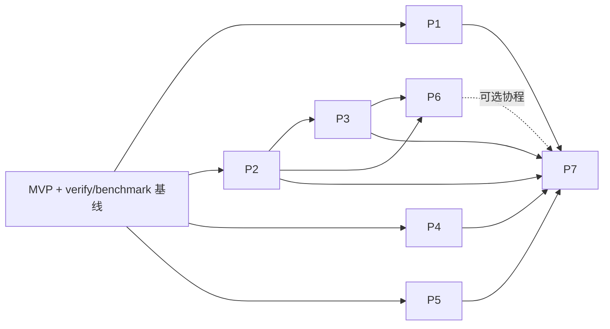

# Async Core 开发计划

本计划对应 [CORE_DESIGN.md](CORE_DESIGN.md)。首个交付是符合目标架构、能够驱动 execution 的 Context MVP；后续在这条完整路径上增加能力，通过 verify 和 benchmark 推进优化。本文的文件和代码均为目标草图，尚未实现，不代表示例已编译。

## 1. 首个里程碑：Context 驱动 execution

当前 Core 只有入口骨架；execution 已重导出 provider 协议和常用算法，verify 与 Google Benchmark 入口已存在。第一步就贯通 Context、逻辑句柄、Worker/EventLoop 和 execution adapter。

```text
Context 配置显式资源，创建逻辑队列和一个 Worker
    → 获取 SchedulerHandle，适配为标准 scheduler
    → schedule | then
    → connect/start，operation 发布内嵌 record
    → Worker 驱动 EventLoop，收取并执行 record
    → receiver 完成，root owner 收回操作
    → 停止准入、drain、join，最后释放资源
```

### 1.1 MVP 范围

层次沿用设计文档的 L0–L6。MVP 缩小配置和策略数量，保留各层职责、所有权及扩展边界。

| 层 | MVP 的真实实现 | 后续扩展 |
| --- | --- | --- |
| L0 Context | 显式资源、一个内部 Worker、启动/关闭/join | N workers、控制 loop、外部 render/gfx loop 组合 |
| L1 句柄 | 非拥有 SchedulerHandle、标准 Scheduler adapter | 固定 producer 的专有 endpoint |
| L2 逻辑目标 | 稳定 QueueToken；serial 目标静态映射到唯一 Worker，不同逻辑身份仍不同 | 多 worker 映射、thread-bound、共享/隔离约束 |
| L3 执行资源 | 可独立手动驱动的 EventLoop；Worker/Workers 管理唯一线程 | 多线程创建回滚、多域装配 |
| L4 机制 | mutex MPSC、intrusive ready、无丢唤醒等待、显式借用标准 PMR | timer、SPSC lane、hook 和无异常分配协议 |
| L5 一次操作 | ScheduleRecord、ScheduleSender、稳定 ScheduleOperation、标准完成通道 | 更多服务 operation 和环境组合 |
| L6 协程 | 不进入 MVP；保留 Core awaitable 的独立依赖方向 | Environment、Task、frame、timer awaitable 和 sender 桥接 |

MVP 的 adapter 必须满足选定 provider 的 scheduler/sender/operation 协议，包括资源相等、完成签名、所公开的 completion scheduler 和跨线程使用契约。拒收、已请求取消、关闭和完成中销毁随 MVP 实现。仅支持的配置明确接受，尚未支持的配置明确拒绝。

### 1.2 MVP 用户端验收

沿用设计文档的目标配置方式。`memory_resource` 是宿主提供并保持存活的 `std::pmr::memory_resource`；可直接传入带统计的派生 resource。初始化/start 的失败契约在 MVP 第一个增量中确定，PMR 示例不承诺分配失败时返回错误码。

```cpp
namespace async = lcf::async;
namespace ex = async::exec;

constexpr std::uint32_t k_cpu_work = 1;

auto context_info = async::core::ContextInfo{}
    .setMemoryResource(memory_resource)
    .setWorkerCount(1)
    .addSerialQueue(k_cpu_work);

async::Context context{context_info};
context.start();

auto scheduler = async::adapters::as_scheduler(
    context.getSchedulerHandle(k_cpu_work));

static_assert(ex::scheduler<decltype(scheduler)>);

auto result = async::this_thread::sync_wait(
    ex::schedule(scheduler)
    | ex::then([]() noexcept { return 42; }));

// The root operation has completed before closing the runtime.
context.close();
context.join();
```

验收证明结果为 42，业务函数在指定 Worker 执行，`sync_wait` 由宿主线程调用。另用受控 gate 验证构造 sender、connect/start 与执行可以发生在不同线程；禁止在唯一 Worker 上阻塞等待仍需该 Worker 推进的任务。

## 2. 目标文件结构

类文件采用 PascalCase，协议、自由函数和聚合文件采用 snake_case；execution 保持标准/provider 命名。标记最早引入阶段：`M` 为 MVP，`P1–P7` 为后续迭代。按需要创建文件，不提前创建空实现。

```text
include/async/
├── async.h                              # M: aggregate including adapters
├── core.h                               # M: Core only
├── execution.h                          # existing provider/algorithm aggregate
├── core/
│   ├── protocol.h                       # M: Core protocol aggregate
│   ├── protocol/
│   │   ├── ScheduleRecord.h              # M: borrowed record, terminal entries
│   │   └── executor.h                    # M: result, CPO, concepts
│   ├── memory/
│   │   └── allocation.h                  # P2: fallible resource protocol/result
│   ├── cancellation/
│   │   └── stop.h                        # P2: token/registration support
│   ├── scheduling/
│   │   ├── SchedulerHandle.h             # M: logical submission target
│   │   ├── LogicalQueue.h                # M: QueueToken and stable identity
│   │   ├── BasicEventLoop.h              # M: EventLoop and drive/report types
│   │   ├── Worker.h                      # M: thread borrowing a loop
│   │   ├── Workers.h                     # M: one worker; P1: N workers
│   │   ├── ProducerEndpoint.h            # P4: registered single producer
│   │   └── queue/
│   │       ├── MutexInbox.h              # M: general MPSC baseline
│   │       ├── IntrusiveReadyQueue.h     # M: owner-local ready
│   │       ├── BoundedProducerLane.h     # P4: preallocated SPSC
│   │       └── InboxSet.h                # P4: bounded fair collection
│   ├── context/
│   │   ├── ContextInfo.h                 # M: resource/worker/queue configuration
│   │   ├── BasicContext.h                # M: composition and lifetime
│   │   └── WorkerMapping.h               # P1: constraints and static mapping
│   ├── timer/
│   │   ├── timer.h                       # P3: TimerNode/TimerOperation/service
│   │   └── HeapTimerIndex.h              # P3: deadline index, replaceable Clock
│   └── coroutine/
│       ├── Environment.h                # P6: capability values
│       ├── Task.h                       # P6: promise/frame/continuation
│       └── awaitables.h                 # P6: schedule/sleep awaitables
├── adapters/
│   ├── Scheduler.h                      # M: executor to execution scheduler
│   ├── ScheduleSender.h                 # M: sender and ScheduleOperation
│   ├── environment.h                    # M: required queries; P2: composition
│   └── awaitable.h                      # P6: sender/coroutine bridge
└── execution/
    ├── config.h                         # existing
    ├── protocol.h                       # existing provider re-exports
    ├── sync_wait.h                      # existing this_thread consumer
    └── extensions/expected.h            # P5: then_expected

modules/async.cppm                       # same public export boundaries
tests/verify/
├── execution_test.cpp                  # existing provider regression
├── protocol_test.cpp                   # M: concepts/customization/isolation
├── event_loop_test.cpp                 # M: publication, wake, drive, close
├── context_test.cpp                    # M; P1: multi-domain
├── scheduler_adapter_test.cpp          # M: scheduler/operation contracts
├── mvp_execution_test.cpp              # M: Context -> execution integration
├── environment_test.cpp                # M/P2: defaults and overrides
├── timer_test.cpp                      # P3
├── producer_lane_test.cpp              # P4
├── expected_test.cpp                   # P5
└── coroutine_test.cpp                  # P6
tests/benchmark/
├── benchmark.cpp                       # existing BENCHMARK_MAIN
└── runtime_benchmark.cpp               # M baseline, expanded per capability
```

测试文件按可观察契约继续拆分，例如 memory、cancellation、workers 和 awaitable adapter；不要求一个头文件对应一个测试文件。新增源文件接入现有 CMake target，保留 deferred test 机制。

## 3. 各层核心接口

下面省略 include、存储字段、策略检测实现及 provider 所需的部分标记/query。模板策略形状和别名是示意；MVP 先用最小编译用例确定公开签名。逻辑分层说明职责，实施时贯通整个 Context → execution → runtime → completion 路径。

### 3.1 L0：Context 组合资源与生命周期

目标文件：`core/context/ContextInfo.h`、`core/context/BasicContext.h`。ContextInfo 收集逻辑需求，Context 初始化时配置资源；提交时按已登记 key 获取句柄。

```cpp
namespace lcf::async::core {

class ContextInfo
{
public:
    ContextInfo & setMemoryResource(std::pmr::memory_resource & memory_resource) noexcept;
    ContextInfo & setWorkerCount(std::size_t worker_count) noexcept;
    ContextInfo & addSerialQueue(std::uint32_t logical_key);
};

template <typename Policies>
class BasicContext
{
public:
    explicit BasicContext(const ContextInfo & context_info);
public:
    void start();
    SchedulerHandle getSchedulerHandle(std::uint32_t logical_key) const noexcept;
    void close() noexcept;
    void join();
};

} // namespace lcf::async::core

namespace lcf::async {
using Context = core::BasicContext<core::DefaultContextPolicies>;
} // namespace lcf::async
```

`DefaultContextPolicies` 表示常用组合，不能让底层反向依赖 Context。MVP 支持一个 Worker 和已登记 serial key，多个 key 可映射同一 Worker；未知 key 的查询前置条件须明确。`close` 停止业务准入并让已接纳工作完成；`join` 只回收自有线程。Context 不自动拥有业务 root，不在自身 Worker 上 join。

上例配置直接借用标准 resource，不增加转发 Handle。P2 的无异常资源使用与 Policies 匹配的静态配置或显式工厂绑定；其类型和值在对象创建前确定，不通过赋值改变 PMR 配置的契约。

### 3.2 L1：提交句柄与 executor 协议

目标文件：`core/protocol/executor.h`、`core/scheduling/SchedulerHandle.h`、`adapters/Scheduler.h`。句柄持有运行时引用和逻辑身份，生命周期由 Context 保证。

```cpp
namespace lcf::async::core {

enum class EnqueueResult
{
    eAccepted,
    eFull,
    eClosed,
};

namespace detail {

struct TryEnqueue
{
    template <typename Executor>
        requires enqueue_target_c<Executor>
    EnqueueResult operator()(
        const Executor & executor, ScheduleRecord & record) const noexcept;
};

} // namespace detail

inline constexpr detail::TryEnqueue try_enqueue{};

template <typename Executor>
concept executor_c = requires(const Executor & executor, ScheduleRecord & record) {
    { try_enqueue(executor, record) } noexcept -> std::same_as<EnqueueResult>;
};

class SchedulerHandle
{
public:
    EnqueueResult tryEnqueue(ScheduleRecord & record) const noexcept;
    bool operator==(const SchedulerHandle & other) const noexcept;
};

} // namespace lcf::async::core
```

`detail::enqueue_target_c` 必须先检测有效成员 `tryEnqueue` 或 ADL hook `enqueue_record`，不能用无约束 CPO 让任意类型符合 concept。`executor_c` 只要求提交，不包含 timer、资源查询或工作计数。P4 的 ProducerEndpoint 使用同一协议，但保留单 producer 线程限制。

### 3.3 L2：逻辑队列身份与静态映射

目标文件：`core/scheduling/LogicalQueue.h`、`core/context/WorkerMapping.h`。

```cpp
namespace lcf::async::core {

enum class QueueMode
{
    eSerial,
    eThreadBound,
};

class QueueToken
{
public:
    bool operator==(const QueueToken & other) const noexcept;
};

class LogicalQueue
{
public:
    QueueToken getToken() const noexcept;
    SchedulerHandle getSchedulerHandle() const noexcept;
};

} // namespace lcf::async::core
```

MVP 的映射是 `logical target → worker 0`，token 仍区分运行时和逻辑资源；相等不能只比较线程。P1 再加入 QueueRequest 的 owner、共享/隔离要求和 WorkerMapping。serial 只保证 record 不重叠，不跨异步挂起点独占。`eParallel`、迁移和 work stealing 不进入首轮静态映射。

### 3.4 L3：EventLoop 推进，Workers 管理线程

目标文件：`core/scheduling/BasicEventLoop.h`、`Worker.h`、`Workers.h`。

```cpp
namespace lcf::async::core {

struct PollBudget
{
    std::size_t m_max_records;
    std::chrono::nanoseconds m_max_duration;
};

struct PollReport
{
    std::size_t m_callbacks;
    std::chrono::nanoseconds m_elapsed;
};

template <typename Policies>
class BasicEventLoop
{
public:
    bool pollOne();
    PollReport poll(PollBudget budget);
    bool runOne();
    void run();
    void close() noexcept;
};

using EventLoop = BasicEventLoop<DefaultLoopPolicies>;

class Worker
{
public:
    explicit Worker(EventLoop & event_loop);
public:
    void start();
    void join();
};

class Workers
{
public:
    Workers(std::span<EventLoop *> event_loops, std::pmr::memory_resource & memory_resource);
public:
    void start();
    void join();
};

} // namespace lcf::async::core
```

Worker 借用稳定 loop，Workers 持有线程集合并负责创建失败回滚；MVP 只有一个真实 Worker。EventLoop 自身不创建线程，纯 Core 用例可直接驱动它；N 个 Worker 不得同时驱动同一个单 owner loop。空闲等待、关闭、必要完成记录和有界 poll 随 MVP 实现；软预算不能抢占 callback。

### 3.5 L4：队列、资源和 timer 机制

目标文件：`core/scheduling/queue/`、`core/memory/allocation.h`、`core/timer/`。MVP 直接使用标准 resource；下面的无异常资源协议在 P2 实现。

```cpp
namespace lcf::async::core {

class MutexInbox
{
public:
    EnqueueResult tryPush(ScheduleRecord & record) noexcept;
    ScheduleRecord * tryPop() noexcept;
    void close() noexcept;
};

struct AllocationResult
{
    void * m_storage_p;
    std::error_code m_error;
};

template <typename Resource>
concept allocation_resource_c = requires(
    Resource & resource, std::size_t bytes, std::size_t alignment, void * storage_p) {
    { resource.tryAllocate(bytes, alignment) } noexcept -> std::same_as<AllocationResult>;
    { resource.deallocate(storage_p, bytes, alignment) } noexcept -> std::same_as<void>;
};

template <typename Clock>
class HeapTimerIndex
{
public:
    using TimePoint = typename Clock::time_point;
public:
    TimerInsertResult insert(TimerNode & node, TimePoint deadline) noexcept;
    bool remove(TimerNode & node) noexcept;
    std::optional<TimePoint> nextDeadline() const noexcept;
    std::size_t expire(TimePoint now, std::span<TimerNode *> expired_nodes) noexcept;
};

} // namespace lcf::async::core
```

MVP 使用 mutex MPSC、嵌入节点和 owner-local ready，不为每次提交分配。`std::pmr::memory_resource` 由宿主保活，动态 backing storage 的来源和回收信息显式保存。普通 execution allocator 仍遵循 allocator 协议，不能统一强转成 PMR。

统计/诊断通过 PMR 的 do_allocate/do_deallocate 装饰上游，普通 allocator 通过 allocator wrapper 扩展。P2 的严格资源装饰器则保留 tryAllocate 的错误值和 noexcept；hook 的分配次数、失败次数、存活字节与上游保留量分别统计，并量化观测成本。

`allocation_resource_c` 保证字节分配的错误返回，typed helper 另负责大小溢出、对象构造与回滚，operation/Task 再按失败发生阶段交付错误。不能给 PMR 外包 noexcept 或令标准 allocate 返回 nullptr 来冒充此协议。标准 `get_allocator` 也不自动带有这项能力；受限路径须检查额外能力，不兼容的显式覆盖须明确诊断。契约细节见设计文档第 4.3–4.4 节。

timer 在 P3 加入。`TimerInsertResult` 需表达容量拒收与是否提前最近 deadline；过期节点写入调用方提供的有界缓冲，由 loop 转成 ready。索引不持有 queue、不等待、不调用用户代码。stop token 优先复用标准能力，只有资源/并发要求确需时再实现 StopState。

### 3.6 L5：稳定 operation 连接 Core 与 execution

目标文件：`core/protocol/ScheduleRecord.h`、`adapters/ScheduleSender.h`。record 的两条入口是互斥的终结路径，不能执行后再无条件访问 record 或调用第二次完成。

```cpp
namespace lcf::async::core {

struct ScheduleRecord
{
    using Entry = void (*)(void *) noexcept;
    void * m_state_p;
    Entry m_execute_p;
    Entry m_stop_p;
};

} // namespace lcf::async::core

namespace lcf::async::adapters {

template <typename Executor, typename Receiver>
class ScheduleOperation
{
public:
    void start() & noexcept;
};

template <typename Executor>
class ScheduleSender
{
public:
    template <typename Receiver>
    ScheduleOperation<Executor, Receiver> connect(Receiver receiver) &&;
    auto get_env() const noexcept;
};

template <core::executor_c Executor>
class Scheduler
{
public:
    ScheduleSender<Executor> schedule() const noexcept;
    bool operator==(const Scheduler & other) const noexcept;
};

template <core::executor_c Executor>
Scheduler<Executor> as_scheduler(Executor executor);

} // namespace lcf::async::adapters
```

代码省略 intrusive link、状态机、标记和 query 类型；`schedule/connect/start/get_env` 是 provider 协议定制成员，不是另定义一组同名公共 CPO。用户调用现有 `ex::schedule/connect/start/get_env`；定制形式须由当前 provider 的编译验证确定。

operation 直接构造于稳定地址，不要求可移动；`start` 才提交，`eAccepted` 后不得读取可能已被完成函数销毁的状态。`eFull/eClosed` 由 adapter 完成，不能静默丢弃或假装已在目标线程成功执行。value completion scheduler 与逻辑句柄一致；error/stopped 只公开实际能保证的完成域。

MVP 的环境支持必需 provider queries、stop token 和显式资源来源。async operation 若需额外动态存储，优先使用 receiver 的 `get_allocator`，缺失时仅使用显式绑定的 Context 默认值；内嵌 operation 不为此强制分配。P2 再扩展覆盖/forwarding 和资源策略测试。sender 属性与 receiver 环境分别处理。

### 3.7 L6：Environment、Task 和 timer awaitable

目标文件：`core/coroutine/` 和 `adapters/awaitable.h`；在 P6 实现，不阻塞 sender MVP。

```cpp
namespace lcf::async::core {

template <executor_c Executor, typename Allocator, typename StopToken>
struct Environment
{
    Executor m_executor;
    Allocator m_allocator;
    StopToken m_stop_token;
};

template <typename Value, typename Environment, typename FramePolicy>
class Task;

template <typename Duration>
struct SleepForAwaitable;

template <typename TimePoint>
struct SleepUntilAwaitable;

template <typename Rep, typename Period>
auto sleep_for(std::chrono::duration<Rep, Period> duration);

} // namespace lcf::async::core
```

Environment 注入能力值，不让 awaiter 依赖具体 Context、Scheduler 或 provider。timer 服务由扩展环境能力提供；三字段基础环境不自动具备 timer。promise 的目标分发为：

```text
await_transform(duration)
    → 约束并读取环境的 timer 服务
    → SleepForAwaitable / TimerAwaiter
    → TimerOperation，完成后按恢复域提交

await_transform(其他表达式)
    → Core awaitable 绑定 / 可选 sender 桥接 / 普通 awaitable 转发
```

两条分发须互斥：缺少 timer 服务时对 duration 给出明确诊断，不能落入通用转发掩盖错误。目标语法支持 `co_await async::sleep_for(1ms)` 与 async Task 中的 `co_await 1ms`。相对 deadline 在挂起注册时计算；非正等待立即完成，让出执行权另用 schedule。timer 计时域与恢复 executor 分开。

frame 在创建前选定环境类型和分配策略；connect 不能改变已有 promise/frame 类型。sender 桥接留在 adapters，expected/error_code 的结果传播不自动等价于异常或 stopped 的协程短路。

### 3.8 execution 扩展独立于运行时层次

`execution/extensions/expected.h` 在 P5 提供 `ex::ext::then_expected`。它直接依赖 provider sender/receiver，不能依赖 Core、Context 或 adapters。

```cpp
auto task = ex::schedule(scheduler)
    | ex::ext::then_expected(
        []() noexcept -> std::expected<int, std::error_code> {
            return 42;
        });
```

函数惰性调用，成功变为 value、unexpected 变为 error，支持 void；上游 error/stopped 跳过函数。标准算法继续重导出。`std::expected` 扩展按 C++23 库能力启用，其余 Core 保持 C++20 基线。

## 4. 交付顺序：MVP 后持续迭代

### 4.1 MVP 的四个连续增量

四个增量构成同一个可用里程碑；内部可分别审阅，完成整个 MVP 才开始扩展能力。

| 增量 | 具体产物 | 验收 |
| --- | --- | --- |
| M.a 协议与最小配置 | record/CPO、显式 PMR 借用、ContextInfo、provider 定制选择、接纳/失败/关闭表 | 两种 executor 替身、非法定制负例、Core 不包含 execution |
| M.b 执行骨架 | MutexInbox、ready、wake、EventLoop、一个 Worker、Context 与稳定逻辑身份 | 发布/收取、空闲唤醒、手动驱动、关闭/drain、线程创建失败回滚 |
| M.c execution 贯通 | Scheduler、ScheduleSender/Operation、必要环境 query；第 1 节完整用例 | provider concept、schedule/then、跨线程 connect/start、拒收/取消完成 |
| M.d 基线交付 | 正确性回归套件、runtime benchmark、记录平台/配置的基线结果 | V01–V04、V07–V09 的已支持范围通过，性能场景可重复 |

MVP 完成标准是 Context 用户端可以运行，架构隔离和生命周期成立，且 verify/benchmark 已能检验后续改动。V07 暂只验单 Worker 配置，V09 暂验实际使用的环境/资源路径；未支持的多域、timer、lane 和协程测试随后加入，不能把“子集通过”写成完整矩阵已通过。

重点验证：提交不在调用线程 inline 执行，但 owner 可以在提交返回前完成；完成回调允许销毁 operation；空队列不自动使 run 退出；关闭不丢失已接纳任务；发布、唤醒、取消 registration 和资源释放均无最后访问竞态。

### 4.2 MVP 之后的能力迭代

每项都沿已有 Context → execution 路径扩展，同时保留纯 Core 验证。表中列出功能依赖，不要求为了多 worker 先完成 timer 或低延迟队列。

| 阶段 | 前置 | 实现范围 | verify 与 benchmark 出口 |
| --- | --- | --- | --- |
| P1 多执行域 | MVP | N Workers、静态多对一映射、thread-bound 与借用的控制/render/gfx loop；硬共享/隔离约束和创建回滚 | V06–V08；1/2/N worker、逻辑队列数大于 worker 数、外部-only/混合关闭；跨域往返成本与可用并行度 |
| P2 环境与资源扩展 | MVP；多域验证用 P1 | allocator 覆盖、显式默认与 forwarding；PMR/allocator hook；allocation_resource_c、typed helper 与错误交付；取消 registration 和跨线程回收 | V02/V09；资源耗尽/溢出/对齐、构造回滚、严格能力负例和统计准确性；hook 成本、分配失败、保留内存、回收与 stop 成本 |
| P3 timer | MVP、P2 | HeapTimerIndex、TimerOperation、fake Clock、独立服务能力、跨线程控制 record、提前 deadline 唤醒 | V03–V05；到期/取消/关闭唯一完成，有界 burst 维护；active 数量、取消比例、精度与尾延迟 |
| P4 专有 producer 入口 | MVP；实际多目标路由用 P1 | BoundedProducerLane、ProducerEndpoint、InboxSet、有界公平汇合与 unregister/drain | V03/V13；暂停 consumer/其他 producer、满载立即 eFull、控制/完成可推进；完整提交 p99/p99.9 和积压 |
| P5 expected 扩展 | MVP 工作基线；代码仅依赖 execution | then_expected 的 success/error/void、上游短路、nothrow 约束与完成签名 | V10；C++23/声明支持的禁用异常配置；纯 provider 和真实 Context pipeline 成本 |
| P6 协程 | P2、P3；多域恢复用 P1 | Environment、Task、FramePolicy、schedule/sleep awaitables、duration await_transform；随后接 sender 桥接 | V11 及相关 V02/V09；两种 executor、同步挂起握手、frame 资源和恢复域；frame/挂起/恢复开销 |
| P7 shader_toy | P1–P5；协程可选用 P6 | 注入逻辑 scheduler，替换 Asio 调度，expected 任务图、owner mailbox、watcher 停止和完整关闭 | V01–V10、V12–V13；完整资源图、每阶段 error/stopped、1/2/N worker 对比；使用协程再要求 V11 |

P2 的错误码分配协议是独立能力，不以为 PMR 包装 Handle 作为前置；普通路径和严格路径分别验证，不宣称整个 runtime 无异常。取消优先复用标准 stop vocabulary，确需自有状态才实现 StopState。P3 先做单次等待，不同时引入重复周期或 timing wheel。P4 不隐式 fallback 到带锁队列或动态分配。P6 的 Core Task 与 sender 桥接分别构建，并验证 frame 分配失败的专门返回机制，不要求 Core 包含 execution。

P7 的目标仓库为 <https://github.com/mmmmmcree/LCFEngine.git>，目录为 `examples/shader_toy`。先做 `render → CPU → render/gfx` 与 `render → main → CPU → render` 两条路径，再接图片/shader 汇合与真正异步的 gfx 操作。root owner 管理稳定 operation 和输入，线程绑定的 error/stopped 收尾交给 owner mailbox。



## 5. verify 与 benchmark 驱动后续开发

MVP 就建立测量入口，后续每个优化遵循同一循环。新增能力先补可观察契约，再用该能力的基线衡量实现；性能策略替换必须同时比较优化前后的相同 workload。

```text
确定目标 workload 与瓶颈
    → 用 verify 固定正确性和失败路径
    → 保存当前版本的 benchmark 基线
    → 替换一个机制或策略
    → 跑相关 verify 与 MVP 集成回归
    → 比较同环境 benchmark，并检查其他场景退化
    → 保留有证据的改动，记录收益、代价和适用范围
```

### 5.1 第一份基线必须测什么

| 场景 | 正确性约束 | 性能数据 |
| --- | --- | --- |
| 单 producer/单 owner | 每个已接纳 record 完成一次，完成中可销毁 | 准备、发布、wake、完整提交及端到端延迟分别测量 |
| 多 producer/单 owner | 可控 gate 验证并发、无重复/丢失 | producer 数量/积压下的吞吐、p50/p99/p99.9、观测最大值 |
| 空闲再投递 | 检查-入睡竞态无丢唤醒，run 持续等待 | 空 poll、唤醒次数、空闲到执行延迟 |
| 拒收/取消/关闭 | eFull/eClosed 不接管，已接纳全部完成，registration 最后访问安全 | 拒收清理、取消响应与 drain/join 耗时 |
| execution 完整路径 | schedule/then、connect/start、完成域与节点寿命正确 | 直接 Core record 与 Context sender 路径的成本差异、分配次数 |

P2 加入资源专项场景：原生 PMR 与统计装饰器使用相同负载比较；严格 resource 注入可控失败，验证错误原样传播和无泄漏；hook 不新增递归分配，不把失败计入存活字节。统计范围仅限实际经过绑定 resource/allocator 的调用。

新增能力同时增加对应场景，例如多 worker 并行、逻辑队列公平性、timer burst、lane 饱和、allocator 回收及 coroutine frame。不能用平均吞吐替代专有 producer 的尾延迟，也不能把观测最大值称为已证明的最坏时间上界。

每份结果记录 commit、provider/编译器、构建配置、平台、worker/producer 数、容量和 workload。benchmark 使用 Release，多次重复并保存原始结果；尾延迟须有独立的逐操作采样或直方图，Google Benchmark 的整轮均值不能直接解释为操作 p99。性能阈值先依据基线波动确定，正确性不能因噪声放宽。

### 5.2 构建、结果与提交粒度

沿用现有 target。verify 与 benchmark 分别运行；benchmark 不加入默认构建或 CTest。以下为实施时使用的命令，本轮仅编辑文档：

```text
cmake --preset clang
cmake --build build/clang --config Debug --target async_verify_run
cmake --build build/clang --config Release --target async_benchmark_run
```

`async_benchmark_run` 当前写入配置对应的 `results/Release/latest.json`，deferred 构建时路径位于对应测试子构建中。比较前另存基线及元信息，避免下一次运行覆盖；按需给场景加入可重复参数与延迟采样。新增源文件须接入 `tests/verify/CMakeLists.txt` 和 `tests/benchmark/CMakeLists.txt`。

每个提交保持一条可运行的 MVP 路径，包含相应实现、verify、受影响的 benchmark 和接口文档。纯 Core 单独构建、provider 身份和模块导出随跨层改动检查；发布前覆盖可用的 msvc/clang/gcc 及模块配置。原生 execution、C++23 expected 和禁用异常路径分别声明实际验证的能力。

exchange/CAS MPSC、共享多 consumer 后端、parallel/迁移/work stealing、timer wheel/tree、pool/slab/recycling 和通知合并都以此流程评估。先证明发布缺口、回收、串行同步或服务存活等新契约，再比较目标负载；没有收益证据时保留 MVP 的简单基线。

下一项实际开发是整个 MVP 的 M.a–M.d：先确定跨层最小接口，随即把 Context 驱动 execution 的用例跑通，并交付能支撑后续所有优化的 verify/benchmark 基线。
