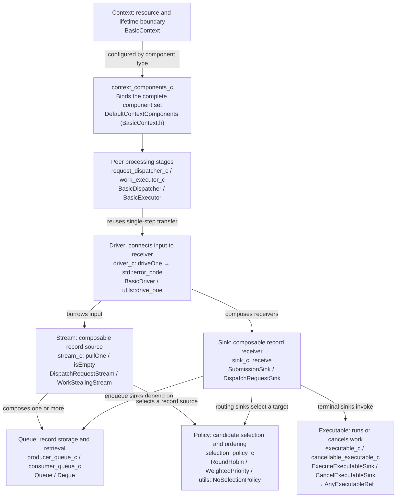
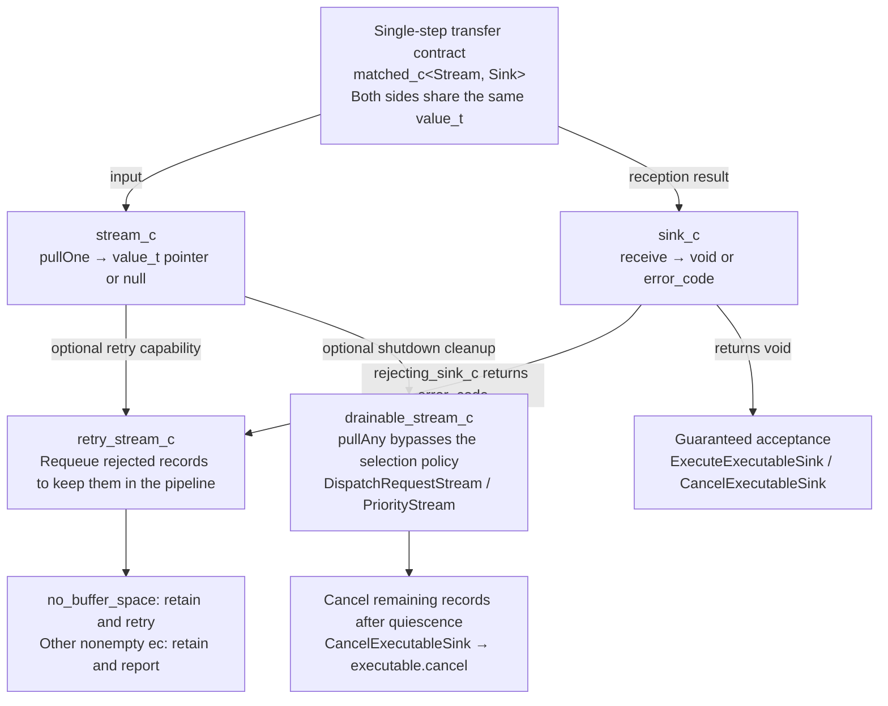
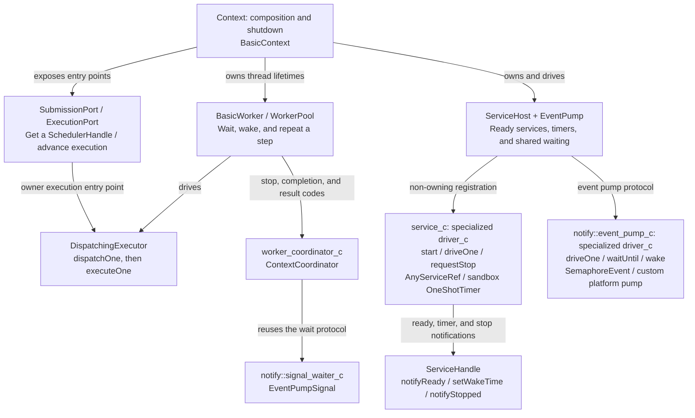
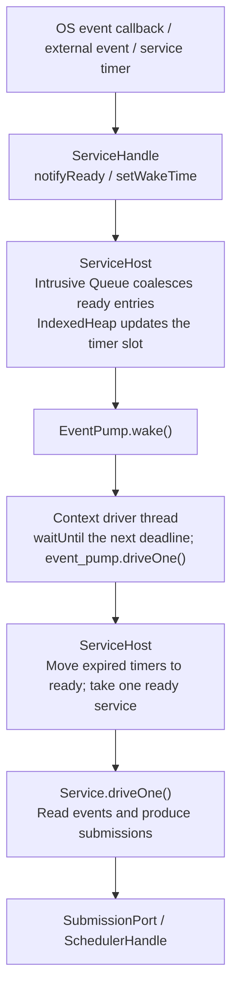
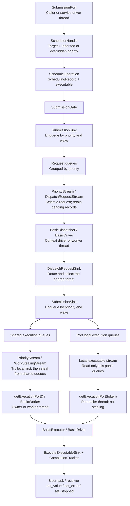
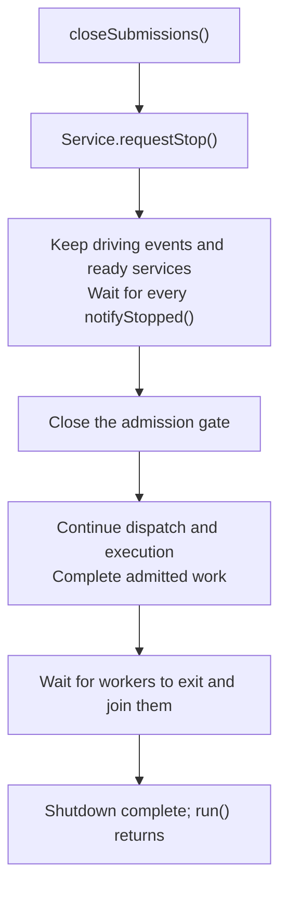
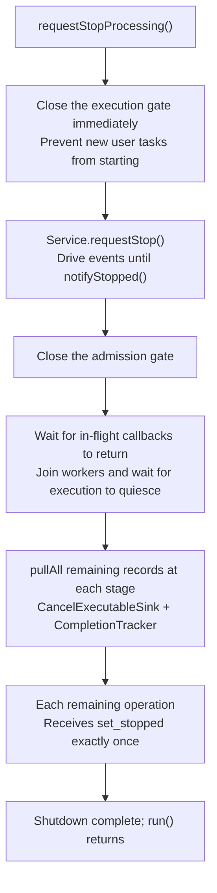

# Async Core

[简体中文](../zh/core-architecture.md)

## Core Concepts and Composition

<!-- diagram-notes: components -->

### Component Responsibilities and Interface Boundaries

Concepts in the diagram express structural interface constraints. Class names identify the current implementations. Arrows show composition or dependencies and carry no inheritance or runtime ordering semantics.

<!-- docs-builder:refs -->

Related source

- [`AnyExecutableRef`](../../../include/async/core/executable/AnyExecutableRef.h)
- [`BasicContext / DefaultContextComponents`](../../../include/async/core/context/BasicContext.h)
- [`BasicDispatcher`](../../../include/async/core/dispatcher/BasicDispatcher.h)
- [`BasicDriver`](../../../include/async/core/driver/BasicDriver.h)
- [`BasicExecutor`](../../../include/async/core/executor/BasicExecutor.h)
- [`CancelExecutableSink`](../../../include/async/core/sink/CancelExecutableSink.h)
- [`context_components_c`](../../../include/async/core/context/declarations/concepts.h)
- [`Deque`](../../../include/async/core/queue/non_intrusive/spmc/Deque.h)
- [`DispatchRequestSink`](../../../include/async/core/dispatcher/DispatchRequestSink.h)
- [`DispatchRequestStream`](../../../include/async/core/stream/DispatchRequestStream.h)
- [`driver_c`](../../../include/async/core/driver/declarations/concepts.h)
- [`executable_c / cancellable_executable_c`](../../../include/async/core/executable/declarations/concepts.h)
- [`ExecuteExecutableSink`](../../../include/async/core/sink/ExecuteExecutableSink.h)
- [`producer_queue_c / consumer_queue_c`](../../../include/async/core/queue/declarations/concepts.h)
- [`Queue`](../../../include/async/core/queue/intrusive/Queue.h)
- [`request_dispatcher_c`](../../../include/async/core/dispatcher/declarations/concepts.h)
- [`RoundRobin`](../../../include/async/core/policy/RoundRobin.h)
- [`selection_policy_c / utils::NoSelectionPolicy`](../../../include/async/core/policy/declarations/concepts.h)
- [`sink_c / rejecting_sink_c`](../../../include/async/core/sink/declarations/concepts.h)
- [`stream_c`](../../../include/async/core/stream/declarations/concepts.h)
- [`SubmissionSink`](../../../include/async/core/sink/SubmissionSink.h)
- [`utils::drive_one`](../../../include/async/core/driver/utils/drive_one.h)
- [`WeightedPriority`](../../../include/async/core/policy/WeightedPriority.h)
- [`work_executor_c`](../../../include/async/core/scheduling/declarations/concepts.h)
- [`WorkStealingStream`](../../../include/async/core/stream/WorkStealingStream.h)

<!-- /docs-builder:refs -->

A Stream composes queues or other streams and encapsulates selection and behaviors such as retaining a pending record. A Sink handles reception, routing, or terminal processing and can wrap another sink. `BasicDriver` performs one `pullOne → receive` step and returns `std::error_code`. An empty code means the step made progress. `errc::no_work` means no record was available. Services and event pumps use the same result convention. The dispatcher and executor convert codes into `DispatchReport` and `ExecutionReport`, respectively.

`BasicContext<Components>` configures the pipeline, event pump, and thread handles through one component set. `context_components_c<Components>` checks the protocols and construction requirements for `event_pump_t` and `thread_handle_t`. It also checks the assembled component factories for compatible constructors and record types, queue concurrency capabilities, stream retry and drain capabilities, and sink and execution report protocols. The notifier is derived from the configured event pump and participates in the checks. The default component set is defined in the `BasicContext` header.

`utils::NoSelectionPolicy` lets `selected` preserve candidate order, so a priority stream can take work in priority-band order. The default Context uses `WeightedPriority<4, 2, 1>`. The weights determine how often each band is tried first, and each attempt still checks the other candidates. When the weight count and candidate count differ, selection falls back to round-robin.

Streams and sinks share the composition model of execution senders and receivers and have their own protocols. A stream is a synchronous, non-blocking record source. A sink is a synchronous reception boundary. Their interfaces alone do not satisfy `sender_c` or `receiver_c`. `SchedulerHandle` integrates with execution through `ScheduleSender` and `ScheduleOperation`. Completion reaches the receiver through `set_value`, `set_error`, or `set_stopped`.

<!-- diagram-notes: transfer -->

### Acceptance, Retry, and Cleanup

Components provide the capabilities required by their use cases:

<!-- docs-builder:refs -->

Related source

- [`BasicContext / DefaultContextComponents`](../../../include/async/core/context/BasicContext.h)
- [`BasicDispatcher`](../../../include/async/core/dispatcher/BasicDispatcher.h)
- [`BasicExecutor`](../../../include/async/core/executor/BasicExecutor.h)
- [`CancelExecutableSink`](../../../include/async/core/sink/CancelExecutableSink.h)
- [`DispatchRequestStream`](../../../include/async/core/stream/DispatchRequestStream.h)
- [`drainable_stream_c`](../../../include/async/core/stream/declarations/concepts.h)
- [`ExecuteExecutableSink`](../../../include/async/core/sink/ExecuteExecutableSink.h)
- [`matched_c`](../../../include/async/core/driver/declarations/concepts.h)
- [`PriorityStream`](../../../include/async/core/stream/PriorityStream.h)
- [`retry_stream_c`](../../../include/async/core/stream/declarations/concepts.h)
- [`sink_c / rejecting_sink_c`](../../../include/async/core/sink/declarations/concepts.h)
- [`stream_c`](../../../include/async/core/stream/declarations/concepts.h)
- [`utils::drive_one`](../../../include/async/core/driver/utils/drive_one.h)

<!-- /docs-builder:refs -->

`std::error_code` records the reception outcome. An empty value means acceptance and a nonempty value means rejection. Drivers require `retry_stream_c` when the sink can reject records. `drainable_stream_c` supports shutdown cleanup as an optional stream capability.

<!-- diagram-notes: runtime -->

### Driver Threads, Waiting, and Coordination

The runtime host determines when and on which thread to advance these components. Services and event backends reuse the single-step driver protocol and can implement their internals independently of streams and sinks:

<!-- docs-builder:refs -->

Related source

- [`AnyServiceRef`](../../../include/async/core/service/AnyServiceRef.h)
- [`BasicContext / DefaultContextComponents`](../../../include/async/core/context/BasicContext.h)
- [`BasicDispatcher`](../../../include/async/core/dispatcher/BasicDispatcher.h)
- [`BasicExecutor`](../../../include/async/core/executor/BasicExecutor.h)
- [`BasicWorker`](../../../include/async/core/worker/BasicWorker.h)
- [`ContextCoordinator / ExecutionGuard`](../../../include/async/core/context/details/ContextCoordinator.h)
- [`DispatchingExecutor`](../../../include/async/core/executor/DispatchingExecutor.h)
- [`ExecutionPort`](../../../include/async/core/context/ExecutionPort.h)
- [`notify::event_pump_c`](../../../include/async/core/notify/declarations/concepts.h)
- [`notify::EventPumpSignal`](../../../include/async/core/notify/EventPumpSignal.h)
- [`notify::SemaphoreEvent`](../../../include/async/core/notify/SemaphoreEvent.h)
- [`notify::signal_waiter_c`](../../../include/async/core/notify/declarations/concepts.h)
- [`OneShotTimer`](../../../tests/sandbox/sandbox.cpp)
- [`SchedulerHandle`](../../../include/async/core/scheduling/SchedulerHandle.h)
- [`service_c`](../../../include/async/core/service/declarations/concepts.h)
- [`ServiceHandle`](../../../include/async/core/service/ServiceHandle.h)
- [`ServiceHost`](../../../include/async/core/service/ServiceHost.h)
- [`SubmissionPort`](../../../include/async/core/context/SubmissionPort.h)
- [`worker_coordinator_c`](../../../include/async/core/worker/declarations/concepts.h)
- [`WorkerPool`](../../../include/async/core/worker/WorkerPool.h)

<!-- /docs-builder:refs -->

`getExecutionPort(token)` executes only the port's local queues and bypasses `DispatchingExecutor`. `DispatchingExecutor` combines dispatch and execution and communicates results through reports. Worker and Context collect error codes in the coordinator. `worker_coordinator_c` belongs to the worker module. `ContextCoordinator` lives in `context/details`.

`ExecutionPort` owns its wait and wake loop. `BasicContext` exposes separate internal interfaces for driver-thread execution and local execution. `run()`, `shutdown()`, and cleanup after service startup fails share the shutdown driver loop. Context records graceful shutdown requests, while the coordinator's execution gate controls fast stop. An empty `ec` does not trigger a stop.

Workers check the stop request before every step. Joining their threads guarantees quiescence after exit. `worker_coordinator_c` uses `notify::signal_waiter_c` to constrain `observe` and `wait` and requires no execution-count interface. Context uses its own `ExecutionGuard` to wait for in-flight calls from external local execution ports.

`BasicWorker::start()` and `WorkerPool::start()` are `noexcept` and return `std::error_code`. They translate thread start exceptions at that boundary. When the pool partially starts, it requests stop, joins the started threads, and returns the original error code. `ServiceHost` borrows its services. Context owns the default event pump and fixed registration storage. Platform event capabilities come from the concrete pump.

## Runtime Flows

<!-- diagram-notes: service-activation -->

### Readiness Notifications and Timers

The Context driver thread serializes service lifecycle calls and `driveOne()`. Callers can use `ServiceHandle` across threads.

<!-- docs-builder:refs -->

Related source

- [`AnyServiceRef`](../../../include/async/core/service/AnyServiceRef.h)
- [`BasicContext / DefaultContextComponents`](../../../include/async/core/context/BasicContext.h)
- [`IndexedHeap`](../../../include/async/core/details/containers/IndexedHeap.h)
- [`notify::event_pump_c`](../../../include/async/core/notify/declarations/concepts.h)
- [`notify::SemaphoreEvent`](../../../include/async/core/notify/SemaphoreEvent.h)
- [`OneShotTimer`](../../../tests/sandbox/sandbox.cpp)
- [`Queue`](../../../include/async/core/queue/intrusive/Queue.h)
- [`SchedulerHandle`](../../../include/async/core/scheduling/SchedulerHandle.h)
- [`service_c`](../../../include/async/core/service/declarations/concepts.h)
- [`ServiceHandle`](../../../include/async/core/service/ServiceHandle.h)
- [`ServiceHost`](../../../include/async/core/service/ServiceHost.h)
- [`SubmissionPort`](../../../include/async/core/context/SubmissionPort.h)

<!-- /docs-builder:refs -->

`enableServiceHandling()` calls `Service.start(handle)`. `run()` enables service handling automatically. The caller owns the service and borrows the event pump through `getEventPump()`. The default `notify::SemaphoreEvent` supplies timed waits and cross-thread wakes. A custom pump provides platform OS event registration and callbacks. Idle services receive no per-service polling.

`ServiceHost::get_storage_requirements(capacity)` returns a public `StorageRequirements` with size and alignment. `create(capacity, memory_resource&)` prepares fixed registration entries and a timer heap. The budget query and allocation share an internal layout definition. Context aggregates the component requirements, while components retain their layout templates. The ready queue links the registration entries directly and coalesces repeat notifications through their link state. `IndexedHeap` tracks timer positions and supports O(log N) updates and removals. The host mutex coordinates state changes. The host releases it before calling services or waking the event pump.

<!-- diagram-notes: submission-execution -->

### Enqueueing, Routing, and Completion

Solid arrows in the submission and execution pipeline show the direction of record flow. Both records and executables borrow storage from the operation.

<!-- docs-builder:refs -->

Related source

- [`BasicContext / DefaultContextComponents`](../../../include/async/core/context/BasicContext.h)
- [`BasicDispatcher`](../../../include/async/core/dispatcher/BasicDispatcher.h)
- [`BasicDriver`](../../../include/async/core/driver/BasicDriver.h)
- [`BasicExecutor`](../../../include/async/core/executor/BasicExecutor.h)
- [`BasicWorker`](../../../include/async/core/worker/BasicWorker.h)
- [`CompletionTracker`](../../../include/async/core/context/details/ContextTracking.h)
- [`ContextResources`](../../../include/async/core/context/details/ContextResources.h)
- [`DispatchRequestSink`](../../../include/async/core/dispatcher/DispatchRequestSink.h)
- [`DispatchRequestStream`](../../../include/async/core/stream/DispatchRequestStream.h)
- [`ExecuteExecutableSink`](../../../include/async/core/sink/ExecuteExecutableSink.h)
- [`ExecutionPort`](../../../include/async/core/context/ExecutionPort.h)
- [`PriorityStream`](../../../include/async/core/stream/PriorityStream.h)
- [`queue::intrusive::mpmc::Queue`](../../../include/async/core/queue/intrusive/mpmc/Queue.h)
- [`receiver_c`](../../../include/async/protocols/receiver.h)
- [`RoundRobin`](../../../include/async/core/policy/RoundRobin.h)
- [`ScheduleOperation`](../../../include/async/core/scheduling/details/ScheduleOperation.h)
- [`SchedulerHandle`](../../../include/async/core/scheduling/SchedulerHandle.h)
- [`SchedulingRecord`](../../../include/async/core/scheduling/SchedulingRecord.h)
- [`SubmissionGate`](../../../include/async/core/context/details/ContextTracking.h)
- [`SubmissionPort`](../../../include/async/core/context/SubmissionPort.h)
- [`SubmissionSink`](../../../include/async/core/sink/SubmissionSink.h)
- [`WorkStealingStream`](../../../include/async/core/stream/WorkStealingStream.h)

<!-- /docs-builder:refs -->

The owner's and workers' `DispatchingExecutor` selects and drives a dispatcher before attempting shared work. A token-local `ExecutionPort` only executes from its own queues. `executeOne()` returns an `ExecutionReport`. `waitAndExecuteOne()` waits for a wake before attempting execution. Completion updates the outstanding count and notifies waiters.

`ExecutionResult` is an enum class with four mutually exclusive results: `eIdle`, `eSucceeded`, `eStopped`, and `eFailed`. A default `ExecutionReport` is idle. The static methods `make_from_succeeded`, `make_from_stopped`, and `make_from_error_code` create the other reports, and the class encapsulates their fields. A nonempty `ec` means failed, while an empty `ec` passed to `make_from_error_code` means succeeded. Use `isSucceeded`, `isStopped`, and `isFailed` to query the result. Implicit conversion to `bool` returns true only for succeeded. A dispatch-only step can succeed, and `getExecutedCount()` separately reports how many tasks actually ran.

When a sink rejects a record, the driver requeues it first. `no_buffer_space` leaves it pending for retry, while other errors appear in the report. Direct submission returns rejections to the caller. Queues, streams, sinks, and policies are replaceable through component composition. Context reserves fixed storage from an explicit memory resource in `create()`.

<!-- diagram-notes: graceful-shutdown -->

### Closing Submissions and Draining Work

The Context driver thread advances graceful shutdown:

<!-- docs-builder:refs -->

Related source

- [`BasicContext / DefaultContextComponents`](../../../include/async/core/context/BasicContext.h)
- [`BasicWorker`](../../../include/async/core/worker/BasicWorker.h)
- [`CompletionTracker`](../../../include/async/core/context/details/ContextTracking.h)
- [`ContextCoordinator / ExecutionGuard`](../../../include/async/core/context/details/ContextCoordinator.h)
- [`DispatchingExecutor`](../../../include/async/core/executor/DispatchingExecutor.h)
- [`notify::event_pump_c`](../../../include/async/core/notify/declarations/concepts.h)
- [`service_c`](../../../include/async/core/service/declarations/concepts.h)
- [`ServiceHandle`](../../../include/async/core/service/ServiceHandle.h)
- [`ServiceHost`](../../../include/async/core/service/ServiceHost.h)
- [`SubmissionGate`](../../../include/async/core/context/details/ContextTracking.h)
- [`WorkerPool`](../../../include/async/core/worker/WorkerPool.h)

<!-- /docs-builder:refs -->

<!-- diagram-notes: immediate-stop -->

### Execution Gate and Pending Work Cancellation

The Context driver thread advances fast stop:

<!-- docs-builder:refs -->

Related source

- [`ActivityGate`](../../../include/async/core/details/ActivityGate.h)
- [`BasicContext / DefaultContextComponents`](../../../include/async/core/context/BasicContext.h)
- [`CancelExecutableSink`](../../../include/async/core/sink/CancelExecutableSink.h)
- [`CompletionTracker`](../../../include/async/core/context/details/ContextTracking.h)
- [`ContextCoordinator / ExecutionGuard`](../../../include/async/core/context/details/ContextCoordinator.h)
- [`notify::event_pump_c`](../../../include/async/core/notify/declarations/concepts.h)
- [`receiver_c`](../../../include/async/protocols/receiver.h)
- [`ScheduleOperation`](../../../include/async/core/scheduling/details/ScheduleOperation.h)
- [`ServiceHandle`](../../../include/async/core/service/ServiceHandle.h)
- [`ServiceHost`](../../../include/async/core/service/ServiceHost.h)
- [`SubmissionGate`](../../../include/async/core/context/details/ContextTracking.h)
- [`utils::pull_all`](../../../include/async/core/stream/utils/pull_all.h)
- [`WorkerPool`](../../../include/async/core/worker/WorkerPool.h)

<!-- /docs-builder:refs -->

Sender and receiver completion is implemented. Coroutine promises and `co_await` are future work. A coroutine adapter could submit an operation on suspension and resume along the scheduler-selected execution path. Queue, service, and shutdown protocols would carry over to that adapter.
